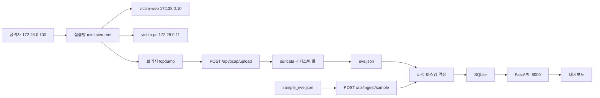
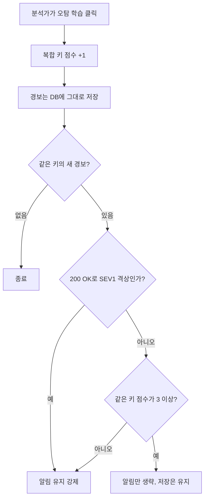

# Mini-SIEM

SK쉴더스 루키즈 07기 미니프로젝트 04조가, 팀 전용 Docker 실습망에서 녹화한 패킷을 Suricata로 분석하고 웹 대시보드에서 경보를 확인하는 경량 SIEM입니다.

이 문서는 GitHub 저장소 [Weo0o0/RookiRooki](https://github.com/Weo0o0/RookiRooki)의 설계·계약 문서입니다. 백엔드 핵심 코드는 main에 구현되어 있으며, 아래 실행 명령은 표준 실행 절차입니다. 시스템 배치와 탐지 흐름의 상세는 [docs/ARCHITECTURE.md](docs/ARCHITECTURE.md)를, 팀 협업 규칙과 역할별 AI 프롬프트는 [ai-guides/mini_siem_ai.md](ai-guides/mini_siem_ai.md)를 참고하세요.

## 팀 구성과 역할

| 역할 | 담당 범위 | 소유 폴더·파일 |
|---|---|---|
| 백엔드 | FastAPI, SQLite, eve.json 파싱, 상관분석, API | `backend/` (`rules/`, `scenarios/` 파일은 읽기 전용으로 참조) |
| 프론트엔드 | 단일 HTML SOC 대시보드 | `frontend/` |
| 룰 | Suricata 커스텀 룰과 메타데이터 카탈로그 | `rules/custom.rules`, `rules/rule_catalog.json` |
| 시나리오 | 실습 트래픽·pcap, 샘플 eve 로그, 대응 플레이북 | `scenarios/lab/pcaps/`, `scenarios/sample_eve.json`, `scenarios/playbooks.json` |
| PM | 심각도·SLA 정책, 통합 스펙, QA, 발표 | `policies/sev_sla_policy.json`, `policies/PROJECT_SPEC_QA.md` |

기술 스택은 고정입니다. 백엔드는 Python FastAPI + 내장 SQLite(`sqlite3`) + Pydantic v2이며, ORM이나 외부 DB로 바꾸지 않습니다. 프론트엔드는 단일 HTML + Tailwind CSS CDN + Vanilla JS(+ 필요 시 Chart.js CDN)이며, React/TypeScript/Webpack으로 바꾸지 않습니다. 백엔드 API는 `http://localhost:8000`에서 제공하고, 대시보드는 5초 주기 폴링(`GET /api/alerts`)과 Mock/Live 토글을 사용합니다.

## 핵심 기능

4일 범위에서 구현·시연하는 차별화는 다음 네 가지입니다.

1. **같은 요청의 HTTP 200 응답이면 SEV1로 격상**  
   Suricata `eve.json`의 `alert`와 `http`를 연결해, SQL 인젝션·XSS·SSRF **해당 공격 요청의 응답 코드가 200**이면 `is_confirmed_risk=1`, 심각도 SEV1로 올립니다. 같은 연결에 섞인 다른 요청의 200으로는 격상하지 않습니다. C2 비콘, SSH 무차별 대입, 포트 스캔은 HTTP 200 격상을 적용하지 않고 카탈로그의 기본 심각도를 유지합니다.
2. **평문 패스워드·토큰 자동 마스킹**  
   URL이나 로그에 보이는 `password`, `token`, `secret` 등 민감 값은 저장·표시 전에 `[MASKED]`로 바꿉니다. 실습 데이터에도 실제 비밀번호를 넣지 않습니다.
3. **경보 클릭 시 OSI 흐름과 검증·차단·원복 CLI 안내**  
   `playbooks.json`을 `category`로 매칭해 공격 경로를 보여 주고, `{{SRC_IP}}`, `{{DEST_IP}}`, `{{DEST_PORT}}`를 실제 값으로 치환한 검증(`verify`)·차단(`block`)·원복(`rollback`) 명령어를 복사할 수 있게 합니다. **차단 명령은 화면에 안내만 하며, 시스템이 iptables 등을 실행하지 않습니다.**
4. **업로드한 PCAP을 커스텀 룰로 검사하고 MITRE 커버리지를 보여 줌**  
   웹에서 pcap을 올리면 백엔드가 `suricata -r`과 `rules/custom.rules`로 오프라인 분석합니다. 대시보드는 `GET /api/stats`로 심각도 집계와 MITRE ATT&CK 커버리지를 표시합니다.

## 공격 시나리오

Stage 1에서 다루는 시나리오는 **확정 6종**입니다. MITRE 기법 ID는 초안이며, **룰 담당자가 카탈로그를 확정할 때 검증**합니다.

| 카테고리 키 | SID | 시나리오 | 대상 | Suricata가 보는 것 | MITRE (검증 필요) | 기본 심각도 | 격상 |
|---|---|---|---|---|---|---|---|
| `sqli` | 1000001 | SQL 인젝션 | `victim-web` (`172.28.0.10`, HTTP) | HTTP URI·바디의 SQL 삽입 패턴 | T1190 (Initial Access) | SEV3 | 해당 요청 응답이 200이면 SEV1 |
| `xss` | 1000002 | XSS | `victim-web` (`172.28.0.10`, HTTP) | HTTP URI·바디의 스크립트 삽입 패턴 | T1189 (Initial Access) | SEV3 | 해당 요청 응답이 200이면 SEV1 |
| `bruteforce` | 1000003 | SSH 무차별 대입 | `victim-pc` (`172.28.0.11`, 22/tcp) | 짧은 시간 동안 동일 출발지가 22/tcp로 반복 연결하는 횟수. SSH는 암호화되어 패스워드 문자열을 볼 수 없음 | T1110.001 (Credential Access) | SEV2 | HTTP 200 격상 없음 |
| `portscan` | 1000004 | 포트 스캔 | `victim-web` / `victim-pc` | 짧은 시간 동안 동일 출발지가 서로 다른 목적 포트로 SYN을 다수 전송. 목적지 22와 80은 사용하지 않으며 샘플은 8080을 사용하고 룰은 `![22,80]`을 유지 (2026-11-24 결정 A) | T1046 (Discovery) | SEV3 | HTTP 200 격상 없음 |
| `c2_beacon` | 1000005 | C2 비콘 | 실습망 내부 (`172.28.0.0/24`) | 반복 연결 횟수 임계치(threshold 기반). attacker 172.28.0.100에서 victim-web 172.28.0.10:8443/tcp로 가며, 같은 출발지가 30초 안에 5회 연결하면 경보 1회(실습 단순화를 위해 공격자가 트래픽을 발생시키는 구조 유지) | T1071.001 (Command and Control, 가안) | SEV2 | HTTP 200 격상 없음 |
| `ssrf` | 1000006 | SSRF | `victim-web` (`172.28.0.10`, HTTP) | 내부 자원 조회 유도 HTTP 요청 패턴. victim-web:80에 GET `/fetch?url=<내부 주소>`로 요청 | T1190 (Initial Access, 가안) | SEV3 | 해당 요청 응답이 200이면 SEV1 (sqli/xss와 동일) |

실습망 주소는 팀이 쓰는 격리 Docker 네트워크만 사용합니다. `mini-siem-net`는 `172.28.0.0/24`, 공격자 `172.28.0.100`, 웹 타깃 `172.28.0.10`, SSH 타깃 `172.28.0.11`입니다. 백엔드와 프론트엔드는 호스트에서 실행하고, API는 8000 포트를 사용합니다.

플레이북 최상위 키, `rule_catalog.json`의 `category`·`sid`, `sample_eve.json`의 `signature_id`는 서로 철자까지 같아야 합니다. SID 대역 `1000001`–`1000999`, 치환 변수, 심각도 `SEV1`–`SEV4`는 그대로입니다.

## 동작 흐름 (Stage 1)

공격과 패킷 녹화는 **팀 격리 Docker 실습망 안에서만** 합니다. 브리지에서 tcpdump로 `victim-web`과 `victim-pc` 트래픽을 함께 남기고, 그 pcap을 웹에 올려 Suricata가 오프라인으로 읽습니다. 라이브 탐지는 Stage 2(Backlog)입니다.



## API

Stage 1에서 프론트·백엔드가 맞출 인터페이스입니다. 앞의 네 개는 기존 계약이고, `POST /api/pcap/upload`는 Stage 1에서 추가합니다. `GET /api/stats`는 원래 백엔드 프롬프트에 있던 집계 API로, 차별화 ④(MITRE 커버리지)를 위해 Stage 1에 포함합니다. 가이드에 있던 `POST /api/sandbox/test`(업로드 pcap + 임의 룰 텍스트)는 Stage 1에서 `POST /api/pcap/upload`(고정 `custom.rules`로 `suricata -r`)로 대체하며, 웹에서 룰 문구를 바꿔 시험하는 기능은 Backlog로 둡니다.

| 메서드 | 경로 | 용도 | 입력 | 응답 요지 |
|---|---|---|---|---|
| `POST` | `/api/ingest/sample` | 데모용 `scenarios/sample_eve.json` 적재 | 없음 | 적재된 경보 건수 |
| `GET` | `/api/alerts` | 경보 목록 | `severity`, `limit`, `offset` | `items`, 페이지 건수 |
| `GET` | `/api/alerts/{id}` | 경보 상세 + 플레이북 | 경로 `id` | 경보 필드 + `playbook` |
| `PATCH` | `/api/alerts/{id}/triage` | 분석가 판정 저장 | `verdict`(`TP`/`FP`/`UNREVIEWED`), `observation`, `assessment`, `confidence`(`HIGH`/`MEDIUM`/`LOW`) | 갱신 결과 |
| `POST` | `/api/pcap/upload` | pcap 업로드 후 `suricata -r` | `multipart/form-data`, `.pcap` 또는 `.pcapng`, 최대 20MB | 분석 요약(적재 건수 등) |
| `GET` | `/api/stats` | 심각도 집계, MITRE 커버리지, 로그 단절(Blind) 룰 | 없음 | `severity_counts`, `mitre_coverage`, `blind_rules` 등 |

경보 JSON의 핵심 키는 `id`, `timestamp`, `sid`, `category`, `signature`, `mitre_id`, `src_ip`, `dest_ip`, `dest_port`, `http_status`, `severity`, `is_confirmed_risk`, `pii_masked`, `raw_url`, `verdict`, `observation`, `assessment`, `confidence`, `playbook`입니다. 스키마 상세는 [ARCHITECTURE.md](docs/ARCHITECTURE.md)를 참고하세요.

## 저장소 구조

```text
mini-siem/
├── backend/                      # 백엔드 (FastAPI, SQLite, 파서)
│   ├── main.py
│   ├── eve_parser.py
│   ├── requirements.txt
│   └── tests/
├── frontend/                     # 프론트엔드 (단일 HTML SOC 대시보드)
│   ├── index.html
│   └── README.md
├── rules/                        # Suricata 커스텀 룰 및 카탈로그
│   ├── custom.rules
│   └── rule_catalog.json
├── scenarios/                    # 시나리오 및 실습 환경
│   ├── lab/                      # Docker 실습망 구성
│   │   ├── docker-compose.yml
│   │   └── pcaps/                # 실습 녹화 pcap 저장 위치
│   ├── sample_eve.json           # 데모용 샘플 eve 로그
│   └── playbooks.json            # 시나리오별 대응 플레이북
├── policies/                     # 정책 및 QA (PM 소유)
│   └── README.md                 # sev_sla_policy.json, PROJECT_SPEC_QA.md 작성 예정 안내
├── docs/                         # 설계 및 연동 가이드
│   ├── ARCHITECTURE.md
│   ├── sample_eve_guide.md
│   ├── playbooks_guide.md
│   └── 설치_테스트_가이드.md
├── ai-guides/                    # 역할별 AI 프롬프트 및 가이드
│   ├── mini_siem_ai.md
│   └── ...
└── README.md
```

## 실행 방법

자세한 설치·테스트 절차는 [docs/설치_테스트_가이드.md](docs/설치_테스트_가이드.md) 참고

아래는 표준 실행 절차입니다. 백엔드는 이미 구현되어 로컬에서 바로 실행할 수 있습니다.

1. **실습망과 녹화 (시나리오 담당, 격리망 전용)**  
   팀 Docker 실습망(`mini-siem-net`)을 띄운 뒤, **Docker 브리지 인터페이스**에서 `victim-web`과 `victim-pc` 트래픽이 모두 보이도록 tcpdump로 pcap을 남깁니다. 브리지 이름은 환경마다 다르므로 `docker network inspect`로 확인합니다.
   ```bash
   sudo tcpdump -i <브리지_인터페이스> -w scenarios/lab/pcaps/lab_capture.pcap
   ```
2. **오프라인 룰 검사 (룰·백엔드 점검용)**  
   ```bash
   mkdir -p /tmp/suricata_out
   suricata -r scenarios/lab/pcaps/lab_capture.pcap -S rules/custom.rules -l /tmp/suricata_out -k none --runmode single
   ```
3. **백엔드**  
   ```bash
   pip install -r backend/requirements.txt
   uvicorn backend.main:app --reload --port 8000
   ```
   API 문서는 `http://localhost:8000/docs`에서 확인합니다. 샘플 로그는 `POST /api/ingest/sample`, 녹화 파일은 `POST /api/pcap/upload`로 넣습니다.
4. **대시보드**  
   `cd frontend && python3 -m http.server 5500`으로 서버를 띄우고 `http://localhost:5500`에 접속합니다(`ALLOWED_ORIGINS` 때문에 `file://`로 열면 CORS 오류가 납니다). 백엔드가 준비되면 Mock 모드를 끄고 Live API(`http://localhost:8000`)에 연결합니다.

## 4일 일정

Day 3 **오후 6시 Feature Freeze** 이후에는 새 기능을 넣지 않고, 버그 수정과 시연 준비만 합니다.

| 일정 | 목표 | 역할별 작업 |
|---|---|---|
| Day 1 | 계약 고정과 뼈대 | 전원이 카테고리 키·SID·API를 확인. 백엔드: 프로젝트 뼈대와 샘플 적재. 프론트: Mock으로 경보 목록·상세 레이아웃. 룰: 6종 1차 룰과 카탈로그. 시나리오: 실습망·1차 pcap과 플레이북 초안. PM: SLA 정책과 QA 목록 |
| Day 2 | 탐지와 화면 연동 | 백엔드: pcap 업로드, 마스킹, SQL/XSS 200 격상. 프론트: Live API, 플레이북 치환, 트리아지(사실/추정 분리). 룰: pcap으로 튜닝. 시나리오: 정상·공격 트래픽 분리 녹화. PM: 키 일치 점검 |
| Day 3 | 통합과 동결 | 4시나리오가 업로드부터 대시보드까지 이어지는지 확인. MITRE 요약과 QA PASS/FAIL. **18:00 Feature Freeze** |
| Day 4 | 시연 | 리허설, README·스크린샷, 발표. 실습망이 안 되면 저장해 둔 pcap과 `sample_eve.json`으로 재현 |

## 심각도 SLA

PM이 `policies/sev_sla_policy.json`으로 관리합니다. 초안 기준은 다음과 같습니다.

| 등급 | 의미 (초안) | 초기 대응 목표 | 상황 공유 |
|---|---|---|---|
| SEV1 | 해당 웹 공격 요청이 200을 받은 침투 성공 의심, 민감정보 유출 등 | 5분 이내 | 15분마다 |
| SEV2 | SSH 무차별 대입 등 고위험 시도, 확인 필요 | 15분 이내 | 30분마다 |
| SEV3 | 포트 스캔, 응답이 200이 아닌 웹 공격 시도 | 1시간 이내 | 2시간마다 |
| SEV4 | 정보성·오탐 튜닝 대상 | 다음 영업일 이내 | 일일 요약 |

자동 격상: SQL 인젝션·XSS·SSRF에서 **그 요청의 응답이 200**이면 즉시 SEV1. 평문 패스워드·토큰이 보이면 마스킹하고, 정책상 최소 SEV2 이상을 검토합니다. SEV1 선언 후 30분 안에 원인을 못 찾으면 상위 보고를 검토합니다.

## 보안 기본기

- 비밀번호, API 키, 웹훅 주소는 코드에 직접 적지 않고 환경변수로 분리합니다.
- SQLite는 파라미터 바인딩(`?`)만 쓰고, 문자열을 이어 붙여 쿼리하지 않습니다.
- CORS는 `*`가 아니라 로컬 주소 목록만 허용합니다. 요청 본문은 Pydantic으로 검증하고, 에러 응답에 스택 트레이스를 넣지 않습니다.
- 프론트엔드는 서버에서 받은 문자열을 `innerHTML`에 넣기 전에 이스케이프합니다.
- 차단 CLI는 반드시 검증·원복 명령과 세트로 적습니다. 관제 메모는 사실(`observation`)과 추정(`assessment`), 신뢰도를 나눕니다.

## 안전과 윤리

- 공격 재현과 패킷 수집은 **이 팀의 격리된 Docker 실습망에서만** 합니다. 학교·회사·가정 네트워크나 허가 없는 대상을 쓰지 않습니다.
- 샘플 로그와 pcap에는 실제 계정, 실제 비밀번호, 실제 개인정보를 넣지 않습니다. 마스킹 시험에는 가짜 `password=` / `token=`만 사용합니다.
- 문서에 적힌 차단 명령은 안내입니다. 실습망 밖 장비에 적용하지 않습니다.
- 샘플 출발지·문서 예시가 필요하면 RFC 5737 문서용 대역(`192.0.2.0/24`, `198.51.100.0/24`, `203.0.113.0/24`)만 쓰고, 실공인 IP는 사용하지 않습니다.

## 추가 목표 (Stretch Goals, 시간 남으면)

아래 네 가지는 발표 차별화(위 [핵심 기능](#핵심-기능) 4개)를 **대체하지 않습니다.** 기본 기능이 끝난 뒤에만 착수하고, **Day 3 18:00 기능 동결 전까지만** 넣습니다. 동결 이후이거나 시간이 없으면 Backlog로 남깁니다.

여기에 적힌 API와 테이블은 **추가 목표 — 기본 계약 아님**입니다. Stage 1 기본 계약은 위의 [API](#api)와 `alerts` 테이블입니다.

권장 착수 순서는 **④ 분석 명령어 해설 → ③ 스토리 → ② 오탐 버튼 → ① 알림봇**입니다. ④는 기존 플레이북 화면을 확장하면 되어 공수가 가장 작고, ③은 같은 출발지 IP만 묶어도 시연 효과가 큽니다. ②는 새 테이블과 가드레일이 필요하고, ①은 외부 웹훅과 환경 설정까지 연동이 큽니다.

### 1. 알림봇 (위협 감지 알림 · 웹 연동 · 임시 대응)

**목적.** 프롬프트나 대시보드를 계속 보지 않아도, 새 위협을 메신저로 받고 웹 경보 화면으로 바로 이동하며, 임시 대응 안내를 확인합니다.

**최소 구현 범위 (MVP).** Discord 또는 Slack 웹훅으로 새 경보 요약을 보내고, 메시지에 해당 경보 딥링크를 붙입니다. 메시지의 「임시 대응」은 **기존 검증·차단·원복 명령 안내 화면으로 가는 버튼(또는 링크)**입니다. 시스템이 iptables 등을 실행하지 않습니다.

**동작 방식.** 경보를 저장한 뒤, 환경변수 `SIEM_WEBHOOK_URL`이 있을 때만 HTTP로 웹훅을 보냅니다. URL은 코드·저장소·문서 예시에 실주소를 넣지 않습니다. 페이로드는 Discord의 `content`와 Slack의 `text`를 함께 담을 수 있습니다. 딥링크 예시는 `http://localhost:8000/?alert_id=101`입니다. 오탐 점수가 3 이상인 키는 알림만 생략하고(아래 2절), 200 OK로 SEV1 격상된 건은 항상 알립니다.

**필요한 API/DB 변경 (추가 목표 — 기본 계약 아님).** 전용 테이블은 필수가 아닙니다. 웹훅 실패는 경보 적재를 롤백하지 않습니다.

**주의점·가드레일.**

- 웹훅 주소를 하드코딩하지 않습니다. 실제 URL·토큰을 커밋하지 않습니다.
- `localhost` 딥링크는 다른 기기나 모바일 메신저에서 열리지 않을 수 있습니다. 시연은 백엔드를 연 같은 호스트에서 확인합니다.
- 「임시 대응」은 안내 링크뿐입니다. 제미나이 초안의 임시 차단 API와 10분 자동 차단·원복은 **실제 실행이므로 Backlog**로 둡니다.

**담당 역할.** 백엔드(웹훅 발송), 프론트엔드(딥링크·경보 상세의 대응 안내), PM(시연 채널·비밀 관리).

**착수 조건.** 기본 기능 완료 후, Day 3 18:00 기능 동결 전까지만.

### 2. 오탐 학습 버튼

**목적.** 분석가가 오탐으로 표시한 패턴에 점수를 쌓아, 반복 오탐은 알림 범위에서 빼 알림 피로를 줄입니다.

**최소 구현 범위 (MVP).** 경보 상세에 「오탐 학습」 버튼을 둡니다. 클릭 1회당 해당 복합 키 점수를 1 올립니다. 점수가 3 이상이면 **같은 키의 이후 경보는 알림만 생략**하고, 경보 자체는 DB에 저장·화면에 표시합니다.

**동작 방식.** 복합 키는 **`SID + src_ip + 쿼리 문자열을 뺀 URI 경로`**입니다. SSH 무차별 대입·포트 스캔처럼 URI가 없으면 경로를 비우고 `SID + src_ip`만 사용합니다. 클릭한 해당 경보는 `verdict=FP`로 둘 수 있습니다. 같은 키라도 다른 출발지 IP의 점수는 건드리지 않습니다.

제미나이 서술에는 복합 키에 HTTP Method·파라미터를 넣거나, 점수를 시간에 따라 감쇠(Decay)하는 안도 있습니다. **구현은 위 단순 키(+1, 감쇠 없음)를 기본**으로 하고, Method·파라미터·감쇠를 넣을지는 착수 전 팀 결정 사항입니다.

**필요한 API/DB 변경 (추가 목표 — 기본 계약 아님).**

선택 테이블 `fp_scores`: `composite_key`(PK), `sid`, `src_ip`, `uri_path`, `score`, `updated_at`.

선택 엔드포인트 `POST /api/alerts/{id}/fp-learn`: 해당 경보의 키로 점수를 +1합니다. 기존 `PATCH /api/alerts/{id}/triage`를 대체하지 않습니다.



**주의점·가드레일.**

- **비슷한 정탐까지 알림에서 빠질 수 있습니다.** 키를 URI 경로 단위로 좁히고, 쿼리 값만 다른 공격을 한꺼번에 묶지 않게 합니다.
- 200 OK로 SEV1 격상된 경보는 점수가 3 이상이어도 **알림을 생략하지 않습니다.**
- 다른 공격자 IP, 다른 SID는 영향이 없습니다.
- 알림을 생략해도 목록·통계·스토리에서는 빠지지 않습니다.

**담당 역할.** 백엔드(테이블·API·알림 필터), 프론트엔드(버튼·점수 표시), 룰·PM(오탐 사례와 오남용 점검).

**착수 조건.** 기본 기능 완료 후, Day 3 18:00 기능 동결 전까지만.

### 3. 시각적 정보 제공 (공격 스토리 · 계층·경로 · 정상/공격 흐름)

**목적.** 흩어진 경보를 공격 단계 순서로 묶어 보여 주고, 어느 OSI 계층에서 무엇이 달랐는지 정상 흐름과 공격 흐름을 비교합니다.

**최소 구현 범위 (MVP).** 같은 `src_ip`의 경보를 시간 순으로 묶어 스토리 목록을 만듭니다. 단계는 6종 시나리오를 매핑합니다. `portscan`은 정찰, `sqli`·`xss`·`ssrf`는 침투, `bruteforce`·`c2_beacon`은 장악 및 명령제어 시도입니다. 상세 화면에는 기존 OSI 안내와 함께, 시나리오가 준비한 정상 흐름과 공격 흐름 설명을 나란히 보여 줍니다.

**동작 방식.** 묶는 기준은 출발지 IP와 시간 순서입니다. 선택적으로 `alerts.story_key`에 `src_ip`와 날짜·시간대를 넣을 수 있습니다. 경로·계층 설명은 기존 `playbooks.json`의 OSI 흐름을 재사용합니다.

**필요한 API/DB 변경 (추가 목표 — 기본 계약 아님).** 선택 컬럼 `alerts.story_key`. 선택 엔드포인트 `GET /api/stories`(출발지별 시간 순 경보와 단계 라벨). Stage 1 기본 `GET /api/alerts`를 대체하지 않습니다.

**주의점·가드레일.** 같은 IP의 무관한 시도가 한 스토리로 보일 수 있으므로, 시간 창과 대상(`dest_ip`)을 화면에 분명히 표시합니다. 정상 흐름 비교 자료는 실습망 녹화분만 사용합니다.

**담당 역할.** 백엔드(묶기 API), 프론트엔드(타임라인·흐름 비교 UI), 시나리오(정상/공격 설명·pcap), 룰(단계·MITRE 라벨).

**착수 조건.** 기본 기능 완료 후, Day 3 18:00 기능 동결 전까지만.

### 4. 분석 명령어 가이드와 해설

**목적.** 경보마다 관련 분석 명령어를 안내하고, 명령의 각 토큰이 무엇을 하는지 한글로 해설합니다. 기존 검증·차단·원복 안내(핵심 기능 ③)를 분석 단계까지 확장합니다.

**최소 구현 범위 (MVP).** 플레이북에 분석용 명령(`analyze`)을 추가하고, 화면에서 `{{SRC_IP}}` 등을 치환해 복사할 수 있게 합니다. 같은 화면에서 명령어를 토큰 단위로 풀어 설명합니다.

예시(실습망 주소만 사용):

```text
grep '172.28.0.100' /var/log/nginx/access.log | tail -n 20
```

해설 예: `grep`은 로그에서 문자열을 찾고, `'172.28.0.100'`은 공격자 주소, `access.log`는 웹 접근 기록, `tail -n 20`은 마지막 20줄만 보여 줍니다.

**동작 방식.** 백엔드는 기존 상세 API의 `playbook`에 분석 명령과 해설을 실어 보내면 됩니다. 전용 테이블은 필수가 아닙니다.

**필요한 API/DB 변경 (추가 목표 — 기본 계약 아님).** 기본 `GET /api/alerts/{id}` 응답의 `playbook`을 확장하거나, 해설 맵을 프론트에서 처리할 수 있습니다. 새 필수 엔드포인트는 없습니다.

**주의점·가드레일.** 분석·차단 명령은 모두 안내만 하며 실행하지 않습니다. 실습망 밖 호스트 경로를 예시에 넣지 않습니다.

**담당 역할.** 시나리오(분석 명령·해설 초안), 프론트엔드(토큰 해설 UI·복사), 백엔드(플레이북 전달), 룰(탐지와 맞는 로그 위치 확인).

**착수 조건.** 기본 기능 완료 후, Day 3 18:00 기능 동결 전까지만.

## Backlog (4일 범위 밖)

- **Stage 2:** 브리지에서 Suricata를 상시 실행하고 `eve.json`을 실시간으로 읽기
- 시스템이 방화벽 명령을 직접 실행하는 임시 차단(지금은 화면 안내만)
- 위 [추가 목표](#추가-목표-stretch-goals-시간-남으면) 가운데 Day 3 18:00 동결 전까지 넣지 못한 항목
- 웹에서 룰 텍스트를 바꿔 시험하는 샌드박스(`POST /api/sandbox/test`)
- 호스트 로그(`auth.log` 등)와의 추가 상관분석, 로그인·다중 권한, 상용 DB 전환
