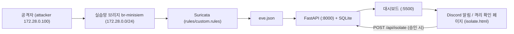
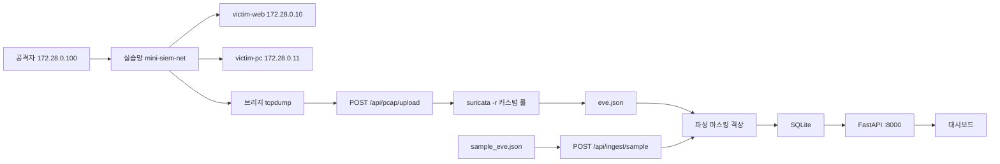

# Mini-SIEM (RookiRooki)

SK쉴더스 루키즈 07기 미니프로젝트 04조가, 팀 전용 Docker 실습망에서 녹화한 패킷을 Suricata로 분석하고 웹 대시보드에서 경보를 확인하는 경량 SIEM입니다.

        

이 문서는 GitHub 저장소 [Weo0o0/RookiRooki](https://github.com/Weo0o0/RookiRooki)의 설계·계약 문서입니다. 백엔드 핵심 코드는 main에 구현되어 있으며, 아래 실행 명령은 표준 실행 절차입니다. 시스템 배치와 탐지 흐름의 상세는 [docs/ARCHITECTURE.md](docs/ARCHITECTURE.md)를, 팀 협업 규칙과 역할별 AI 프롬프트는 [ai-guides/mini_siem_ai.md](ai-guides/mini_siem_ai.md)를 참고하세요.

## 목차

- [핵심 기능](#핵심-기능)
- [탐지 시나리오](#탐지-시나리오)
- [전체 아키텍처](#전체-아키텍처)
- [동작 흐름 (Stage 1)](#동작-흐름-stage-1)
- [빠른 시작](#빠른-시작)
- [실행 방법](#실행-방법)
- [문서 안내](#문서-안내)
- [저장소 구조](#저장소-구조)
- [보안 원칙](#보안-원칙)
- [팀 구성과 역할](#팀-구성과-역할)
- [API](#api)
- [4일 일정](#4일-일정)
- [심각도 SLA](#심각도-sla)
- [추가 목표 (Stretch Goals) 및 구현 완료 항목](#추가-목표-stretch-goals-및-구현-완료-항목)
- [Backlog (4일 범위 밖)](#backlog-4일-범위-밖)

## 핵심 기능

| 기능 | 설명 |
|---|---|
| HTTP 200 → SEV1 격상 | Suricata `alert`와 `http`를 연결해 SQL 인젝션·XSS·SSRF 공격 요청의 응답 코드가 `200`이면 `is_confirmed_risk=1`, 심각도 `SEV1`로 격상 |
| `[MASKED]` 마스킹 | URL·로그의 `password`, `token`, `secret` 등 민감 값을 저장·표시 전에 `[MASKED]`로 치환 |
| OSI 흐름·CLI 차단 안내(안내만) | `playbooks.json` 기반으로 OSI 공격 경로와 치환된 검증(`verify`)·차단(`block`)·원복(`rollback`) CLI 명령을 안내(안내만 제공, 호스트 방화벽 미실행) |
| PCAP 룰 검사·MITRE 커버리지 | 업로드한 PCAP을 `suricata -r`과 `rules/custom.rules`로 검사하고 `GET /api/stats`로 심각도 집계·MITRE ATT&CK 커버리지·Blind 룰 표시 |
| 트리아지(TP/FP/UNREVIEWED, 오탐 숨김) | 관찰된 사실(`observation`)과 추정(`assessment`), 신뢰도, 판정(`TP`/`FP`/`UNREVIEWED`)을 저장하고 기본 목록·통계에서 오탐(`FP`) 숨김 지원 |
| Discord 알림(SEV1 자동·수동, 격리 확인 링크) | SEV1 경보 자동·수동 Discord 알림 발송 및 토큰 조건 충족 시 격리 확인 페이지(`isolate.html`) 링크 포함 |
| 승인 기반 격리(기본 꺼짐) | `ISOLATION_ENABLED=1`일 때만 실습망 `attacker`(`172.28.0.100`) 한 대를 분석가의 수동 승인(1회용 토큰)으로만 네트워크에서 분리·해제 |

### 핵심 기능 상세

4일 범위에서 구현·시연하는 차별화는 다음 네 가지입니다.

1. **같은 요청의 HTTP 200 응답이면 SEV1로 격상**  
   Suricata `eve.json`의 `alert`와 `http`를 연결해, SQL 인젝션·XSS·SSRF **해당 공격 요청의 응답 코드가 200**이면 `is_confirmed_risk=1`, 심각도 SEV1로 올립니다. 같은 연결에 섞인 다른 요청의 200으로는 격상하지 않습니다. C2 비콘, SSH 무차별 대입, 포트 스캔은 HTTP 200 격상을 적용하지 않고 카탈로그의 기본 심각도를 유지합니다.
2. **평문 패스워드·토큰 자동 마스킹**  
   URL이나 로그에 보이는 `password`, `token`, `secret` 등 민감 값은 저장·표시 전에 `[MASKED]`로 바꿉니다. 실습 데이터에도 실제 비밀번호를 넣지 않습니다.
3. **경보 클릭 시 OSI 흐름과 검증·차단·원복 CLI 안내**  
   `playbooks.json`을 `category`로 매칭해 공격 경로를 보여 주고, `{{SRC_IP}}`, `{{DEST_IP}}`, `{{DEST_PORT}}`를 실제 값으로 치환한 검증(`verify`)·차단(`block`)·원복(`rollback`) 명령어를 복사할 수 있게 합니다. **차단 명령은 화면에 안내만 합니다. 호스트 방화벽(iptables 등)은 실행하지 않습니다. 단, 실습망의 `attacker` 컨테이너를 사용자가 승인했을 때만 네트워크에서 분리(`docker network disconnect`)하는 격리 기능이 있으며 `ISOLATION_ENABLED=1`일 때만 동작합니다.**
4. **업로드한 PCAP을 커스텀 룰로 검사하고 MITRE 커버리지를 보여 줌**  
   웹에서 pcap을 올리면 백엔드가 `suricata -r`과 `rules/custom.rules`로 오프라인 분석합니다. 대시보드는 `GET /api/stats`로 심각도 집계와 MITRE ATT&CK 커버리지를 표시합니다.

## 탐지 시나리오

Stage 1에서 다루는 시나리오는 **확정 6종**입니다. MITRE 기법 ID는 초안이며, **룰 담당자가 카탈로그를 확정할 때 검증**합니다.

| 카테고리 키 | SID | 시나리오 | 대상 | Suricata가 보는 것 | MITRE (검증 필요) | 기본 심각도 | 격상 |
|---|---|---|---|---|---|---|---|
| `sqli` | 1000001 | SQL 인젝션 | `victim-web` (`172.28.0.10`, HTTP) | HTTP URI·바디의 SQL 삽입 패턴 | T1190 (Initial Access) | SEV3 | 해당 요청 응답이 200이면 SEV1 |
| `xss` | 1000002 | XSS | `victim-web` (`172.28.0.10`, HTTP) | HTTP URI·바디의 스크립트 삽입 패턴 | T1189 (Initial Access) | SEV3 | 해당 요청 응답이 200이면 SEV1 |
| `bruteforce` | 1000003 | SSH 무차별 대입 | `victim-pc` (`172.28.0.11`, 22/tcp) | 짧은 시간 동안 동일 출발지가 22/tcp로 반복 연결하는 횟수. SSH는 암호화되어 패스워드 문자열을 볼 수 없음 | T1110.001 (Credential Access) | SEV2 | HTTP 200 격상 없음 |
| `portscan` | 1000004 | 포트 스캔 | `victim-web` / `victim-pc` | 짧은 시간 동안 동일 출발지가 서로 다른 목적 포트로 SYN을 다수 전송. 목적지 22와 80은 사용하지 않으며 샘플은 8080을 사용하고 룰은 `![22,80]`을 유지 (2026-11-24 결정 A) | T1046 (Discovery) | SEV3 | HTTP 200 격상 없음 |
| `c2_beacon` | 1000005 | C2 비콘 | 실습망 내부 (`172.28.0.0/24`) | 반복 연결 횟수 임계치(threshold 기반). attacker 172.28.0.100에서 victim-web 172.28.0.10:8443/tcp로 가며, 같은 출발지가 30초 안에 5회 연결하면 경보 1회(실습 단순화를 위해 공격자가 트래픽을 발생시키는 구조 유지) | T1071.001 (Command and Control, 가안) | SEV2 | HTTP 200 격상 없음 |
| `ssrf` | 1000006 | SSRF | `victim-web` (`172.28.0.10`, HTTP) | 내부 자원 조회 유도 HTTP 요청 패턴. victim-web:80에 GET `/fetch?url=<내부 주소>`로 요청 | T1190 (Initial Access, 가안) | SEV3 | 해당 요청 응답이 200이면 SEV1 (sqli/xss와 동일) |

실습망 주소는 팀이 쓰는 격리 Docker 네트워크만 사용합니다. `mini-siem-net`는 `172.28.0.0/24`, 공격자 `172.28.0.100`, 웹 타깃 `172.28.0.10`, SSH 타깃 `172.28.0.11`입니다. 백엔드와 프론트엔드는 호스트에서 실행하고, API는 8000 포트를 사용합니다.

플레이북 최상위 키, `rule_catalog.json`의 `category`·`sid`, `sample_eve.json`의 `signature_id`는 서로 철자까지 같아야 합니다. SID 대역 `1000001`–`1000999`, 치환 변수, 심각도 `SEV1`–`SEV4`는 그대로입니다.

## 전체 아키텍처



## 동작 흐름 (Stage 1)

공격과 패킷 녹화는 **팀 격리 Docker 실습망 안에서만** 합니다. 브리지에서 tcpdump로 `victim-web`과 `victim-pc` 트래픽을 함께 남기고, 그 pcap을 웹에 올려 Suricata가 오프라인으로 읽습니다. (선택 기능으로 브리지 실시간 eve.json을 읽는 라이브 캡처도 제공됩니다.)



## 빠른 시작

1. **설치 및 환경 구축**: [docs/설치_테스트_가이드.md](docs/설치_테스트_가이드.md)를 따라 WSL2 Ubuntu, Python `.venv`, Suricata, Docker 환경을 설치합니다.
2. **설치 확인**: `python -m pytest backend/tests -q`(`59 passed`), 백엔드(`uvicorn backend.main:app --port 8000`, `:8000`), 프론트엔드(`python3 -m http.server 5500`, `:5500`) 실행을 확인합니다.
3. **전체 기능 체험**: [docs/RookiRooki_전체기능_체험_종합명령어.md](docs/RookiRooki_전체기능_체험_종합명령어.md) 순서대로 Mock 모드, PCAP 업로드, 6종 라이브 탐지, 트리아지, Discord 알림 및 승인 기반 격리를 체험합니다.

## 실행 방법

자세한 설치·테스트 절차는 [docs/설치_테스트_가이드.md](docs/설치_테스트_가이드.md) 참고

아래는 표준 실행 절차입니다. 백엔드는 이미 구현되어 로컬에서 바로 실행할 수 있습니다.

1. **실습망과 녹화 (시나리오 담당, 격리망 전용)**  
   팀 Docker 실습망(`mini-siem-net`)을 띄운 뒤, **Docker 브리지 인터페이스**에서 `victim-web`과 `victim-pc` 트래픽이 모두 보이도록 tcpdump로 pcap을 남깁니다. 브리지 이름은 환경마다 다르므로 `docker network inspect`로 확인합니다.
   ```bash
   sudo tcpdump -i <브리지_인터페이스> -w scenarios/lab/pcaps/lab_capture.pcap
   ```
2. **오프라인 룰 검사 (룰·백엔드 점검용)**  
   ```bash
   mkdir -p /tmp/suricata_out
   suricata -r scenarios/lab/pcaps/lab_capture.pcap -S rules/custom.rules -l /tmp/suricata_out -k none --runmode single
   ```
3. **백엔드**  
   ```bash
   pip install -r backend/requirements.txt
   uvicorn backend.main:app --port 8000
   ```
   API 문서는 `http://localhost:8000/docs`에서 확인합니다. 샘플 로그는 `POST /api/ingest/sample`, 녹화 파일은 `POST /api/pcap/upload`로 넣습니다. 라이브 캡처·격리 기능을 켠 서버는 `--reload`를 쓰지 않습니다.
4. **대시보드**  
   `cd frontend && python3 -m http.server 5500 --bind 127.0.0.1`으로 서버를 띄우고 `http://localhost:5500`에 접속합니다(`ALLOWED_ORIGINS` 때문에 `file://`로 열면 CORS 오류가 납니다). 백엔드가 준비되면 Mock 모드를 끄고 Live API(`http://localhost:8000`)에 연결합니다.

## 문서 안내

| 문서 | 용도 |
|---|---|
| [docs/설치_테스트_가이드.md](docs/설치_테스트_가이드.md) | Mini-SIEM 설치 및 테스트 가이드 (Windows 11 + WSL2 Ubuntu + Docker + Suricata + Python 환경 설치·검증) |
| [docs/RookiRooki_전체기능_체험_종합명령어.md](docs/RookiRooki_전체기능_체험_종합명령어.md) | RookiRooki 미니 SIEM 전체 기능 체험 종합 명령어 (순서대로 붙여 넣어 전체 기능을 화면으로 확인하는 실습 안내) |
| [docs/ARCHITECTURE.md](docs/ARCHITECTURE.md) | Mini-SIEM 시스템 구상도 (구성 요소, 실습망, 데이터 흐름, 탐지 규칙, 데이터 저장 구조 정리) |
| [docs/live_capture_guide.md](docs/live_capture_guide.md) | 라이브 캡처 ingest 가이드 (선택 기능, 기본 꺼짐, 팀 합의 후 사용) |
| [docs/playbooks_guide.md](docs/playbooks_guide.md) | `scenarios/playbooks.json` v2 기술 명세서 및 6종 공격 카테고리 관제 플레이북 1줄 1주석 해설 |
| [docs/sample_eve_guide.md](docs/sample_eve_guide.md) | `scenarios/sample_eve.json` v2 기술 명세서 및 6종 공격 카테고리 세션별 주석 해설 |
| [docs/isolation_demo_script.md](docs/isolation_demo_script.md) | 격리·트리아지 시연 대본 |
| [docs/isolation_rehearsal_log.md](docs/isolation_rehearsal_log.md) | 격리·트리아지 리허설 기록표 |
| [backend/README.md](backend/README.md) | 백엔드 실행(`uvicorn`)·테스트(`pytest`) 명령, 엔드포인트 목록 및 승인 기반 격리(`ISOLATION_ENABLED=1`) 안내 |
| [frontend/README.md](frontend/README.md) | 프론트엔드 폴더 안내 (단일 `index.html` 기반 HTML + Tailwind CDN + Vanilla JS 구성) |
| [rules/isolation_criteria.md](rules/isolation_criteria.md) | 격리 판단 기준표 (격리 API 및 확인 페이지 실제 동작과 격리 기준 정리) |
| [rules/triage_templates.md](rules/triage_templates.md) | 트리아지 오탐(FP) 근거와 메모 템플릿 (웹 경보 상세의 관찰된 사실·분석가 추정 작성 템플릿) |
| [scenarios/lab/WSL2_Docker_환경구축_종합명령어.md](scenarios/lab/WSL2_Docker_환경구축_종합명령어.md) | WSL2 Ubuntu Docker 환경 구축 종합 명령어 (`systemd` 활성화 및 Docker Engine 설치 참고 문서) |

## 저장소 구조

```text
mini-siem/
├── backend/                                      # 백엔드 (FastAPI, SQLite, 파서)
│   ├── .gitignore
│   ├── README.md
│   ├── __init__.py
│   ├── main.py
│   ├── eve_parser.py
│   ├── isolation.py                              # 선택 기능: 승인 기반 컨테이너 격리 (기본 꺼짐)
│   ├── live_capture.py                           # 선택 기능: 라이브 eve.json 폴링 (기본 꺼짐)
│   ├── requirements.txt
│   └── tests/
│       ├── fixtures/
│       │   ├── playbooks.json
│       │   ├── rule_catalog.json
│       │   ├── sample_eve.json
│       │   └── test_custom.rules
│       ├── test_alerts_and_sample.py
│       ├── test_api.py
│       ├── test_eve_parser.py
│       ├── test_isolation.py
│       ├── test_live_capture.py
│       └── test_triage_fields.py
├── frontend/                                     # 프론트엔드 (단일 HTML SOC 대시보드 및 격리 확인 페이지)
│   ├── README.md
│   ├── index.html
│   ├── isolate.html
│   └── mock_demo_data.js
├── rules/                                        # Suricata 커스텀 룰, 카탈로그 및 판단 기준
│   ├── custom.rules
│   ├── isolation_criteria.md
│   ├── rule_catalog.json
│   └── triage_templates.md
├── scenarios/                                    # 시나리오 및 실습 환경
│   ├── lab/                                      # Docker 실습망 구성
│   │   ├── WSL2_Docker_환경구축_종합명령어.md
│   │   ├── docker-compose.yml
│   │   ├── attacker/
│   │   │   ├── Dockerfile
│   │   │   ├── lab-traffic.sh
│   │   │   └── passwords.txt
│   │   ├── pcaps/                                # 실습 녹화 pcap 저장 위치
│   │   ├── victim-pc/
│   │   │   └── Dockerfile
│   │   └── victim-web/
│   │       ├── Dockerfile
│   │       └── app.py
│   ├── playbooks.json                            # 시나리오별 대응 플레이북
│   └── sample_eve.json                           # 데모용 샘플 eve 로그
├── policies/                                     # 정책 및 QA (PM 소유)
│   └── README.md                                 # sev_sla_policy.json, PROJECT_SPEC_QA.md 작성 예정 안내
├── docs/                                         # 설계, 설치 및 전체 기능 체험 가이드
│   ├── ARCHITECTURE.md
│   ├── RookiRooki_전체기능_체험_종합명령어.md
│   ├── isolation_demo_script.md
│   ├── isolation_rehearsal_log.md
│   ├── live_capture_guide.md
│   ├── playbooks_guide.md
│   ├── sample_eve_guide.md
│   └── 설치_테스트_가이드.md
├── ai-guides/                                    # 역할별 AI 프롬프트 및 가이드
│   ├── 01_백엔드_AI룰.md
│   ├── 02_프론트엔드_AI룰.md
│   ├── 03_시나리오_AI룰.md
│   ├── 04_룰_AI룰.md
│   ├── 05_PM_AI룰.md
│   ├── 06_문서_PPT_AI룰.md
│   └── mini_siem_ai.md
└── README.md
```

## 보안 원칙

- **격리 실습망(`172.28.0.0/24`) 전용**: 공격 재현과 패킷 수집은 팀의 격리된 Docker 실습망(`mini-siem-net`, `172.28.0.0/24`)에서만 수행하며, 학교·회사·가정 네트워크나 외부 대상에는 사용하지 않습니다.
- **차단 명령 안내 전용 및 승인 기반 격리**: 차단 CLI 명령은 안내만 하며 호스트 방화벽을 실행하지 않습니다. 컨테이너 격리는 기본 꺼짐(`ISOLATION_ENABLED=1`일 때만 동작)이고, 분석가가 승인했을 때만 실습망 `attacker`(`172.28.0.100`) 한 대에 한해 실행됩니다.
- **민감 정보·원본 산출물 커밋 금지**: 원본 `pcap`, 라이브/분석 `eve.json`, 실제 웹훅 URL, 격리 토큰, 실제 비밀번호·개인정보는 코드나 저장소에 절대 커밋하지 않습니다.

### 보안 기본기

- 비밀번호, API 키, 웹훅 주소는 코드에 직접 적지 않고 환경변수로 분리합니다.
- SQLite는 파라미터 바인딩(`?`)만 쓰고, 문자열을 이어 붙여 쿼리하지 않습니다.
- CORS는 `*`가 아니라 로컬 주소 목록만 허용합니다. 요청 본문은 Pydantic으로 검증하고, 에러 응답에 스택 트레이스를 넣지 않습니다.
- 프론트엔드는 서버에서 받은 문자열을 `innerHTML`에 넣기 전에 이스케이프합니다.
- 차단 CLI는 반드시 검증·원복 명령과 세트로 적습니다. 관제 메모는 사실(`observation`)과 추정(`assessment`), 신뢰도를 나눕니다.

### 안전과 윤리

- 공격 재현과 패킷 수집은 **이 팀의 격리된 Docker 실습망에서만** 합니다. 학교·회사·가정 네트워크나 허가 없는 대상을 쓰지 않습니다.
- 샘플 로그와 pcap에는 실제 계정, 실제 비밀번호, 실제 개인정보를 넣지 않습니다. 마스킹 시험에는 가짜 `password=` / `token=`만 사용합니다.
- 문서에 적힌 차단 명령은 안내입니다. 실습망 밖 장비에 적용하지 않습니다. 격리 기능의 대상은 `172.28.0.100`의 `attacker` 컨테이너뿐이며 허용 목록 밖의 IP는 거절됩니다.
- 샘플 출발지·문서 예시가 필요하면 RFC 5737 문서용 대역(`192.0.2.0/24`, `198.51.100.0/24`, `203.0.113.0/24`)만 쓰고, 실공인 IP는 사용하지 않습니다.

## 팀 구성과 역할

| 역할 | 담당 범위 | 소유 폴더·파일 |
|---|---|---|
| 백엔드 | FastAPI, SQLite, eve.json 파싱, 상관분석, API | `backend/` (`rules/`, `scenarios/` 파일은 읽기 전용으로 참조) |
| 프론트엔드 | 단일 HTML SOC 대시보드 | `frontend/` |
| 룰 | Suricata 커스텀 룰과 메타데이터 카탈로그 | `rules/custom.rules`, `rules/rule_catalog.json` |
| 시나리오 | 실습 트래픽·pcap, 샘플 eve 로그, 대응 플레이북 | `scenarios/lab/pcaps/`, `scenarios/sample_eve.json`, `scenarios/playbooks.json` |
| PM | 심각도·SLA 정책, 통합 스펙, QA, 발표 | `policies/sev_sla_policy.json`, `policies/PROJECT_SPEC_QA.md` |

기술 스택은 고정입니다. 백엔드는 Python FastAPI + 내장 SQLite(`sqlite3`) + Pydantic v2이며, ORM이나 외부 DB로 바꾸지 않습니다. 프론트엔드는 단일 HTML + Tailwind CSS CDN + Vanilla JS(+ 필요 시 Chart.js CDN)이며, React/TypeScript/Webpack으로 바꾸지 않습니다. 백엔드 API는 `http://localhost:8000`에서 제공하고, 대시보드는 5초 주기 폴링(`GET /api/alerts`)과 Mock/Live 토글을 사용합니다.

## API

Stage 1에서 프론트·백엔드가 맞출 인터페이스입니다. 앞의 네 개는 기존 계약이고, `POST /api/pcap/upload`는 Stage 1에서 추가합니다. `GET /api/stats`는 원래 백엔드 프롬프트에 있던 집계 API로, 차별화 ④(MITRE 커버리지)를 위해 Stage 1에 포함합니다. 가이드에 있던 `POST /api/sandbox/test`(업로드 pcap + 임의 룰 텍스트)는 Stage 1에서 `POST /api/pcap/upload`(고정 `custom.rules`로 `suricata -r`)로 대체하며, 웹에서 룰 문구를 바꿔 시험하는 기능은 Backlog로 둡니다.

| 메서드 | 경로 | 용도 | 입력 | 응답 요지 |
|---|---|---|---|---|
| `POST` | `/api/ingest/sample` | 데모용 `scenarios/sample_eve.json` 적재 | 없음 | 적재된 경보 건수 |
| `GET` | `/api/alerts` | 경보 목록 | `severity`, `limit`, `offset`, `include_fp`(`0`/`1`, 기본 `0` = 오탐(FP) 제외) | `items`, 페이지 건수(`total`도 같은 기준) |
| `GET` | `/api/alerts/{id}` | 경보 상세 + 플레이북 | 경로 `id` | 경보 필드 + `playbook` |
| `PATCH` | `/api/alerts/{id}/triage` | 분석가 판정 저장 | `verdict`(`TP`/`FP`/`UNREVIEWED`), `observation`, `assessment`, `confidence`(`HIGH`/`MEDIUM`/`LOW`), `analyst`(문자열, 최대 50자), `action_status`(`ISOLATED`/`GUIDE_ONLY`/`NONE`, 기본 `NONE`) | 갱신 결과 |
| `POST` | `/api/pcap/upload` | pcap 업로드 후 `suricata -r` | `multipart/form-data`, `.pcap` 또는 `.pcapng`, 최대 20MB | 분석 요약(적재 건수 등) |
| `GET` | `/api/stats` | 심각도 집계, MITRE 커버리지, 로그 단절(Blind) 룰 | `include_fp`(`0`/`1`, 기본 `0`) | `severity_counts`, `mitre_coverage`, `blind_rules` 등 (집계도 기본은 FP 제외) |
| `GET` | `/api/live/status` | (선택 기능, 기본 꺼짐) 라이브 캡처 상태·시작/중지 안내 | 없음 | `enabled`, `eve_path`, `offset`, `last_poll_at`, `rows_stored`, `rows_skipped_out_of_scope`, `last_error`, `start_command`, `stop_command` |
| `POST` | `/api/isolate` | (선택 기능, 기본 꺼짐) 승인된 격리 실행 | JSON `alert_id`, `token`(1회용) | `status`, `ip`, `container` |
| `POST` | `/api/unisolate` | (선택 기능, 기본 꺼짐) 격리 해제 | JSON `alert_id` 또는 `ip` 중 하나 | `status`, `ip`, `container` |
| `GET` | `/api/isolation/status` | 격리 상태 조회(읽기 전용, 꺼져 있어도 응답) | 없음 | `enabled`, `allowed_ips`, `isolated_ips`, `source`, `docker_error`, `recent` |

경보 JSON의 핵심 키는 `id`, `timestamp`, `sid`, `category`, `signature`, `mitre_id`, `src_ip`, `dest_ip`, `dest_port`, `http_status`, `severity`, `is_confirmed_risk`, `pii_masked`, `raw_url`, `verdict`, `observation`, `assessment`, `confidence`, `analyst`, `action_status`, `isolation_token`(조건 불충족이면 `null`), `playbook`입니다. 스키마 상세는 [ARCHITECTURE.md](docs/ARCHITECTURE.md)를 참고하세요.

### 선택 기능: 라이브 캡처 ingest (기본 꺼짐, 팀 합의 후 사용)

Backlog의 Stage 2 항목으로 기획되었던 브리지 실시간 eve.json 수집을 **선택 기능**으로 구현해 둔 것입니다. 환경변수 `LIVE_CAPTURE_ENABLED=1`을 직접 지정할 때만 동작하며, 지정하지 않으면 위의 pcap 업로드·샘플 적재 흐름은 그대로이고 폴링 스레드도 새 테이블 쓰기도 없습니다. **팀 합의 후에 사용하세요.**

- 사용자가 자기 Ubuntu 터미널에서 `sudo suricata -i br-minisiem ...`로 브리지를 라이브 캡처하면, 백엔드가 `backend/data/live/eve.json`을 읽어 기존 파서로 저장합니다. 백엔드는 Suricata를 시작·중지하지 않고 `sudo`도 호출하지 않습니다(root 권한이 필요하므로 안내만 제공).
- `src_ip`와 `dest_ip`가 모두 `172.28.0.0/24` 안인 경보만 저장합니다.
- 이미 저장한 경보의 `http` 응답이 나중 배치에 도착하면 `http_status`·심각도(200이면 SEV1)만 갱신하며, 같은 줄을 다시 읽어도 중복 저장되지 않습니다.
- 터미널은 Windows에서 PowerShell → `wsl -d Ubuntu` → `cd ~/RookiRooki` 순서로 엽니다. 백엔드 `uvicorn`은 `(서버_터미널.1)`(`.venv` 필요)에서 `--reload` 없이 프로세스 1개로 실행하고, 요청은 `(요청_터미널.3)`, 트래픽은 `(attacker_터미널.4)`, Suricata는 `(라이브_터미널.8)`(`.venv` 불필요)에서 실행합니다.
- 시작·중지 명령, 터미널별 역할, offset·중복 규칙, 한계는 [docs/live_capture_guide.md](docs/live_capture_guide.md)를 참고하세요.

### 선택 기능: 승인 기반 격리 (기본 꺼짐)

실습망의 `attacker` 컨테이너 **한 대**(`172.28.0.100`, 네트워크 `mini-siem-net`)만 대상으로, 분석가가 **승인했을 때만** 네트워크에서 분리(`docker network disconnect`)하는 기능입니다. 환경변수 `ISOLATION_ENABLED=1`을 직접 지정할 때만 동작하며, 지정하지 않으면 docker를 한 번도 호출하지 않고 `isolation_token`은 항상 `null`입니다.

- **승인 흐름:** 경보 조회 응답의 `isolation_token`(경보당 하나) → 분석가가 확인 화면에서 승인 → `POST /api/isolate`(`alert_id`, `token`)만 격리를 실행합니다. 조회·적재·라이브 캡처는 절대 격리하지 않습니다.
- **토큰 조건:** SEV1이고, `src_ip`가 `172.28.0.100`이며, 경보 시각이 5분 이내인 경보에만 발급됩니다. 토큰은 1회용이고 10분 뒤 만료됩니다(서버 메모리에만 있고 서버를 다시 켜면 사라집니다).
- **허용 목록 밖은 거절:** `172.28.0.10`, `172.28.0.11`, 실습망 밖 IP 등은 403이며 docker를 호출하지 않습니다.
- **해제는 수동:** 자동 해제(타이머)는 없습니다. `POST /api/unisolate`(`alert_id` 또는 `ip` 중 하나)로 해제하며, 해제 뒤 IP가 `172.28.0.100`으로 유지되는지 서버가 확인합니다. 그래도 실제 컨테이너의 IP 유지는 사람이 한 번 더 확인해야 합니다(자세한 절차는 [backend/README.md](backend/README.md)).
- **실행 조건:** 격리를 켠 서버는 `--host 0.0.0.0`으로 열지 않고(기본 `127.0.0.1` 유지), `--reload`·`--workers` 없이 프로세스 1개로 실행합니다(토큰이 메모리에 있음). 사용자 계정이 `docker` 그룹이어야 하며 이는 문서로만 안내합니다.
- **Discord 격리 확인 링크:** SEV1 경보에 `isolation_token`이 있을 때만 Discord 알림 embed에 `격리 확인` 링크(`frontend/isolate.html?alert_id=<N>#token=<T>`)가 포함됩니다.
- **수동 승인 전용:** 확인 페이지는 열기만 해서는 절대 격리하지 않으며(GET 조회만 수행), 화면에서 `[승인(격리 실행)]` 버튼을 눌렀을 때만 `POST /api/isolate`를 호출합니다.
- **접속 방법 및 주의:** `frontend/`에서 `python3 -m http.server 5500`을 실행해 `http://localhost:5500`으로 열어야 하며, `localhost` 링크는 백엔드가 실행 중인 같은 PC의 브라우저에서만 동작합니다.

## 4일 일정

Feature Freeze는 11/26(목) 18:00으로 옮겼습니다(기존 Day 3 18:00). 동결 이후에는 새 기능을 넣지 않고, 버그 수정과 시연 준비만 합니다. 11/27(금)은 발표일이며 버그 수정만 합니다.

| 일정 | 목표 | 역할별 작업 |
|---|---|---|
| Day 1 (11/23) | 계약 고정과 뼈대 | 전원이 카테고리 키·SID·API를 확인. 백엔드: 프로젝트 뼈대와 샘플 적재. 프론트: Mock으로 경보 목록·상세 레이아웃. 룰: 6종 1차 룰과 카탈로그. 시나리오: 실습망·1차 pcap과 플레이북 초안. PM: SLA 정책과 QA 목록 |
| Day 2 (11/24) | 탐지와 화면 연동 | 백엔드: pcap 업로드, 마스킹, SQL/XSS 200 격상. 프론트: Live API, 플레이북 치환, 트리아지(사실/추정 분리). 룰: pcap으로 튜닝. 시나리오: 정상·공격 트래픽 분리 녹화. PM: 키 일치 점검 |
| Day 3 (11/25) | 통합과 동결 | 6종 시나리오가 업로드부터 대시보드까지 이어지는지 확인. MITRE 요약과 QA PASS/FAIL. (Feature Freeze는 11/26 18:00으로 이동) |
| Day 4 (11/26) | 시연 준비 | 리허설, README·스크린샷, 발표 준비. **18:00 Feature Freeze**. 실습망이 안 되면 저장해 둔 pcap과 `sample_eve.json`으로 재현 |

## 심각도 SLA

PM이 `policies/sev_sla_policy.json`으로 관리합니다. 초안 기준은 다음과 같습니다.

| 등급 | 의미 (초안) | 초기 대응 목표 | 상황 공유 |
|---|---|---|---|
| SEV1 | 해당 웹 공격 요청이 200을 받은 침투 성공 의심, 민감정보 유출 등 | 5분 이내 | 15분마다 |
| SEV2 | SSH 무차별 대입 등 고위험 시도, 확인 필요 | 15분 이내 | 30분마다 |
| SEV3 | 포트 스캔, 응답이 200이 아닌 웹 공격 시도 | 1시간 이내 | 2시간마다 |
| SEV4 | 정보성·오탐 튜닝 대상 | 다음 영업일 이내 | 일일 요약 |

자동 격상: SQL 인젝션·XSS·SSRF에서 **그 요청의 응답이 200**이면 즉시 SEV1. 평문 패스워드·토큰이 보이면 `[MASKED]`로 마스킹만 하며(`pii_masked=1`), 마스킹 때문에 심각도를 올리거나 바꾸지는 않습니다(팀 결정). SEV1 선언 후 30분 안에 원인을 못 찾으면 상위 보고를 검토합니다.

## 추가 목표 (Stretch Goals) 및 구현 완료 항목

기존 추가 목표 중 **알림 기능, 시각적 정보 제공, 분석 명령어 가이드**는 구현이 완료되어 서비스에 반영되었습니다.

### 1. 알림 기능 (위협 감지 알림 · 웹 연동 · 임시 대응) [구현 완료]

**목적.** 프롬프트나 대시보드를 계속 보지 않아도, 새 위협을 메신저로 받고 웹 경보 화면으로 바로 이동하며, 임시 대응 안내를 확인합니다.

**구현 범위.** Discord 웹훅으로 새 경보 요약을 보내고, 메시지에 해당 경보 딥링크 및 SEV1 경보 시 격리 확인 페이지(`isolate.html`) 링크를 제공합니다.

**동작 방식.** 경보를 저장한 뒤, 환경변수 `SIEM_WEBHOOK_URL`이 있을 때만 HTTP로 웹훅을 보냅니다. URL은 코드·저장소·문서 예시에 실주소를 넣지 않습니다. 딥링크 예시는 `http://localhost:8000/?alert_id=101`입니다. 200 OK로 SEV1 격상된 건은 항상 알립니다. 임시 차단 API 중 **승인 기반 격리(`attacker` 컨테이너 분리)와 수동 해제는 구현 완료**되었습니다.

### 2. 시각적 정보 제공 (공격 스토리 · 계층·경로 · 정상/공격 흐름) [구현 완료]

**목적.** 흩어진 경보를 공격 단계 순서로 묶어 보여 주고, 어느 OSI 계층에서 무엇이 달랐는지 정상 흐름과 공격 흐름을 비교합니다.

**구현 범위.** 대시보드 내 시각화 보기 탭을 통해 같은 `src_ip`의 경보를 시간 순으로 묶어 공격 경로와 스토리를 시각적으로 제공하며, 6종 공격에 대한 OSI 계층 흐름 및 정상/공격 흐름 설명을 제공합니다.

### 3. 분석 명령어 가이드와 해설 [구현 완료]

**목적.** 경보마다 관련 분석 명령어를 안내하고, 명령의 각 토큰이 무엇을 하는지 한글로 해설합니다.

**구현 범위.** `playbooks.json`의 `analysis` 필드를 통해 분석용 명령어(`grep`, `tail` 등)와 `{{SRC_IP}}` 등의 동적 치환, 토큰별 한글 해설을 대시보드 상세 화면에 제공합니다.

### 4. 오탐 학습 버튼 [미구현(추후 작업)]

**목적.** 분석가가 오탐으로 표시한 패턴에 점수를 쌓아, 반복 오탐은 알림 범위에서 빼 알림 피로를 줄입니다.

**최소 구현 범위 (MVP).** 경보 상세에 「오탐 학습」 버튼을 둡니다. 클릭 1회당 해당 복합 키 점수를 1 올립니다. 점수가 3 이상이면 **같은 키의 이후 경보는 알림만 생략**하고, 경보 자체는 DB에 저장·화면에 표시합니다.

**동작 방식.** 복합 키는 **`SID + src_ip + 쿼리 문자열을 뺀 URI 경로`**입니다. SSH 무차별 대입·포트 스캔처럼 URI가 없으면 경로를 비우고 `SID + src_ip`만 사용합니다. 클릭한 해당 경보는 `verdict=FP`로 둘 수 있습니다. 같은 키라도 다른 출발지 IP의 점수는 건드리지 않습니다.

**필요한 API/DB 변경.** 선택 테이블 `fp_scores`, 선택 엔드포인트 `POST /api/alerts/{id}/fp-learn`. (현재는 `PATCH /api/alerts/{id}/triage`에서 `verdict=FP` 판정 및 기본 숨김 처리로 대응)

## Backlog (4일 범위 밖)

- 웹에서 룰 텍스트를 바꿔 시험하는 샌드박스(`POST /api/sandbox/test`)
- 호스트 로그(`auth.log` 등)와의 추가 상관분석, 로그인·다중 권한, 상용 DB 전환
