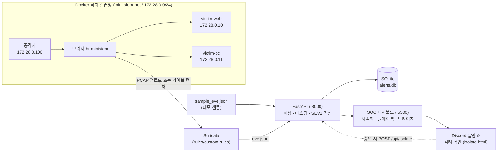

<div align="center">

# 🛡️ RookiRooki (Mini-SIEM)

**초보 관제사와 보안 입문자를 위한 경량·시각화 Mini-SIEM**  
SK쉴더스 루키즈 07기 미니프로젝트 04조


[프로젝트 소개](#-프로젝트-소개) · [핵심 기능](#-핵심-기능) · [탐지 시나리오](#-탐지-시나리오-6종) · [아키텍처](#-아키텍처-및-동작-흐름) · [빠른 시작](#-빠른-시작-quick-start) · [API 및 선택 기능](#-api-및-선택-기능) · [문서 안내](#-문서-안내)

</div>

---

## 💡 프로젝트 소개

**RookiRooki**는 무거운 상용 SIEM 구축 없이도 **개인 노트북 1대(WSL2 + Docker)**에서 네트워크 공격 발생부터 탐지, 분석, 판정, 격리까지 **보안 관제의 전 과정을 시각적으로 체험**할 수 있는 경량 SIEM입니다.

- **대상 환경**: 팀 전용 격리 Docker 실습망(`mini-siem-net`, `172.28.0.0/24`)
- **핵심 파이프라인**: `패킷 수집(PCAP / 라이브)` → `Suricata 6종 룰 분석` → `FastAPI 파싱·마스킹·위험도 격상` → `SQLite 저장` → `웹 SOC 대시보드 & Discord 알림`
- **상세 문서**: 시스템 설계는 [docs/ARCHITECTURE.md](docs/ARCHITECTURE.md), 팀 협업 및 AI 가이드는 [ai-guides/mini_siem_ai.md](ai-guides/mini_siem_ai.md)를 참고하세요.

---

## ✨ 핵심 기능

### 1. 탐지·분석 핵심 기능
| 기능 | 설명 |
|---|---|
| **🔥 HTTP 200 → SEV1 자동 격상** | Suricata `alert`와 `http` 이벤트를 정밀 매칭해, SQLi·XSS·SSRF **공격 요청 자체가 HTTP 200 응답**을 받은 경우에만 `SEV1`(`is_confirmed_risk=1`)로 격상 |
| **🔒 민감정보 자동 마스킹** | URL·로그·트리아지 메모 속 `password`, `token`, `secret` 등을 저장·표시 전 `[MASKED]`로 자동 치환 |
| **📊 PCAP 룰 검사 & MITRE 통계** | 업로드한 `.pcap`/`.pcapng`를 `suricata -r` + `rules/custom.rules`로 분석하고 심각도 집계, MITRE ATT&CK 커버리지, 로그 결측 사각지대(`blind_rules`) 표시 |
| **📝 트리아지 & 오탐(FP) 필터** | 사실(`observation`)·추정(`assessment`)·신뢰도·판정(`TP`/`FP`/`UNREVIEWED`)·분석가명(`analyst`)·조치 상태(`action_status`) 저장 및 오탐 기본 숨김 지원 |

### 2. 시각화·관제·대응 기능 (구현 완료)
- **🧭 공격 스토리 & OSI 흐름 시각화**: 대시보드 시각화 탭에서 출발지 IP별 공격 경로·타임라인과 OSI 계층별 정상/공격 흐름 비교 제공
- **💻 플레이북 & 분석 명령어 토큰 해설**: 경보 클릭 시 `{{SRC_IP}}`, `{{DEST_IP}}`, `{{DEST_PORT}}`가 자동 치환된 검증(`verify`)·차단(`block`)·원복(`rollback`) CLI 및 분석 명령어(`analysis`) 토큰별 한글 해설 제공
- **🔔 Discord 실시간 알림**: 프론트엔드에서 브라우저 탭 세션에 저장된 웹훅 주소로 SEV1(신규 및 SEV3→SEV1 격상) 경보 요약과 격리 확인 페이지(`isolate.html`) 링크를 자동·수동 발송 *(오탐 `FP`는 자동 알림 제외)*
- **📡 선택형 라이브 캡처(`LIVE_CAPTURE_ENABLED=1`)**: 브리지(`br-minisiem`)의 실시간 `eve.json`을 주기적으로 수집하고, 뒤늦게 도착한 HTTP 200 응답도 기존 경보에 반영
- **🚧 승인 기반 컨테이너 격리(`ISOLATION_ENABLED=1`)**: SEV1·5분 이내·실습망 공격자(`172.28.0.100`) 조건 충족 시, 분석가의 수동 승인(1회용 토큰)으로만 `attacker` 컨테이너를 네트워크에서 분리(`docker network disconnect`) 및 수동 해제

---

## 🎯 탐지 시나리오 (6종)

| 카테고리 | SID | 공격 유형 | 대상 | 탐지 기준 (Suricata) | MITRE ATT&CK | 기본 심각도 | SEV1 격상 |
|---|---|---|---|---|---|---|---|
| `sqli` | `1000001` | SQL 인젝션 | `victim-web` (HTTP) | HTTP URI·바디 SQL 삽입 패턴 | `T1190` | SEV3 | HTTP 200 시 격상 |
| `xss` | `1000002` | XSS | `victim-web` (HTTP) | HTTP URI·바디 스크립트 삽입 패턴 | `T1189` | SEV3 | HTTP 200 시 격상 |
| `bruteforce` | `1000003` | SSH 무차별 대입 | `victim-pc` (22/tcp) | 짧은 시간 내 동일 출발지 22/tcp 반복 연결 | `T1110.001` | SEV2 | 없음 |
| `portscan` | `1000004` | 포트 스캔 | `victim-web` / `pc` | 짧은 시간 내 다수 포트(`![22,80]`) SYN 전송 | `T1046` | SEV3 | 없음 |
| `c2_beacon` | `1000005` | C2 비콘 | `victim-web` (8443/tcp) | 30초 내 동일 출발지 5회 이상 주기적 연결 | `T1071.001` | SEV2 | 없음 |
| `ssrf` | `1000006` | SSRF | `victim-web` (HTTP) | `GET /fetch?url=<내부 주소>` 내부 자원 조회 유도 | `T1190` | SEV3 | HTTP 200 시 격상 |

> **실습망 IP 구성 (`mini-siem-net`, `172.28.0.0/24`)**  
> `attacker`: `172.28.0.100` · `victim-web`: `172.28.0.10` · `victim-pc`: `172.28.0.11`  
> *(백엔드 API `:8000`과 프론트엔드 대시보드 `:5500`은 호스트/WSL에서 실행)*

---

## 🏗️ 아키텍처 및 동작 흐름



1. **수집**: 격리 실습망에서 `tcpdump`로 녹화한 PCAP을 웹에 업로드(`POST /api/pcap/upload`)하거나, 샘플 적재(`POST /api/ingest/sample`) / 라이브 캡처를 통해 로그를 수집합니다.
2. **분석·저장**: Suricata가 생성한 `eve.json`을 백엔드가 파싱·마스킹하고, 중복을 제거한 뒤 SQLite에 저장합니다.
3. **관제·대응**: 대시보드에서 경보 목록·공격 스토리·플레이북·통계를 확인하고, 트리아지 판정 및(필요 시) 승인 기반 컨테이너 격리를 수행합니다.

---

## 🚀 빠른 시작 (Quick Start)

> [!TIP]
> 처음 설치하시나요? [docs/설치_테스트_가이드.md](docs/설치_테스트_가이드.md)에서 WSL2 Ubuntu, Docker, Suricata, Python 환경 구축을 단계별로 안내합니다.  
> 전체 기능을 순서대로 체험하려면 [docs/RookiRooki_전체기능_체험_종합명령어.md](docs/RookiRooki_전체기능_체험_종합명령어.md)를 참고하세요.

### 1. 백엔드 설치 및 실행 (`:8000`)
```bash
pip install -r backend/requirements.txt
python -m pytest backend/tests -q          # 자동 테스트 확인 (59 passed)
uvicorn backend.main:app --port 8000       # API 문서: http://localhost:8000/docs
```
> 라이브 캡처·승인 기반 격리 기능을 켠 서버는 `--reload` 없이 단일 프로세스로 실행합니다.

### 2. 프론트엔드 대시보드 실행 (`:5500`)
```bash
cd frontend
python3 -m http.server 5500 --bind 127.0.0.1   # 접속: http://localhost:5500
```
> `ALLOWED_ORIGINS` 보안 정책 때문에 HTML 파일을 `file://`로 직접 열면 CORS 오류가 발생합니다. 반드시 로컬 HTTP 서버(`http://localhost:5500`)로 접속한 뒤, 대시보드에서 **Live API** 모드로 전환하세요.

<details>
<summary><b>📦 실습망 패킷 녹화 및 오프라인 Suricata 룰 단독 점검 명령어 펼치기</b></summary>

1. **Docker 실습망 패킷 녹화 (격리망 전용)**
   ```bash
   # docker network inspect로 브리지 인터페이스 이름 확인 후 실행
   sudo tcpdump -i <브리지_인터페이스> -w scenarios/lab/pcaps/lab_capture.pcap
   ```
2. **오프라인 Suricata 룰 검사**
   ```bash
   mkdir -p /tmp/suricata_out
   suricata -r scenarios/lab/pcaps/lab_capture.pcap -S rules/custom.rules -l /tmp/suricata_out -k none --runmode single
   ```

</details>

---

## 🔌 API 및 선택 기능

| 메서드 | 경로 | 용도 | 주요 파라미터 / 본문 |
|---|---|---|---|
| `POST` | `/api/pcap/upload` | PCAP 업로드 → Suricata 분석·적재 | `multipart/form-data` (`.pcap`/`.pcapng`, 최대 20MB) |
| `POST` | `/api/ingest/sample` | 데모용 `scenarios/sample_eve.json` 적재 | 없음 |
| `GET` | `/api/alerts` | 경보 목록 조회 | `severity`, `limit`, `offset`, `include_fp` (`0`/`1`, 기본 `0`) |
| `GET` | `/api/alerts/{id}` | 경보 상세 + 대응 플레이북 조회 | 경로 `id` |
| `PATCH` | `/api/alerts/{id}/triage` | 분석가 트리아지 판정 저장 | `verdict`, `confidence`, `observation`, `assessment`, `analyst`, `action_status` |
| `GET` | `/api/stats` | 심각도·카테고리 집계, MITRE 커버리지, Blind 룰 | `include_fp` (`0`/`1`, 기본 `0`) |
| `GET` | `/api/live/status` | *(선택)* 라이브 캡처 상태 및 시작/중지 명령 안내 | 없음 |
| `POST` | `/api/isolate` | *(선택)* 승인된 공격자 컨테이너 격리 실행 | `alert_id`, `token` (1회용) |
| `POST` | `/api/unisolate` | *(선택)* 격리된 컨테이너 네트워크 재연결 | `alert_id` 또는 `ip` |
| `GET` | `/api/isolation/status` | 격리 활성화 여부·대상·최근 이력 조회 | 없음 |

<details>
<summary><b>📡 선택 기능 ①: 라이브 캡처 ingest (기본 꺼짐, <code>LIVE_CAPTURE_ENABLED=1</code>)</b></summary>

- 환경변수 `LIVE_CAPTURE_ENABLED=1`을 지정할 때만 동작합니다. 지정하지 않으면 기존 PCAP 업로드·샘플 적재 흐름만 동작합니다.
- 사용자가 Ubuntu 터미널에서 `sudo suricata -i br-minisiem ...`로 브리지를 캡처하면, 백엔드가 `backend/data/live/eve.json`을 주기적으로 읽어 기존 파서로 저장합니다(백엔드는 `sudo`를 호출하지 않음).
- `src_ip`와 `dest_ip`가 모두 `172.28.0.0/24` 내부인 경보만 저장하며, 뒤늦게 도착한 `http` 200 응답도 기존 경보의 `http_status`와 `SEV1` 심각도에 반영합니다.
- 자세한 실행 터미널 구성 및 규칙은 [docs/live_capture_guide.md](docs/live_capture_guide.md)를 참고하세요.

</details>

<details>
<summary><b>🚧 선택 기능 ②: 승인 기반 컨테이너 격리 (기본 꺼짐, <code>ISOLATION_ENABLED=1</code>)</b></summary>

- 실습망 `attacker` 컨테이너(`172.28.0.100`, `mini-siem-net`) 한 대만 대상으로 하며, `ISOLATION_ENABLED=1`일 때만 활성화됩니다.
- **토큰 발급 조건**: `SEV1` 등급 + `src_ip == 172.28.0.100` + 경보 발생 5분 이내일 때만 1회용 토큰(유효기간 10분, 서버 메모리 보관)이 발급됩니다.
- **수동 승인 & 수동 해제**: `isolate.html` 페이지를 열기만 해서는 절대 격리되지 않으며, `[승인(격리 실행)]` 버튼을 눌렀을 때만 `POST /api/isolate`가 호출됩니다. 해제는 `POST /api/unisolate`로 수동 수행합니다.
- **실행 주의**: 토큰이 메모리에 있으므로 `uvicorn`은 `--reload`·`--workers` 없이 단일 프로세스(`127.0.0.1`)로 실행해야 합니다. 자세한 기준은 [backend/README.md](backend/README.md) 및 [rules/isolation_criteria.md](rules/isolation_criteria.md)를 참고하세요.

</details>

<details>
<summary><b>📄 경보 JSON 응답 주요 필드 보기</b></summary>

`id`, `timestamp`, `sid`, `category`, `signature`, `mitre_id`, `src_ip`, `dest_ip`, `dest_port`, `http_status`, `severity`, `is_confirmed_risk`, `pii_masked`, `raw_url`, `verdict`, `observation`, `assessment`, `confidence`, `analyst`, `action_status`, `isolation_token` (조건 불충족 시 `null`), `playbook`

</details>

---

## 🔒 보안 및 안전 원칙

> [!WARNING]
> 모든 공격 재현·패킷 수집·컨테이너 격리는 **팀의 격리된 Docker 실습망(`172.28.0.0/24`) 안에서만** 수행하며, 외부 네트워크나 허가 없는 대상에는 절대 사용하지 않습니다.

- **안전한 대응 정책**: 대시보드의 차단 CLI(iptables 등)는 안내 전용으로 호스트 방화벽을 직접 실행하지 않습니다. 컨테이너 격리는 기본 꺼짐이며, 승인 토큰 검증 후 `172.28.0.100` 한 대에 한해서만 동작합니다.
- **민감정보 보호**: 실제 비밀번호·API 키·웹훅 URL·원본 `pcap`·라이브 `eve.json`은 저장소에 절대 커밋하지 않으며, 문서 예시 IP는 RFC 5737 대역(`192.0.2.0/24` 등)만 사용합니다.
- **애플리케이션 보안 기본기**: SQLite 파라미터 바인딩(`?`), 명시적 CORS 허용(`ALLOWED_ORIGINS`), Pydantic v2 입력 검증, 에러 응답 스택 트레이스 비노출, 프론트엔드 `innerHTML` 이스케이프 적용.

---

## 📚 문서 안내

| 분류 | 문서 | 설명 |
|---|---|---|
| **설치 · 체험** | [docs/설치_테스트_가이드.md](docs/설치_테스트_가이드.md) | Windows 11 + WSL2 + Docker + Suricata + Python 환경 설치·검증 |
| **설치 · 체험** | [docs/RookiRooki_전체기능_체험_종합명령어.md](docs/RookiRooki_전체기능_체험_종합명령어.md) | Mock, PCAP, 라이브 탐지, 트리아지, Discord, 격리 전체 체험 순서 |
| **설계 · 구조** | [docs/ARCHITECTURE.md](docs/ARCHITECTURE.md) | 시스템 아키텍처, 데이터 흐름, DB 스키마 및 탐지 규칙 상세 |
| **기능 가이드** | [docs/live_capture_guide.md](docs/live_capture_guide.md) | 선택 기능: 라이브 캡처 ingest 실행 및 운영 가이드 |
| **기능 가이드** | [docs/playbooks_guide.md](docs/playbooks_guide.md) / [docs/sample_eve_guide.md](docs/sample_eve_guide.md) | 6종 공격 대응 플레이북 및 샘플 `eve.json` 상세 해설 |
| **시연 · 기준** | [docs/isolation_demo_script.md](docs/isolation_demo_script.md) / [docs/isolation_rehearsal_log.md](docs/isolation_rehearsal_log.md) | 격리·트리아지 시연 대본 및 리허설 기록표 |
| **모듈 · 룰** | [backend/README.md](backend/README.md) / [frontend/README.md](frontend/README.md) | 백엔드·프론트엔드 모듈별 실행 및 테스트 안내 |
| **모듈 · 룰** | [rules/isolation_criteria.md](rules/isolation_criteria.md) / [rules/triage_templates.md](rules/triage_templates.md) | 격리 판단 기준표 및 오탐(FP)·트리아지 메모 템플릿 |
| **환경 참고** | [scenarios/lab/WSL2_Docker_환경구축_종합명령어.md](scenarios/lab/WSL2_Docker_환경구축_종합명령어.md) | WSL2 `systemd` 활성화 및 Docker Engine 설치 참고 |

<details>
<summary><b>📂 전체 저장소 구조 (Directory Tree) 펼치기</b></summary>

```text
RookiRooki/
├── backend/                          # FastAPI, SQLite, Suricata 파서 및 테스트
│   ├── main.py                       # REST API 엔드포인트 및 DB 관리
│   ├── eve_parser.py                 # eve.json 파싱, 마스킹, HTTP 200 → SEV1 격상
│   ├── live_capture.py               # (선택) 실시간 eve.json 폴링 수집
│   ├── isolation.py                  # (선택) 승인 기반 attacker 컨테이너 격리/해제
│   ├── requirements.txt
│   └── tests/                        # pytest 자동화 테스트 (API·파서·트리아지·격리·라이브)
├── frontend/                         # 단일 HTML SOC 대시보드 및 격리 확인 페이지
│   ├── index.html                    # 메인 대시보드 (Mock/Live, 시각화, 트리아지, 알림)
│   ├── isolate.html                  # 승인 기반 컨테이너 격리 확인 페이지
│   └── mock_demo_data.js             # 데모용 Mock 데이터셋
├── rules/                            # Suricata 6종 커스텀 룰, 카탈로그, 판단 기준
│   ├── custom.rules
│   ├── rule_catalog.json
│   ├── isolation_criteria.md
│   └── triage_templates.md
├── scenarios/                        # Docker 실습망, 6종 플레이북, 샘플 로그
│   ├── lab/                          # docker-compose.yml, attacker, victim-web, victim-pc
│   ├── playbooks.json
│   └── sample_eve.json
├── policies/                         # 심각도·SLA 정책, 의사결정 변경이력 및 QA 문서
│   ├── sev_sla_policy.json
│   ├── POLICY_SUMMARY.md
│   ├── PROJECT_SPEC_QA.md
│   └── DECISIONS_changelog.md
├── docs/                             # 아키텍처, 설치·체험 가이드, 시연 대본
├── ai-guides/                        # 팀 협업 규칙 및 역할별 AI 룰 가이드
└── README.md
```

</details>

---

## 👥 팀 구성 및 참고 사항

| 역할 | 담당 범위 | 주요 소유 경로 |
|---|---|---|
| **백엔드** | FastAPI, SQLite, `eve.json` 파싱, 상관분석, API, 라이브·격리 모듈 | `backend/` |
| **프론트엔드** | 단일 HTML SOC 대시보드(Tailwind CDN + Vanilla JS + Chart.js) | `frontend/` |
| **룰** | Suricata 커스텀 룰, 메타데이터 카탈로그, 격리·트리아지 기준 | `rules/` |
| **시나리오** | Docker 실습망 트래픽·PCAP, 샘플 로그, 대응 플레이북 | `scenarios/` |
| **PM** | 심각도·SLA 정책, 통합 스펙, QA, 발표 | `policies/` |

<details>
<summary><b>📅 심각도 SLA 기준 및 4일 개발 일정 펼치기</b></summary>

### 심각도 SLA
| 등급 | 의미 | 초기 대응 목표 | 상황 공유 |
|---|---|---|---|
| **SEV1** | 웹 공격 요청이 HTTP 200 응답을 받은 침투 성공 의심 등 | 5분 이내 | 15분마다 |
| **SEV2** | SSH 무차별 대입, C2 비콘 등 고위험 시도 | 15분 이내 | 30분마다 |
| **SEV3** | 포트 스캔, 응답이 200이 아닌 웹 공격 시도 | 1시간 이내 | 2시간마다 |
| **SEV4** | 정보성·오탐 튜닝 대상 | 다음 영업일 이내 | 일일 요약 |

> 평문 패스워드·토큰이 발견되면 `[MASKED]`로 마스킹만 수행(`pii_masked=1`)하며, 마스킹 여부로 심각도를 올리거나 바꾸지 않습니다(팀 결정). 상세 정책은 [policies/POLICY_SUMMARY.md](policies/POLICY_SUMMARY.md)와 [policies/sev_sla_policy.json](policies/sev_sla_policy.json)을 참고하세요.

### 프로젝트 일정
| 일정 | 목표 | 주요 마일스톤 |
|---|---|---|
| **Day 1 (11/23)** | 계약 고정과 뼈대 | 카테고리 키·SID·API 규격 확정, 백엔드 뼈대, 프론트 Mock, 실습망·1차 룰 |
| **Day 2 (11/24)** | 탐지와 화면 연동 | PCAP 업로드·마스킹·SEV1 격상, Live API 연동, 플레이북·트리아지 |
| **Day 3 (11/25)** | 통합 및 확장 | 6종 시나리오 종단 간(E2E) 통합, MITRE 통계, 시각화·라이브 캡처 확장 |
| **Day 4 (11/26)** | 시연 준비 및 동결 | 트리아지·격리 완성, 리허설, 문서·README 정리 (**18:00 Feature Freeze**) |
| **Day 5 (11/27)** | 최종 발표 | 최종 버그 수정 및 프로젝트 발표 |

</details>

---

## 🗺️ 향후 과제 (Backlog)

4일 프로젝트 범위 밖의 향후 확장 항목입니다.

- **오탐 학습 버튼 (`POST /api/alerts/{id}/fp-learn`)**: `SID + src_ip + URI 경로` 복합 키 점수를 `fp_scores` 테이블에 누적해 반복 오탐 알림만 자동 생략 *(현재는 트리아지 `verdict=FP` 판정 및 기본 숨김 필터로 대응)*
- **룰 샌드박스 테스트 (`POST /api/sandbox/test`)**: 웹 화면에서 Suricata 룰 문구를 직접 수정해 업로드한 PCAP으로 즉시 시험하는 기능
- **운영 환경 고도화**: 호스트 로그(`auth.log` 등) 상관분석, 사용자 로그인·다중 권한 관리, 상용 DB 전환
