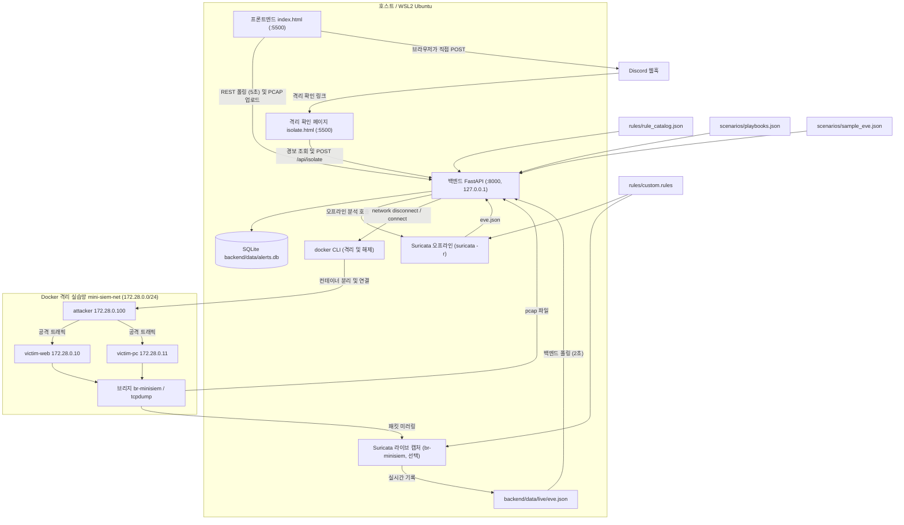
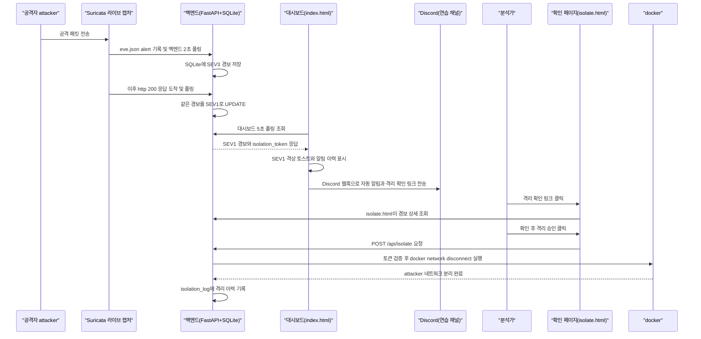

<div align="center">

# 🏗️ Mini-SIEM 시스템 아키텍처 (ARCHITECTURE)

**RookiRooki (SK쉴더스 루키즈 07기 04조) 시스템 설계 · 데이터 흐름 · API · DB 스키마 명세**

[구현 현황](#-1-구현-현황) · [시스템 구성](#-2-시스템-구성-요소) · [격리 실습망](#-3-격리-실습망-mini-siem-net) · [데이터 흐름](#-4-핵심-데이터-흐름) · [탐지·파싱 논리](#-5-탐지-시나리오-및-파싱격상마스킹-논리) · [API 명세](#-6-rest-api-명세-10종) · [DB 스키마](#-7-sqlite-데이터베이스-스키마) · [보안 경계](#-8-보안-경계) · [남은 과제](#-10-남은-과제)

</div>

> [!NOTE]
> 이 문서는 RookiRooki Mini-SIEM의 최신 구현 현황, 구성 요소, 실습망, 데이터 흐름, 6종 탐지 논리, API 및 SQLite 스키마를 정리한 기술 명세서입니다.  
> 프로젝트 개요는 [README.md](../README.md), 환경 구축은 [설치_테스트_가이드.md](설치_테스트_가이드.md), 단계별 전체 실습은 [RookiRooki_전체기능_체험_종합명령어.md](RookiRooki_전체기능_체험_종합명령어.md)를 참고하세요.

---

## 📊 1. 구현 현황

| 기능 | 상태 | 요약 |
|---|---|---|
| **6종 시나리오 탐지** | ✅ 구현 | `sqli`(1000001), `xss`(1000002), `bruteforce`(1000003), `portscan`(1000004), `c2_beacon`(1000005), `ssrf`(1000006) |
| **PCAP 업로드 분석** | ✅ 구현 | `POST /api/pcap/upload` — `.pcap`/`.pcapng`(최대 20MB) `suricata -r` 오프라인 분석 및 SHA-256 중복 차단 |
| **샘플 적재** | ✅ 구현 | `POST /api/ingest/sample` — `scenarios/sample_eve.json` 적재 |
| **트리아지 & 오탐(FP) 숨김** | ✅ 구현 | `PATCH /api/alerts/{id}/triage` (`verdict`, `confidence`, `observation`, `assessment`, `analyst`, `action_status`) · 기본 목록·통계에서 FP 제외 (`include_fp=1`로 포함) |
| **민감값 마스킹** | ✅ 구현 | `password`, `passwd`, `pwd`, `token`, `secret` 값을 `[MASKED]`로 자동 치환 (`pii_masked=1`) |
| **OSI 흐름·CLI/분석 명령 안내** | ✅ 구현 *(화면 표시)* | `playbooks.json` 기반 OSI 공격 경로 및 검증·차단·원복·분석 명령어 토큰 해설 표시 |
| **Discord 알림 & SEV1 격상 알림** | ✅ 구현 | 브라우저 탭 세션(`sessionStorage`) 웹훅으로 신규 SEV1 및 SEV3→SEV1 격상 경보(#42) 자동·수동 전송 |
| **라이브 캡처 ingest** | ⚙️ 선택 *(기본 꺼짐)* | `LIVE_CAPTURE_ENABLED=1` — 별도 터미널의 Suricata 라이브 `eve.json`을 백엔드가 2초 주기로 폴링 |
| **승인 기반 컨테이너 격리** | ⚙️ 선택 *(기본 꺼짐)* | `ISOLATION_ENABLED=1` — 1회용 토큰과 `isolate.html` 분석가 승인으로 `attacker`(`172.28.0.100`) 네트워크 분리·수동 해제 |
| **서버 측 호스트 방화벽 실행** | ➖ 미구현 | 임시 차단 안내는 CLI 표시 전용, 실제 차단은 승인 기반 컨테이너 격리로 구현 |

---

## 🧩 2. 시스템 구성 요소

백엔드(`:8000`)와 프론트엔드(`:5500`)는 호스트/WSL에서 실행하고, 공격자와 피해 서버 컨테이너만 격리된 Docker 실습망(`mini-siem-net`)에 배치합니다.



<details>
<summary><b>📋 구성 요소별 위치 및 책임 상세 표 펼치기</b></summary>

| 구성 요소 | 위치 | 책임 |
|---|---|---|
| **`attacker`** | `172.28.0.100` | 실습망 내 6종 시나리오 트래픽 발생 · 승인 기반 격리의 유일한 허용 대상 |
| **`victim-web`** | `172.28.0.10` | 웹 타깃 (SQLi, XSS, SSRF `/fetch` 80/tcp, C2 비콘 수신 8443/tcp) |
| **`victim-pc`** | `172.28.0.11` | SSH 타깃 (22/tcp) 및 포트 스캔 대상 |
| **브리지 `br-minisiem` + `tcpdump`** | 실습망 브리지 | 웹과 SSH 타깃 양쪽 트래픽을 하나의 PCAP 파일/스트림으로 수집 |
| **Suricata (오프라인 / 라이브)** | 호스트 | `rules/custom.rules`(`--runmode single`)로 패킷을 분석해 `eve.json` 생성 |
| **FastAPI 백엔드** | `127.0.0.1:8000` | 업로드·샘플·라이브 폴링, 파싱·마스킹·격상, 트리아지, 격리 토큰 발급 및 `docker` CLI 호출 |
| **SQLite (`alerts.db`)** | `backend/data/alerts.db` | `alerts`, `pcap_uploads`, `ingest_sources`, `ingest_meta`, `isolation_log`, `live_capture_state` 저장 |
| **대시보드 (`index.html`)** | 브라우저 `:5500` | 5초 폴링, 플레이북·분석 명령, 트리아지, 오탐 숨김, 통계·시각화, SEV1 알림, Discord 웹훅 직접 전송 |
| **격리 확인 (`isolate.html`)** | 브라우저 `:5500` | URL fragment로 1회용 토큰을 받아 경보 조회 후, 분석가가 승인 버튼을 누를 때만 격리/해제 API 호출 |
| **`docker` CLI** | 호스트 | 백엔드가 고정 인자 목록으로 호출해 `attacker`를 `mini-siem-net`에서 분리/재연결(`172.28.0.100`) |

</details>

---

## 🧪 3. 격리 실습망 (`mini-siem-net`)

`scenarios/lab/docker-compose.yml`에서 `internal: true`로 외부 인터넷을 차단한 팀 전용 네트워크(`172.28.0.0/24`, 브리지 `br-minisiem`)입니다. 개별 컨테이너가 아닌 **브리지에서 캡처**함으로써 `victim-web`과 `victim-pc` 양쪽 트래픽을 한 번에 수집합니다.

| 공격 (카테고리 / SID) | 출발 | 대상 | 발생 트래픽 |
|---|---|---|---|
| **SQL 인젝션** (`sqli` / `1000001`) | `172.28.0.100` | `victim-web` (`172.28.0.10:80`) | HTTP GET `/login` 등에 SQL 삽입 패턴 전송 |
| **XSS** (`xss` / `1000002`) | `172.28.0.100` | `victim-web` (`172.28.0.10:80`) | HTTP GET `/search?q=` 등에 스크립트·이벤트 핸들러 전송 |
| **SSH 무차별 대입** (`bruteforce` / `1000003`) | `172.28.0.100` | `victim-pc` (`172.28.0.11:22`) | 짧은 시간 동안 22/tcp로 반복 SYN 연결 시도 |
| **포트 스캔** (`portscan` / `1000004`) | `172.28.0.100` | `victim-web`, `victim-pc` | 서비스 포트(`22`, `80`) 외 다수 포트로 연속 SYN 전송 |
| **C2 비콘** (`c2_beacon` / `1000005`) | `172.28.0.100` | `victim-web` (`172.28.0.10:8443`) | 30초 내 8443/tcp로 주기적 반복 연결(5회 이상) |
| **SSRF** (`ssrf` / `1000006`) | `172.28.0.100` | `victim-web` (`172.28.0.10:80`) | HTTP GET `/fetch?url=<내부 주소>` 내부 자원 조회 유도 |

> 문서용 예시 IP가 필요할 때는 RFC 5737 대역(`192.0.2.0/24`, `198.51.100.0/24`, `203.0.113.0/24`)만 사용하며 실공인 IP는 쓰지 않습니다.

---

## 🔄 4. 핵심 데이터 흐름

### 4-1. 라이브 탐지 → SEV1 격상 → Discord 알림 → 승인 기반 격리 시퀀스



### 4-2. PCAP 업로드 및 샘플 적재 (`POST /api/pcap/upload`, `POST /api/ingest/sample`)
1. **파일 검증**: `.pcap`/`.pcapng` 확장자(`400`) 및 최대 20MB 용량(`413`, 초과 시 즉시 삭제)을 스트림으로 검사합니다.
2. **1차 중복 차단**: 스트림 읽기 중 계산한 **SHA-256 해시**가 `pcap_uploads`에 이미 있으면 Suricata를 재실행하지 않고 `alerts_stored: 0`, `duplicate_of`를 즉시 반환합니다.
3. **Suricata 오프라인 실행**: `subprocess.run` 인자 리스트(`shell=False`, `-k none --runmode single`, 타임아웃 120초)로 실행합니다 *(룰 없음 `500`, 바이너리 없음 `503`, 실패 `502`, 시간 초과 `504`)*.
4. **파싱·저장**: `parse_eve`로 매칭·마스킹·SEV1 격상을 적용해 `INSERT OR IGNORE`로 저장하고, `ingest_sources`·`ingest_meta`·`pcap_uploads`를 갱신합니다.
5. **샘플 적재**: `POST /api/ingest/sample`도 `scenarios/sample_eve.json`을 동일한 `ingest_eve` 파이프라인으로 처리합니다 *(파일 없음 `404`)*.

### 4-3. 선택형 라이브 캡처 (`LIVE_CAPTURE_ENABLED=1`)
- **별도 터미널 Suricata 실행**: 백엔드는 `sudo`를 호출하지 않으며, 사용자가 별도 터미널에서 아래 명령으로 브리지를 캡처합니다.
  ```bash
  sudo suricata -i br-minisiem -S rules/custom.rules -l backend/data/live -k none --user $(id -un) --group $(id -gn) 'net 172.28.0.0/24'
  ```
- **2초 폴링 & 오프셋/문맥 관리**: 백엔드 데몬 스레드가 `backend/data/live/eve.json`을 `LIVE_POLL_SECONDS`(기본 2초)마다 최대 8MB(`MAX_BATCH_BYTES`)씩 완성된 줄(`\n`)까지만 읽어 `live_capture_state`에 오프셋을 저장합니다. 파일 초기화·로테이션 시 오프셋을 0으로 되돌리며, 직전 `http` 이벤트 최대 200줄(`http_context`)을 메모리에 유지해 배치 경계 매칭을 보완합니다.
- **실습망 범위 필터**: `src_ip`·`dest_ip`가 모두 `172.28.0.0/24` 안인 경보만 저장하며 범위 밖은 `rows_skipped_out_of_scope`로 집계합니다. *(상세: [live_capture_guide.md](live_capture_guide.md))*

### 4-4. 알림 및 SEV3→SEV1 자동 격상 알림 (#42)
- 라이브 캡처에서 `alert`가 먼저 `SEV3`(`http_status=NULL`)로 저장된 뒤 다음 배치에 `http 200`이 도착하면, `_apply_late_http`가 기존 행을 `SEV1`(`is_confirmed_risk=1`, `http_status=200`)로 `UPDATE`합니다.
- 대시보드는 첫 5초 폴링을 기준선(baseline)으로 삼아 알림을 보내지 않고, 이후 새로 `SEV1`이 된 경보를 감지하면 **① `SEV1 격상` 토스트 표시 → ② 상단 `📜 알림 이력` 기록(토큰·링크 미노출) → ③ 자동 알림 활성화 + 웹훅 입력 시 브라우저에서 Discord로 경보당 1회 직접 POST**합니다.
- `isolation_token`이 있는 SEV1 경보는 Discord embed에 `isolate.html?alert_id=N#token=…` 링크가 자동 포함되며, 기준선 경보와 오탐(`FP`)은 자동 알림에서 제외됩니다.

### 4-5. 선택형 승인 기반 격리 (`ISOLATION_ENABLED=1`)
1. **1회용 토큰 발급**: `SEV1` + `src_ip == 172.28.0.100` + 발생 5분(300초, 시계 오차 60초 허용) 이내 경보에 한해 경보당 1개의 메모리 토큰(1회용, 10분 만료)을 발급합니다.
2. **안전한 확인 페이지(`isolate.html`)**: `#token=...` fragment를 읽자마자 `history.replaceState`로 주소창에서 토큰을 지우고 조회(`GET`)만 수행합니다. 열기만 해서는 절대 격리되지 않습니다.
3. **승인 실행 & 수동 해제**: `[승인(격리 실행)]` 클릭 시 `POST /api/isolate`가 토큰 검증 후 `docker network disconnect mini-siem-net attacker`를 실행하고 `isolation_log`에 기록합니다. 자동 해제 타이머는 없으며 `POST /api/unisolate`로 `172.28.0.100`을 수동 재연결·재확인합니다.

<details>
<summary><b>⚠️ 격리 API 상태 조회 및 주요 HTTP 오류 코드 상세 보기</b></summary>

- **`GET /api/isolation/status`**: 격리 기능이 꺼져 있어도 응답하며 `enabled`, `allowed_ips`, `isolated_ips`, `source`(`docker` 또는 `log`), `docker_error`, `recent`(최대 20건) 반환
- **`403`**: `Isolation is disabled` / `Invalid token` / `Token expired` / `Token already used` / `Target not allowed` (`172.28.0.100` 외 IP 거절)
- **`404`**: `Alert not found` / `Target container not found`
- **`409`**: 컨테이너 미실행 또는 예기치 않은 IP 연결
- **`502` / `503` / `504`**: Docker 명령 실패·미확인(`502`), Docker 미설치·권한 거부(`503`), 타임아웃 10초 초과(`504`)
- 참고 문서: [isolation_criteria.md](../rules/isolation_criteria.md), [isolation_demo_script.md](isolation_demo_script.md)

</details>

---

## 🎯 5. 탐지 시나리오 및 파싱·격상·마스킹 논리

커스텀 룰(`rules/custom.rules`)과 카탈로그(`rules/rule_catalog.json`)가 6종 시나리오를 동등하게 지원합니다.

| 카테고리 / SID | MITRE | 기본 → 격상 | 탐지 관점 | 사용 이벤트 | 오탐·한계 (예시) |
|---|---|---|---|---|---|
| `sqli` / `1000001` | `T1190` | `SEV3` → `SEV1`(200) | URI 따옴표 뒤 `or`/`and`/`\|\|`, 주석(`--`, `#`, `/*`), `union select` | `alert` + `http` | 일반 검색어의 SQL 문구, 이중 URL 인코딩 |
| `xss` / `1000002` | `T1189` | `SEV3` → `SEV1`(200) | URI `<script`, `
<summary><b>⚙️ <code>eve.json</code> 파싱 · 짝 매칭 · 중복 방지 · Blind 룰 상세 알고리즘 펼치기</b></summary>

1. **NDJSON 파싱**: 빈 줄은 무시하고 JSON 오류·비객체 줄은 건너뛰어 `skipped`에 집계합니다. `event_type == "alert"`이고 `signature_id`가 `1000001`~`1000006`인 항목만 채택합니다.
2. **`alert` ↔ `http` 정밀 짝 매칭 (`_events_match`)**:
   - ① `flow_id` 일치 + 양쪽 `tx_id` 존재 시 `tx_id` 일치
   - ② `tx_id`가 없으면 양쪽 `http.url` 일치
   - ③ `alert`에 `flow_id`만 있고 `tx_id`·`http.url`이 모두 비어 있으면, 같은 `flow_id`의 `http`가 파일(또는 배치)에 정확히 1건일 때만 매칭
3. **민감값 마스킹 (`mask_text`)**: `password|passwd|pwd|token|secret`(대소문자 무시)에 대해 쿼리·폼(`key=값`)과 JSON(`"key":"값"`) 형태를 `[MASKED]`로 치환합니다. 경보(`signature`, `raw_url`), 트리아지(`observation`, `assessment`), 플레이북 `analysis`(`title`, `where`, `command`, `tokens`) 전체에 동일 적용합니다.
4. **라이브 후속 `http` 반영 (`_apply_late_http`)**: 이미 저장된 `http_status IS NULL` 웹 경보에 같은 `flow_id`(및 URL 일치 또는 빈 URL)의 후속 `http`가 도착하면 `http_status`와 `severity`(200→`SEV1`, 그 외 `SEV3`)를 `UPDATE`합니다.
5. **2차 DB 중복 방지**: 실행마다 바뀌는 `flow_id`를 제외한 고유 인덱스 `ux_alert_identity_v2`(`timestamp, sid, src_ip, dest_ip, dest_port, raw_url`) + `INSERT OR IGNORE`로 동일 이벤트 중복 저장을 차단합니다.
6. **Blind 룰 계산**: `ingest_eve`가 파일 내 `event_type`을 `suricata_<event_type>` 형태로 `ingest_sources`에 기록하면, `GET /api/stats`가 `rule_catalog.json`의 필수 `data_sources`와 비교해 누락된 규칙을 `blind_rules`로 반환합니다.

</details>

---

## 🔌 6. REST API 명세 (10종)

| 메서드 | 경로 | 용도 | 주요 입력 / 응답 / 오류 |
|---|---|---|---|
| `POST` | `/api/pcap/upload` | PCAP 업로드 및 `suricata -r` 분석 | `.pcap`/`.pcapng`(400), 20MB(413), SHA-256 중복 시 `alerts_stored: 0`·`duplicate_of`; Suricata 503/502/504 |
| `POST` | `/api/ingest/sample` | `scenarios/sample_eve.json` 적재 | 응답: `alerts_stored`, `duplicates_skipped`, `skipped_lines` *(파일 없음 404)* |
| `GET` | `/api/alerts` | 경보 목록 조회 | 쿼리: `severity`, `limit`(1~200, 기본 50), `offset`, `include_fp`(`0`/`1`, 기본 `0`) |
| `GET` | `/api/alerts/{alert_id}` | 경보 단건 상세 조회 | 경보 22개 필드 + `playbook` + 조건 충족 시 `isolation_token` *(없음 404)* |
| `PATCH` | `/api/alerts/{alert_id}/triage` | 트리아지 판정·메모 저장 | `verdict`, `confidence`, `observation`·`assessment`(2000자, 마스킹), `analyst`(50자), `action_status` *(위반 422, 없음 404)* |
| `POST` | `/api/isolate` | *(선택)* 승인 기반 컨테이너 격리 | `ISOLATION_ENABLED=1` 필요(403), `{alert_id, token}` → `{status, ip, container}` |
| `POST` | `/api/unisolate` | *(선택)* 컨테이너 격리 수동 해제 | `ISOLATION_ENABLED=1` 필요(403), `alert_id` 또는 `ip` 중 정확히 하나(422) |
| `GET` | `/api/isolation/status` | 격리 상태 및 최근 이력(최대 20건) | 꺼져 있어도 응답: `enabled`, `allowed_ips`, `isolated_ips`, `source`, `docker_error`, `recent` |
| `GET` | `/api/live/status` | 라이브 캡처 상태 및 시작·중지 명령 | 꺼져 있어도 응답: `enabled`, `eve_path`, `offset`, `last_poll_at`, `rows_stored`, `rows_skipped_out_of_scope`, `last_error`, `start_command`, `stop_command` |
| `GET` | `/api/stats` | 심각도·카테고리 집계, MITRE, Blind 룰 | 쿼리: `include_fp`(`0`/`1`, 기본 `0`) → `total`, `severity_counts`, `category_counts`, `mitre_coverage`, `blind_rules` |

<details>
<summary><b>📄 경보 응답 JSON 22개 키 및 트리아지·오탐(FP) 숨김 동작 보기</b></summary>

- **경보 JSON 22개 키**: `id`, `timestamp`, `sid`, `category`, `signature`, `mitre_id`, `src_ip`, `dest_ip`, `dest_port`, `http_status`, `severity`, `is_confirmed_risk`, `pii_masked`, `raw_url`, `verdict`, `observation`, `assessment`, `confidence`, `analyst`, `action_status`, `isolation_token`, `playbook`
- **트리아지 & 오탐(FP) 숨김**: `verdict`는 `TP`, `FP`, `UNREVIEWED`(화면 표시명 `보류(미확정)`) 3종을 지원합니다. `FP`로 저장된 경보는 기본 목록(`GET /api/alerts`), 통계(`GET /api/stats`), 대시보드 자동 알림에서 제외되며, 화면의 `오탐(FP) 포함해서 보기` 또는 `include_fp=1`로 언제든 다시 조회할 수 있습니다. *(오탐 판단 템플릿: [triage_templates.md](../rules/triage_templates.md))*

</details>

---

## 🗄️ 7. SQLite 데이터베이스 스키마

핵심 경보 테이블(`alerts`)과 격리 감사 로그(`isolation_log`) 구조입니다. 옛 DB에 `analyst`, `action_status` 컬럼이 없으면 서버 시작 시 `ALTER TABLE`로 자동 보정(멱등)됩니다.

```sql
CREATE TABLE IF NOT EXISTS alerts (
    id INTEGER PRIMARY KEY AUTOINCREMENT,
    timestamp TEXT NOT NULL,
    flow_id INTEGER,
    sid INTEGER,
    category TEXT,
    signature TEXT,
    mitre_id TEXT,
    src_ip TEXT,
    dest_ip TEXT,
    dest_port INTEGER,
    http_status INTEGER,
    severity TEXT,
    is_confirmed_risk INTEGER DEFAULT 0,
    pii_masked INTEGER DEFAULT 0,
    raw_url TEXT,
    verdict TEXT DEFAULT 'UNREVIEWED',
    observation TEXT DEFAULT '',
    assessment TEXT DEFAULT '',
    confidence TEXT DEFAULT 'MEDIUM',
    analyst TEXT DEFAULT '',
    action_status TEXT DEFAULT 'NONE'
);

CREATE UNIQUE INDEX IF NOT EXISTS ux_alert_identity_v2 ON alerts(
    timestamp, sid, IFNULL(src_ip,''), IFNULL(dest_ip,''),
    IFNULL(dest_port,-1), IFNULL(raw_url,'')
);

CREATE TABLE IF NOT EXISTS isolation_log (
    id INTEGER PRIMARY KEY AUTOINCREMENT,
    alert_id INTEGER,
    ip TEXT,
    container TEXT,
    action TEXT NOT NULL,     -- 'isolate' | 'unisolate'
    result TEXT NOT NULL,     -- 'ok' | 'fail'
    detail TEXT,
    created_at TEXT NOT NULL  -- UTC ISO 8601
);
```

| 보조 테이블 | 컬럼 (PK 표시) | 용도 |
|---|---|---|
| `pcap_uploads` | `sha256` (PK), `upload_id`, `alerts_stored`, `created_at` | 업로드 PCAP의 SHA-256 해시 기록 및 동일 파일 재분석 차단 |
| `ingest_sources` | `source` (PK) | 마지막 오프라인·샘플 적재 파일의 `suricata_<event_type>` 목록 |
| `ingest_meta` | `key` (PK), `value` | `last_ingest_at` 등 메타데이터 저장 (`blind_rules` 계산 기준) |
| `live_capture_state` | `eve_path` (PK), `offset`, `updated_at` | 라이브 캡처 활성화 시 생성, `eve.json` 읽기 바이트 오프셋 저장 |

<details>
<summary><b>📑 <code>alerts</code> 주요 컬럼 설명 및 카탈로그·플레이북 CLI 구조 펼치기</b></summary>

| 컬럼 | 설명 |
|---|---|
| `category` / `sid` | `sqli`, `xss`, `bruteforce`, `portscan`, `c2_beacon`, `ssrf` / `1000001`–`1000006` (대역 `1000001`–`1000999`) |
| `http_status` / `is_confirmed_risk` | 웹 3종에만 채움(비웹 3종은 `NULL`). 응답 `200`으로 `SEV1` 격상 시 `is_confirmed_risk=1` |
| `pii_masked` / `raw_url` | `signature` 또는 `raw_url` 마스킹 발생 시 `1` / 마스킹된 URL |
| `verdict` / `confidence` | `TP`, `FP`, `UNREVIEWED` / `HIGH`, `MEDIUM`, `LOW` |
| `observation` / `assessment` | 관찰된 사실 / 분석가 추정 (각 2000자, 마스킹 적용, 서로 섞어 쓰지 않음) |
| `analyst` / `action_status` | 담당자명(최대 50자) / `ISOLATED`, `GUIDE_ONLY`, `NONE` *(트리아지 API로만 변경, 격리 API가 자동 변경하지 않음)* |

- **`rules/rule_catalog.json` 키**: `sid`, `category`, `title`, `status`, `mitre_tactic`, `mitre_id`, `base_severity`, `escalated_severity`, `data_sources`, `false_positives`, `validation_pcap`, `notes`
- **`scenarios/playbooks.json` 구조**: 6종 카테고리 키 아래 `name`, `severity`, `description`, `preserve_evidence_first`, 장비별(`linux`, `ufw`) `verify`/`block`/`rollback`, 분석 명령 가이드 `analysis`(`title`, `where`, `command`, `tokens`). 치환 변수 `{{SRC_IP}}`, `{{DEST_IP}}`, `{{DEST_PORT}}` 사용.
  ```text
  verify:    sudo iptables -L INPUT -n | grep {{SRC_IP}}
  block:     sudo iptables -I INPUT -s {{SRC_IP}} -j DROP
  rollback:  sudo iptables -D INPUT -s {{SRC_IP}} -j DROP
  ```
  *(위 CLI는 화면 안내 전용이며 백엔드가 실행하지 않습니다.)*

</details>

---

## 🔒 8. 보안 경계

> [!WARNING]
> 승인 기반 격리(`ISOLATION_ENABLED=1`)를 사용하려면 백엔드 실행 계정이 `docker` 그룹에 속해야 합니다. `docker` 그룹은 사실상 호스트 `root`와 동등한 권한을 가지므로 **반드시 격리된 실습 PC에서만** 사용하세요.

- **실행·네트워크 격리**
  - 모든 공격·캡처는 외부와 차단된 Docker 실습망 `172.28.0.0/24`(`internal: true`) 안에서만 수행합니다.
  - 백엔드는 `127.0.0.1:8000` 단일 프로세스(`--reload`·`--host 0.0.0.0` 미사용) 및 일반 사용자 권한으로 실행합니다. 라이브 Suricata만 별도 터미널에서 `sudo`로 실행하되 `--user`/`--group`으로 일반 사용자 소유 로그를 남깁니다.
  - CORS는 `ALLOWED_ORIGINS`(`http://localhost:5500,http://127.0.0.1:5500`)만 허용하며 `*`는 코드에서 제거합니다.
- **격리 기능 안전장치**
  - 격리 대상은 코드에 하드코딩된 `172.28.0.100`(`attacker`, `mini-siem-net`) 한 대뿐이며 피해 서버·외부 IP는 `403`으로 거절합니다.
  - 1회용 토큰(5분 내 SEV1 발급, 10분 만료)은 서버 메모리에만 보관되며, `isolate.html`은 fragment에서 토큰을 읽자마자 주소창에서 제거합니다.
  - Suricata 및 `docker` 호출은 모두 고정 인자 목록(`shell=False`, `docker` 타임아웃 10초)만 사용합니다.
- **데이터·애플리케이션 보호**
  - Discord 웹훅은 브라우저 탭 세션(`sessionStorage`)에만 보관하며, 원본 `pcap`·라이브 `eve.json`·로컬 DB·웹훅 URL·토큰은 절대 커밋하지 않습니다.
  - SQLite 파라미터 바인딩(`?`), 프론트엔드 DOM 출력 이스케이프, 에러 응답 스택 트레이스 비노출을 준수합니다.

---

## 👥 9. 역할별 책임

| 역할 | 아키텍처 내 책임 |
|---|---|
| **백엔드** | PCAP 업로드(검증·SHA-256 중복 차단)·샘플 적재, 라이브 2초 폴링 및 후속 HTTP 200 갱신, 파싱·마스킹·요청 단위 200 격상, 트리아지·오탐 숨김·통계 API, 1회용 승인 토큰 및 `attacker` 격리·해제 API |
| **프론트엔드** | 관제·통계·시각화 탭, Mock/Live 전환, 5초 폴링, 플레이북·분석 명령 치환/복사, 사실/추정 트리아지 및 오탐 숨김, SEV1 격상 토스트·이력·Discord 웹훅 직접 전송, `isolate.html` |
| **룰** | 6종 `rules/custom.rules` 작성 및 `--runmode single` 검증, `rule_catalog.json`, MITRE 매핑, 우회·오탐 메모, `isolation_criteria.md`, `triage_templates.md` |
| **시나리오** | Docker 실습망(`mini-siem-net`, `br-minisiem`) 구성, 브리지 `tcpdump`·6종 PCAP, `sample_eve.json`, 6종 `playbooks.json`(CLI·`analysis`), 격리·트리아지 시연 대본 |
| **PM** | 심각도·SLA 정책(`policies/`), 통합 QA, 카테고리·SID·API 계약 준수 확인, 선택 기능 운용 및 리허설·발표 관리 |

---

## 🗺️ 10. 남은 과제

현재 구현 범위에서 의도적으로 제외했거나 향후 고도화가 필요한 항목입니다.

| 영역 | 현재 동작 및 남은 과제 |
|---|---|
| **판정·오탐 학습** | `verdict`는 `TP`/`FP`/`UNREVIEWED` 3종만 지원(미탐 `FN`·정미탐 `TN` 미지원). 점수제 오탐 학습(`fp_scores`, `fp-learn` API) 대신 트리아지 `FP` 기본 숨김으로 대응 |
| **격리 확장** | 분석가 수동 승인·수동 해제 및 단일 대상(`172.28.0.100`) 고정. 자동 격리, 다중 컨테이너 격리, 자동 해제 타이머, 호스트 방화벽 실행(`iptables`/`ufw`, `temp_blocks`) 미구현 |
| **토큰·알림·스토리** | 격리 토큰은 서버 메모리 보관(재시작 시 소멸), 알림은 브라우저 직접 전송(서버 측 웹훅 미구현), 공격 스토리는 DB `story_key`/`GET /api/stories` 없이 프론트엔드에서 묶어 표시 |
| **운영 서비스화** | 라이브 캡처 시 사용자가 별도 터미널에서 Suricata를 직접 실행·중지(데몬/서비스화 미구현) |
