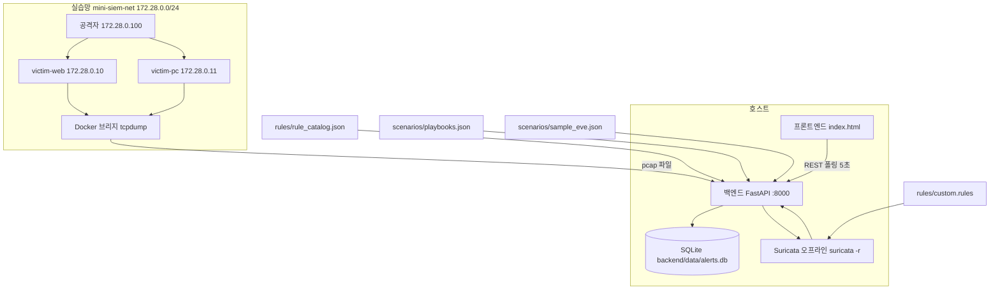
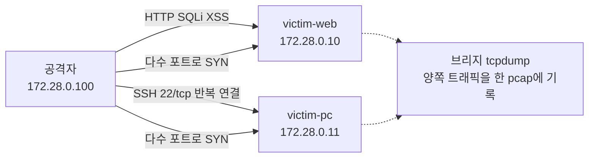
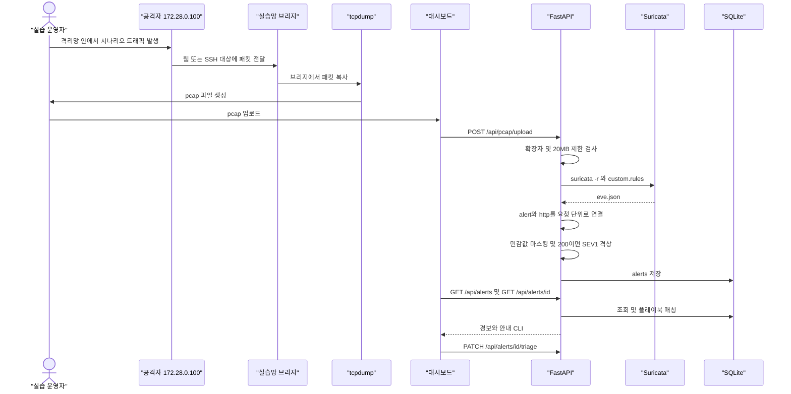
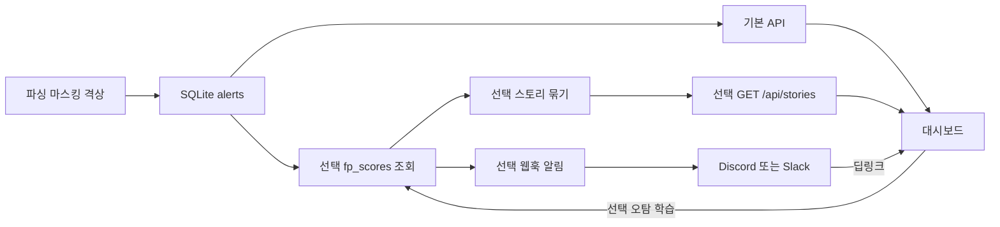

# Mini-SIEM 시스템 구상도

이 문서는 04조 Mini-SIEM의 구성 요소, 실습망, 데이터 흐름, 탐지 규칙, 데이터 저장 구조를 정리합니다. 제품 개요와 일정은 [README.md](../README.md)를 참고하세요. 백엔드(FastAPI)와 프론트엔드(`frontend/index.html`)는 `main`에 구현되어 있으며, 여기서는 팀이 합의한 설계를 정리합니다.

Stage 1(이번 4일)은 격리된 Docker 실습망에서 tcpdump로 녹화된 pcap을 업로드해 Suricata가 오프라인으로 분석하는 경로입니다. Stage 2(브리지에 Suricata를 상시 배치)는 Backlog입니다. 시스템이 차단 명령을 실행하는 기능도 Backlog이며, Stage 1의 차단은 대시보드에 표시하는 명령 안내뿐입니다.

## 1. 구성 요소

백엔드와 프론트엔드는 호스트에서 실행합니다. Suricata는 Stage 1에서 백엔드가 `suricata -r`로 호출하는 오프라인 분석기입니다. 실습 대상과 공격자만 Docker 실습망에 둡니다.



| 구성 | 위치 | 책임 |
|---|---|---|
| 공격자 컨테이너 | `172.28.0.100` | 실습망 안에서만 6종 시나리오 트래픽을 발생 |
| victim-web | `172.28.0.10` | 웹 타깃 (SQL 인젝션, XSS, SSRF(/fetch), C2 비콘 수신 8443/tcp) |
| victim-pc | `172.28.0.11` | SSH 타깃 (22/tcp). 포트 스캔 대상이 될 수 있음 |
| Docker 브리지 + tcpdump | 실습망 브리지 | 웹과 SSH 호스트로 가는 패킷을 한 파일에 녹화 |
| Suricata | 호스트, `suricata -r` | `custom.rules`로 pcap을 읽고 `eve.json` 생성 |
| FastAPI | 호스트 `:8000` | 업로드·샘플 적재, 파싱, 마스킹, 격상, API |
| SQLite | `backend/data/alerts.db` (테이블 `alerts`) | 경보와 트리아지 저장 |
| 대시보드 | 호스트 브라우저 | 경보 목록, 플레이북, 트리아지, 커버리지 |

## 2. 실습망

외부 인터넷을 목적지로 두지 않는 팀 전용 망입니다. 주소는 사설 실습 대역만 사용합니다.



브리지에서 녹화를 하는 이유는, 컨테이너 하나의 네트워크 네임스페이스만 보면 웹 또는 SSH 한쪽만 남을 수 있기 때문입니다. 브리지 트래픽을 저장하면 `172.28.0.10`과 `172.28.0.11`으로 가는 패킷을 같은 pcap에서 분석할 수 있습니다.

문서용 예시 IP가 더 필요하면 RFC 5737 대역만 사용하고, 실제 공인 주소는 쓰지 않습니다.

## 3. Stage 1 데이터 흐름

데모 경로(`POST /api/ingest/sample`)는 미리 준비한 `sample_eve.json`을 같은 파서에 넣습니다. 아래는 본선인 pcap 업로드 경로입니다.



업로드 API는 `.pcap` 또는 `.pcapng`만 받고, 크기는 20MB를 넘지 못하게 합니다. Suricata 호출은 셸 문자열 결합이 아니라 인자 목록으로 실행합니다. Stage 2에서는 이 파서를 그대로 두고, 입력만 실시간 `eve.json`으로 바꿀 수 있게 설계합니다.

## 4. 시나리오별 탐지 논리

룰 문구는 룰 담당자가 `custom.rules`에 작성하고, 메타데이터는 `rule_catalog.json`에 둡니다. 아래는 Stage 1에서 합의한 탐지 관점입니다. MITRE ID는 초안이며 룰 담당자가 검증합니다.

| 키 / SID | 탐지 관점 | 엔진이 쓰는 이벤트 | 오탐·한계 (예시) |
|---|---|---|---|
| `sqli` / 1000001 | HTTP URI 또는 바디에서 SQL 삽입으로 보이는 패턴 | `alert` + 해당 요청의 `http`(상태 코드, URL) | 교육용 SQL 문자열, URL 인코딩 우회. 응답 200일 때만 성공 의심으로 격상 |
| `xss` / 1000002 | HTTP URI 또는 바디에서 스크립트 삽입으로 보이는 패턴 | `alert` + 해당 요청의 `http` | 정상 문서의 코드 예시, 인코딩 우회. 격상 조건은 SQL 인젝션과 동일 |
| `bruteforce` / 1000003 | 짧은 시간 창에서 한 출발지가 `172.28.0.11:22`로 연결을 임계치 이상 반복 | 22/tcp 연결·세션 횟수 (`flow` 또는 threshold 룰). **페이로드는 암호화되어 비밀번호를 보지 않음** | 정상 재시도, 모니터링 점검. HTTP 200 격상 없음 |
| `portscan` / 1000004 | 짧은 시간 창에서 한 출발지가 서로 다른 목적 포트로 SYN을 다수 전송. 목적지 22·80 제외, 샘플은 8080 사용, 룰 `![22,80]` 유지 (2026-11-24 결정 A) | 포트가 다른 SYN·연결 시도의 집계 | 정상 다중 포트 접속. HTTP 200 격상 없음 |
| `c2_beacon` / 1000005 | 실습망 내부 반복 연결 횟수 임계치(threshold 기반). attacker 172.28.0.100에서 victim-web 172.28.0.10:8443/tcp로 가며, 같은 출발지가 30초 안에 5회 연결하면 경보 1회(공격자가 트래픽을 발생시키는 구조 유지) | 연결 횟수 집계 (`alert` 등) | 정상 주기적 폴링. HTTP 200 격상 없음 |
| `ssrf` / 1000006 | 내부 자원 조회를 유도하는 HTTP 요청 패턴. victim-web:80에 GET `/fetch?url=<내부 주소>` 요청 | `alert` + 해당 요청의 `http`(상태 코드, URL) | 정상 내부 링크 참조. 응답 200일 때 SEV1 격상 (sqli/xss와 동일) |

격상 규칙을 다시 적으면 다음과 같습니다.

- SQL 인젝션·XSS·SSRF: `alert`를 **그 공격 요청의** `http` 응답과 맞춥니다. 식별은 `flow_id`를 쓰되, 한 연결에 요청이 여러 개이면 URL 또는 HTTP 트랜잭션까지 같아야 합니다. 그 응답이 200이면 `severity=SEV1`, `is_confirmed_risk=1`. SQL 인젝션·XSS는 403/404 등이면 카탈로그의 `base_severity`(SEV3)를 유지합니다. SSRF는 403이면 경보만 내고 격상하지 않으며(내부 대상이 접속을 거절한 것이지 방어 차단이 아님) 기본 SEV3를 유지하고, 404 동작은 TBD입니다.
- SSH 무차별 대입·포트 스캔·C2 비콘: HTTP 격상을 적용하지 않고 `base_severity`(bruteforce SEV2, portscan SEV3, c2_beacon SEV2)를 유지합니다.
- 저장 전에 URL·로그의 평문 민감값을 `[MASKED]`로 바꿉니다. `pii_masked`를 표시하고, 정책상 최소 SEV2 검토 대상인지 PM 기준을 따릅니다.

`sample_eve.json`은 Suricata NDJSON 형식이며, 웹 시나리오는 같은 요청을 가리키는 `http`와 `alert`를 짝으로 넣습니다. 200 격상 사례와 403/404 시도 사례를 모두 포함하고, 마스킹 시험용 가짜 `password=` 또는 `token=`을 최소 한 건 넣습니다.

## 5. SQLite 스키마

Stage 1의 핵심 테이블은 `alerts`입니다. 트리아지 필드는 팀 가이드와 같습니다. 오탐 학습 점수 테이블은 기본 계약이 아니며, 추가 목표로 넣을 때의 위치는 [7절](#7-추가-목표-확장-지점)을 참고하세요. 자동 차단 이력 테이블은 Backlog입니다.

```sql
CREATE TABLE IF NOT EXISTS alerts (
    id INTEGER PRIMARY KEY AUTOINCREMENT,
    timestamp TEXT NOT NULL,
    flow_id INTEGER,
    sid INTEGER,
    category TEXT,
    signature TEXT,
    mitre_id TEXT,
    src_ip TEXT,
    dest_ip TEXT,
    dest_port INTEGER,
    http_status INTEGER,
    severity TEXT,
    is_confirmed_risk INTEGER DEFAULT 0,
    pii_masked INTEGER DEFAULT 0,
    raw_url TEXT,
    verdict TEXT DEFAULT 'UNREVIEWED',
    observation TEXT DEFAULT '',
    assessment TEXT DEFAULT '',
    confidence TEXT DEFAULT 'MEDIUM',
    analyst TEXT DEFAULT '',
    action_status TEXT DEFAULT 'NONE'
);
```

옛 DB는 서버 시작 시 `ALTER TABLE ... ADD COLUMN`으로 자동 보정됩니다(멱등).

| 컬럼 | 설명 |
|---|---|
| `category` | `sqli`, `xss`, `bruteforce`, `portscan`, `c2_beacon`, `ssrf` 중 하나 |
| `sid` | `1000001`–`1000999` |
| `http_status` | 웹 공격에만 채움. 스캔·SSH는 비울 수 있음 |
| `severity` | `SEV1`–`SEV4` |
| `is_confirmed_risk` | 해당 웹 요청의 응답이 200이면 1 |
| `pii_masked` | 마스킹이 발생하면 1 |
| `raw_url` | 마스킹 이후 URL. SSH·스캔은 비울 수 있음 |
| `verdict` | `TP`, `FP`, `UNREVIEWED` (`UNREVIEWED`의 화면 표시명은 보류) |
| `observation` / `assessment` | 사실 / 추정. 섞어 쓰지 않음 |
| `confidence` | `HIGH`, `MEDIUM`, `LOW` |
| `analyst` | 담당자 이름, 최대 50자 |
| `action_status` | `ISOLATED`, `GUIDE_ONLY`, `NONE` |

`rule_catalog.json` 항목 키는 `sid`, `category`, `title`, `status`, `mitre_tactic`, `mitre_id`, `base_severity`, `escalated_severity`, `data_sources`, `false_positives`, `validation_pcap`, `notes`를 유지합니다. `playbooks.json`의 최상위 키는 여섯 카테고리와 같고, 각 항목에 OSI 설명, 흐름, `preserve_evidence_first`, 장비별 `verify` / `block` / `rollback`을 둡니다. 주소와 포트는 `{{SRC_IP}}`, `{{DEST_IP}}`, `{{DEST_PORT}}`만 사용합니다.

차단 안내 예시는 화면용입니다. 시스템이 실행하지 않습니다.

```text
verify:    sudo iptables -L INPUT -n | grep {{SRC_IP}}
block:     sudo iptables -I INPUT -s {{SRC_IP}} -j DROP
rollback:  sudo iptables -D INPUT -s {{SRC_IP}} -j DROP
```

ufw를 쓰는 환경이면 같은 세 단계(확인·차단·원복)를 플레이북에 병기할 수 있습니다.

## 6. 역할별 책임

| 역할 | 이 구상도에서의 책임 |
|---|---|
| 시나리오 | 실습망 구성, 브리지 tcpdump, 6종 pcap(가능하면 정상/공격 분리), `sample_eve.json`, `playbooks.json` |
| 룰 | 6종 `custom.rules`, 카탈로그, MITRE ID 검증, 우회·오탐 메모, pcap으로 룰 확인 |
| 백엔드 | 업로드·샘플 적재, 파싱, 마스킹, 요청 단위 200 격상, API, Suricata 호출 시 파일 크기·확장자 검사 |
| 프론트엔드 | 목록·상세, Mock/Live, 플레이북 치환과 복사, 사실/추정 트리아지, 커버리지 표시. 차단 버튼으로 호스트 명령을 실행하지 않음 |
| PM | SLA와 QA, 키·SID 계약 준수 확인, 시연 범위가 Stage 1을 넘지 않게 관리 |

백엔드와 프론트는 구현 시작 전에 이 문서의 API와 `alerts` 컬럼을 기준으로 맞춥니다. 카테고리 키나 SID를 바꿔야 하면 백엔드와 PM을 거쳐 가이드·프롬프트까지 함께 수정합니다.

## 7. 추가 목표 확장 지점

이 절의 테이블과 API는 **추가 목표 — 기본 계약 아님**입니다. Stage 1 기본 흐름은 3절까지이며, 발표 차별화 4개는 README의 핵심 기능을 유지합니다. 상세 동작·가드레일·착수 조건은 [README 추가 목표](../README.md#추가-목표-stretch-goals-시간-남으면)를 따릅니다. 기본 기능이 끝난 뒤, Day 3 18:00 동결 전에만 연결합니다.

추가 모듈이 붙는 위치는 파서가 `alerts`에 저장한 이후입니다.



| 확장 | 연결 지점 | 선택 스키마·API | 하지 않는 것 |
|---|---|---|---|
| 알림봇 | 저장 직후, `SIEM_WEBHOOK_URL`이 있을 때만 | 전용 테이블 없음. 딥링크는 대시보드 경보 상세 | 웹훅 URL 하드코딩. 임시 대응의 실제 차단 실행 |
| 오탐 학습 | 저장 후 알림 직전 점수 조회, 상세 화면 버튼 | 테이블 `fp_scores`(`composite_key`, `sid`, `src_ip`, `uri_path`, `score`, `updated_at`). `POST /api/alerts/{id}/fp-learn` | 200 OK SEV1 알림 생략. 다른 `src_ip` 점수 변경. 경보 삭제 |
| 공격 스토리 | 목록과 별도 조회 | 선택 컬럼 `alerts.story_key`. `GET /api/stories` | 무관한 IP간 묶기 |
| 명령어 해설 | 기존 `GET /api/alerts/{id}`의 `playbook` | 플레이북에 분석 명령·토큰 해설. 새 테이블 없음 | 명령 자동 실행 |

실제 방화벽 실행과 `temp_blocks` 테이블은 Backlog입니다.
