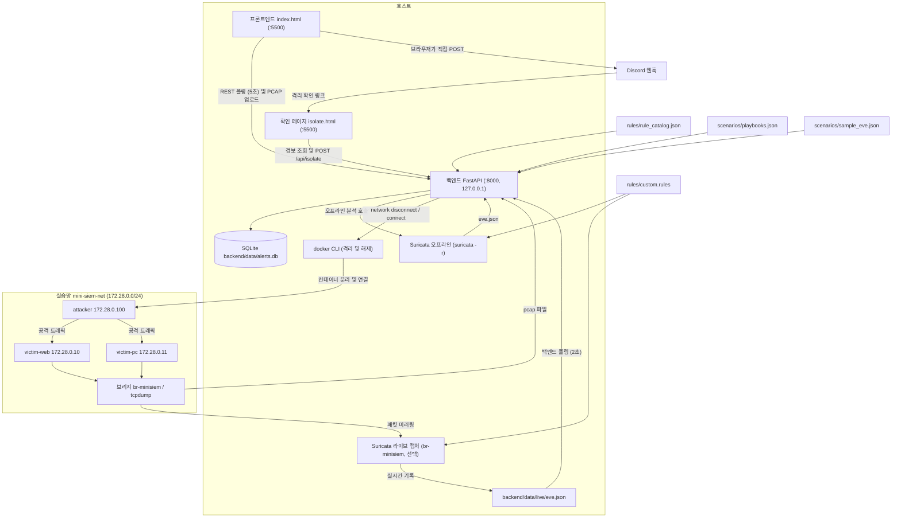
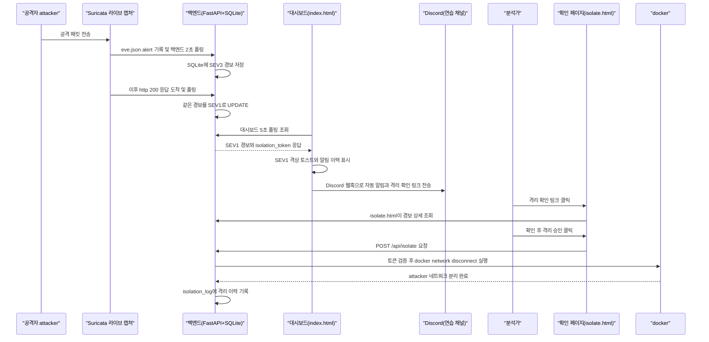

# Mini-SIEM 시스템 구상도

이 문서는 04조 Mini-SIEM(`main b452fec`, #42까지 반영 기준)의 구현 현황, 구성 요소, 실습망, 데이터 흐름, 6종 시나리오 탐지 논리, API 및 SQLite 스키마를 정리합니다. 프로젝트 개요는 [README.md](../README.md), 환경 구축과 기본 검증은 [설치_테스트_가이드.md](설치_테스트_가이드.md), 단계별 전체 실습은 [RookiRooki_전체기능_체험_종합명령어.md](RookiRooki_전체기능_체험_종합명령어.md)를 참고하세요. 패킷 분석은 PCAP 오프라인 업로드와 선택형 라이브 캡처(`LIVE_CAPTURE_ENABLED=1`)를 모두 지원하며, 임시 차단 안내는 CLI 표시, 격리는 승인 기반 구현으로 동작합니다.

## 1. 구현 현황

| 기능 | 상태 | 비고 |
|---|---|---|
| 6종 시나리오 탐지 | 구현 | `sqli`(1000001), `xss`(1000002), `bruteforce`(1000003), `portscan`(1000004), `c2_beacon`(1000005), `ssrf`(1000006) |
| PCAP 업로드 분석 `POST /api/pcap/upload` | 구현 | `.pcap`/`.pcapng`(최대 20MB) 업로드 후 `suricata -r` 오프라인 분석 및 SHA-256 중복 방지 |
| 샘플 적재 | 구현 | `POST /api/ingest/sample`로 `scenarios/sample_eve.json` 적재 |
| 라이브 캡처 | 선택 (`LIVE_CAPTURE_ENABLED=1`, 기본 꺼짐) | 별도 터미널의 Suricata 라이브 `eve.json`을 백엔드가 2초 주기로 폴링 |
| 트리아지 | 구현 | `PATCH /api/alerts/{alert_id}/triage` (`verdict`, `confidence`, `observation`, `assessment`, `analyst`, `action_status`) |
| 오탐(FP) 숨김 | 구현 | 기본 목록·통계에서 제외, `include_fp=1`로 포함 |
| Discord 알림 | 구현 | 프론트엔드가 브라우저에 입력한 웹훅으로 전송(웹훅 주소는 브라우저 탭 세션에만 저장) |
| SEV3→SEV1 격상 자동 알림 | 구현 (#42) | 라이브 후속 HTTP 200 응답으로 SEV1 격상 시 토스트·알림 이력·Discord 자동 알림 |
| 승인 기반 격리 | 선택 (`ISOLATION_ENABLED=1`, 기본 꺼짐) | 1회용 토큰과 `isolate.html` 분석가 승인으로 `attacker`(`172.28.0.100`) 네트워크 분리·해제 |
| 마스킹 | 구현 | `password`, `passwd`, `pwd`, `token`, `secret` 값을 `[MASKED]`로 치환 (`pii_masked=1`) |
| OSI 흐름·CLI 안내 | 구현 (화면 표시만) | `playbooks.json` 기반 OSI 공격 경로 및 검증·차단·원복·분석 명령 화면 표시 |
| 서버 측 호스트 방화벽 실행 | 미구현 | 임시 차단 안내는 CLI 표시, 격리는 승인 기반 구현 |

## 2. 구성 요소

백엔드와 프론트엔드는 호스트에서 실행하고, 실습 대상과 공격자 컨테이너만 격리된 Docker 실습망(`mini-siem-net`)에 배치합니다. Suricata는 PCAP 업로드 시 백엔드가 `suricata -r`로 호출하는 오프라인 분석 경로와, 선택 기능(`LIVE_CAPTURE_ENABLED=1`)으로 브리지 `br-minisiem`을 실시간 캡처해 `backend/data/live/eve.json`에 기록하는 경로를 갖습니다.



| 구성 | 위치 | 책임 |
|---|---|---|
| 공격자 컨테이너 (`attacker`) | `172.28.0.100` | 실습망 안에서만 6종 시나리오 트래픽을 발생시키며 승인 기반 격리의 유일한 허용 대상 |
| `victim-web` | `172.28.0.10` | 웹 타깃 (SQL 인젝션, XSS, SSRF `/fetch` 80/tcp, C2 비콘 수신 8443/tcp) |
| `victim-pc` | `172.28.0.11` | SSH 타깃 (22/tcp) 및 포트 스캔 대상 |
| Docker 브리지 + `tcpdump` | 실습망 브리지 (`br-minisiem`) | 웹과 SSH 호스트로 오가는 양쪽 트래픽을 한 pcap 파일에 녹화 |
| Suricata 오프라인 (`suricata -r`) | 호스트 | 업로드된 pcap을 `rules/custom.rules`(`--runmode single`)로 분석해 `eve.json` 생성 |
| Suricata 라이브 캡처 (선택) | 호스트 (`br-minisiem`) | 별도 터미널에서 실습망 트래픽을 실시간 분석해 `backend/data/live/eve.json`에 기록 |
| FastAPI 백엔드 | 호스트 `127.0.0.1:8000` | 업로드·샘플 적재, 라이브 `eve.json` 2초 폴링, 파싱·마스킹·격상, 트리아지, 격리 토큰 발급 및 `docker` CLI 호출 |
| SQLite | `backend/data/alerts.db` | 경보(`alerts`), 업로드 해시(`pcap_uploads`), 적재 출처(`ingest_sources`, `ingest_meta`), 격리 이력(`isolation_log`), 라이브 오프셋(`live_capture_state`) 저장 |
| 대시보드 (`frontend/index.html`) | 호스트 브라우저 (`:5500`) | 5초 주기 경보 폴링, 플레이북·분석 명령 안내, 트리아지, 오탐 숨김, 통계·시각화, SEV1 격상 알림, Discord 웹훅 직접 전송 |
| 격리 확인 페이지 (`frontend/isolate.html`) | 호스트 브라우저 (`:5500`) | URL fragment로 1회용 토큰을 받아 경보를 조회하고 분석가가 승인 버튼을 누를 때만 `POST /api/isolate` 및 해제 호출 |
| Discord 웹훅 | 외부 연습 채널 | 프론트엔드 브라우저가 직접 전송한 고위험 경보 카드와 격리 확인 페이지 링크 수신 |
| `docker` CLI | 호스트 | 백엔드가 고정 인자 목록으로 호출하여 `attacker` 컨테이너를 `mini-siem-net`에서 분리하거나 `172.28.0.100`으로 재연결 |

## 3. 실습망

실습망 `mini-siem-net`(`172.28.0.0/24`)은 `docker-compose.yml`에서 `internal: true`로 설정되어 외부 인터넷을 목적지로 두지 않는 팀 전용 격리 네트워크입니다. 브리지 인터페이스 이름은 `br-minisiem`으로 고정하며, 주소는 공격자 `172.28.0.100`(`attacker`), 웹 타깃 `172.28.0.10`(`victim-web`), SSH 타깃 `172.28.0.11`(`victim-pc`)만 사용합니다.

| 공격 | 출발 | 대상 | 트래픽 |
|---|---|---|---|
| SQL 인젝션 (`sqli`, 1000001) | `attacker` (`172.28.0.100`) | `victim-web` (`172.28.0.10:80`) | HTTP GET `/login` 등에 SQL 삽입 패턴 전송 |
| XSS (`xss`, 1000002) | `attacker` (`172.28.0.100`) | `victim-web` (`172.28.0.10:80`) | HTTP GET `/search?q=` 등에 스크립트 태그·이벤트 핸들러 전송 |
| SSH 무차별 대입 (`bruteforce`, 1000003) | `attacker` (`172.28.0.100`) | `victim-pc` (`172.28.0.11:22`) | 짧은 시간 동안 22/tcp로 반복 연결(SYN) 시도 |
| 포트 스캔 (`portscan`, 1000004) | `attacker` (`172.28.0.100`) | `victim-web` (`172.28.0.10`), `victim-pc` (`172.28.0.11`) | 서비스 포트(22, 80) 외 다수 목적지 포트로 SYN 패킷 연속 전송 |
| C2 비콘 (`c2_beacon`, 1000005) | `attacker` (`172.28.0.100`) | `victim-web` (`172.28.0.10:8443`) | 8443/tcp로 주기적 반복 연결(30초 안 5회 SYN) |
| SSRF (`ssrf`, 1000006) | `attacker` (`172.28.0.100`) | `victim-web` (`172.28.0.10:80`) | HTTP GET `/fetch?url=<내부 주소>`로 내부 자원 조회 유도 |

브리지(`br-minisiem`)에서 패킷을 녹화하거나 캡처하는 이유는, 개별 컨테이너 하나의 네트워크 네임스페이스만 보면 웹(`172.28.0.10`) 또는 SSH(`172.28.0.11`) 한쪽 트래픽만 남을 수 있기 때문입니다. 브리지 트래픽을 수집하면 두 타깃으로 가는 패킷을 한 파일과 한 스트림에서 함께 분석할 수 있습니다.

문서용 예시 IP가 더 필요하면 RFC 5737 대역(`192.0.2.0/24`, `198.51.100.0/24`, `203.0.113.0/24`)만 사용하고, 실제 공인 주소는 쓰지 않습니다.

## 4. 데이터 흐름

### 4-1. PCAP 업로드 분석

1. 실습 운영자가 격리 실습망 브리지에서 `tcpdump`로 녹화한 패킷 파일을 대시보드 또는 `POST /api/pcap/upload`로 업로드합니다.
2. 백엔드는 파일 확장자가 `.pcap` 또는 `.pcapng`인지 검사하고(위반 시 `400`), 스트림을 읽으면서 크기가 20MB를 넘으면 즉시 파일을 지우고 `413 Upload too large`를 반환합니다.
3. 파일을 읽는 동시에 계산한 SHA-256 해시를 SQLite `pcap_uploads` 테이블에서 조회합니다. 이미 분석한 파일이면 Suricata를 재실행하지 않고 임시 파일을 정리한 뒤 `alerts_stored: 0`과 기존 `upload_id`를 담은 `duplicate_of`를 반환합니다.
4. 새 파일이면 백엔드가 `suricata -r <pcap> -S rules/custom.rules -l <outdir> -k none --runmode single`을 인자 목록(`subprocess.run`, 셸 문자열 결합 없음)으로 호출합니다. `rules/custom.rules`가 없으면 `500`, Suricata 실행 파일이 없으면 `503`, 반환 코드가 0이 아니면 `502`, 시간 초과(기본 120초)면 `504`를 반환합니다.
5. 생성된 `eve.json`을 `parse_eve`로 파싱하여 같은 요청의 `alert`와 `http`를 연결하고, 민감값 마스킹(`[MASKED]`)과 HTTP 200 응답 기준 `SEV1` 격상을 적용합니다.
6. 결과를 SQLite `alerts`에 `INSERT OR IGNORE`로 저장하고, 파일 내 `event_type` 목록을 `ingest_sources`에, 적재 시각을 `ingest_meta`에, 파일 해시를 `pcap_uploads`에 기록합니다.
7. 샘플 적재 엔드포인트 `POST /api/ingest/sample`도 미리 준비된 `scenarios/sample_eve.json`을 동일한 `ingest_eve`(`parse_eve`) 파서에 넣어 같은 규칙으로 저장합니다(샘플 파일이 없으면 `404`).

### 4-2. 라이브 캡처 (선택)

`LIVE_CAPTURE_ENABLED=1`을 지정해 백엔드를 실행했을 때만 동작하며 기본값은 꺼짐입니다.

- **Suricata 별도 실행**: 백엔드 자체는 `sudo`를 호출하거나 Suricata 프로세스를 시작·중지하지 않습니다. 사용자가 별도 터미널에서 아래 명령으로 브리지를 실시간 캡처합니다.
  ```bash
  sudo suricata -i br-minisiem -S rules/custom.rules -l backend/data/live -k none --user $(id -un) --group $(id -gn) 'net 172.28.0.0/24'
  ```
- **주기적 폴링과 오프셋 관리**: 백엔드 데몬 스레드가 `backend/data/live/eve.json`(`LIVE_EVE_PATH`)을 `LIVE_POLL_SECONDS`(기본 2초)마다 폴링합니다. 읽은 바이트 위치(`offset`)는 SQLite `live_capture_state` 테이블에 저장하며, 파일 크기가 저장된 `offset`보다 작아지면(파일 초기화·로테이션) `offset`을 0으로 되돌리고 메모리 문맥을 비웁니다.
- **배치 읽기와 문맥 재사용**: 한 번에 최대 8MB(`MAX_BATCH_BYTES`)까지 읽되 마지막 줄바꿈(`\n`)이 완성된 줄까지만 잘라 처리하고, 쓰이는 중인 미완성 줄은 다음 폴링까지 대기합니다. 배치 경계에서 `http`와 `alert`가 나뉘는 경우를 보완하기 위해 직전 `http` 이벤트 최대 200줄을 메모리 큐(`http_context`)에 유지해 배치 앞에 붙여 파싱합니다.
- **실습망 범위 필터와 상태 조회**: `src_ip`와 `dest_ip`가 모두 `172.28.0.0/24` 안에 있는 경보만 `alerts`에 저장하고, 범위 밖 경보는 건너뛰며 `rows_skipped_out_of_scope`만 증가시킵니다. 현재 폴링 상태와 안내 명령은 `GET /api/live/status`로 조회합니다. 자세한 절차는 [live_capture_guide](live_capture_guide.md)를 참고하세요.

### 4-3. 알림과 SEV3→SEV1 자동 알림 (#42)

라이브 캡처에서는 Suricata가 요청 시점의 `alert`를 응답 시점의 `http`보다 먼저 기록할 수 있습니다. 이 경우 경보는 첫 폴링에서 `http_status=NULL`, 심각도 `SEV3`로 먼저 저장되고, 뒤늦게 도착한 `http` 200 이벤트가 다음 폴링의 `_apply_late_http`를 통해 같은 경보 행을 `UPDATE`하여 `SEV1`(`is_confirmed_risk=1`, `http_status=200`)로 격상합니다.

대시보드(`frontend/index.html`)는 5초마다 `GET /api/alerts`를 폴링하며 다음과 같이 알림을 처리합니다.

- 첫 폴링 응답은 기존 경보 기준선(baseline)으로만 기록하고 알림을 보내지 않습니다.
- 이후 폴링에서 새로 `SEV1`이 된 경보를 감지하면:
  1. 새 경보 ID가 아니라 기존 경보가 격상된 경우 `SEV1 격상` 토스트를 화면에 띄웁니다.
  2. 상단 `📜 알림 이력`에 `🚨 [SEV1 격상] 고위험 경보` 줄을 남깁니다(알림 이력에는 격리 링크나 토큰을 표시하지 않습니다).
  3. 자동 알림 설정(브라우저 `sessionStorage` 설정)이 켜져 있고 웹훅 주소가 입력되어 있으면, 브라우저가 Discord 웹훅으로 `🚨 [자동 알림] 고위험 경보 탐지` 메시지를 경보당 한 번 직접 POST합니다.
- 해당 경보가 `SEV1`이고 응답에 `isolation_token`이 들어 있으면 Discord embed에 `격리 확인` → `[확인 페이지 열기]`(`isolate.html?alert_id=N#token=…`) 링크가 자동으로 붙습니다.
- 첫 폴링부터 이미 `SEV1`이던 기준선 경보와 오탐(`FP`)으로 판정된 경보는 자동 알림 대상이 아닙니다.
- 자동 알림이 꺼져 있거나 재전송이 필요할 때는 경보 상세의 수동 `🔔 알림 전송` 버튼을 대체 수단으로 사용합니다. 웹훅 주소를 입력하지 않으면 웹 화면(토스트·알림 이력)에만 출력합니다. 자세한 실습 절차는 [전체기능 체험 Part 6](RookiRooki_전체기능_체험_종합명령어.md#part-6-알림과-승인-기반-격리)을 참고하세요.

### 4-4. 승인 기반 격리 (선택)

`ISOLATION_ENABLED=1`일 때만 동작하며 기본값은 꺼짐입니다.

1. **토큰 발급**: `SEV1` 경보이면서 `src_ip`가 `172.28.0.100`이고 경보 시각이 현재로부터 5분(300초) 이내(시계 오차 60초 허용)이면, `GET /api/alerts` 및 `GET /api/alerts/{id}` 응답의 `isolation_token` 필드에 토큰을 발급합니다. 토큰은 경보당 하나만 생성되며 서버 메모리에만 보관되고, 1회용·10분(600초) 만료 규칙을 따릅니다.
2. **확인 페이지 조회**: 분석가가 Discord 링크로 `isolate.html`을 열면, 스크립트가 URL fragment(`#token=...`)에서 토큰을 읽은 즉시 `history.replaceState`로 주소창에서 토큰을 지우고 `GET /api/alerts/{id}`와 `GET /api/isolation/status`만 조회합니다. 확인 페이지를 열기만 해서는 절대 격리가 실행되지 않습니다.
3. **승인 및 격리 실행**: 분석가가 `승인(격리 실행)` 버튼을 누르면 `POST /api/isolate {alert_id, token}`을 호출합니다. 백엔드는 경보 존재 여부와 허용 대상(`172.28.0.100` → `attacker`)을 확인하고, 토큰을 검증한 뒤 `docker inspect` → `docker network disconnect mini-siem-net attacker` → 연결 해제 재확인 순서로 실행하고 토큰을 소모 처리한 다음 SQLite `isolation_log`에 기록합니다.
4. **수동 해제**: 자동 해제 타이머는 없으며, 확인 페이지의 `격리 해제` 버튼 또는 `POST /api/unisolate`(`alert_id` 또는 `ip` 중 하나)를 호출하면 `docker network connect --ip 172.28.0.100 mini-siem-net attacker`로 원래 주소를 복구하고 재확인한 뒤 `isolation_log`에 기록합니다.
5. **허용 범위와 상태·오류 코드**: 허용 대상은 `172.28.0.100`(`attacker`) 하나뿐이며 다른 IP는 `403 Target not allowed`로 거절합니다. 상태 조회 `GET /api/isolation/status`는 격리 기능이 꺼져 있어도 응답하며 `enabled`, `allowed_ips`, `isolated_ips`, `source`(`docker` 또는 `log`), `docker_error`, `recent`(최대 20건)를 반환합니다. 주요 오류 코드는 `403`(`Isolation is disabled` / `Invalid token` / `Token expired` / `Token already used` / `Target not allowed`), `404`(`Alert not found` / `Target container not found`), `409`(컨테이너 미실행 또는 예기치 않은 IP 연결), `502`(Docker 명령 실패 또는 격리·복구 미확인), `503`(`Docker unavailable` / `Docker permission denied`), `504`(`Docker timed out`)입니다. 격리 판단 기준은 [isolation_criteria](../rules/isolation_criteria.md), 시연 대본은 [isolation_demo_script](isolation_demo_script.md)를 참고하세요.

### 4-5. 라이브 탐지에서 격리 승인까지



## 5. 시나리오별 탐지 논리

커스텀 룰은 `rules/custom.rules`에, 메타데이터와 오탐 사례는 `rules/rule_catalog.json`에 두며 6종 시나리오를 동등하게 지원합니다.

| 키 / SID | MITRE ID | 기본 심각도 | 격상 | 탐지 관점 | 엔진이 쓰는 이벤트 | 오탐·한계 (예시) |
|---|---|---|---|---|---|---|
| `sqli` / 1000001 | `T1190` | `SEV3` | 응답 200이면 `SEV1` | HTTP URI에서 따옴표 뒤 `or`/`and`/`\|\|`, 주석(`--`, `#`, `/*`), `union select` 등 SQL 삽입 패턴 | `alert` + 해당 요청의 `http`(상태 코드, URL) | 일반 검색어에 `union select`나 따옴표 문장이 포함된 경우, 이중 URL 인코딩 |
| `xss` / 1000002 | `T1189` | `SEV3` | 응답 200이면 `SEV1` | HTTP URI에서 `<script`, `` 형태로 `ingest_sources` 테이블에 저장하고 `ingest_meta`에 `last_ingest_at`을 기록합니다. `GET /api/stats` 호출 시 `rules/rule_catalog.json`의 각 룰 `data_sources` 중 마지막 적재(`ingest_sources`)에 없는 항목이 있으면 `blind_rules`(`sid`, `category`, `title`, `missing_sources`)로 반환합니다.

## 7. API

백엔드가 제공하는 엔드포인트 10개 전체 목록입니다.

| 메서드 | 경로 | 용도 | 비고 |
|---|---|---|---|
| `POST` | `/api/pcap/upload` | PCAP 파일 업로드 및 `suricata -r` 분석 | `.pcap`/`.pcapng`만 허용(400), 20MB 제한(413), SHA-256 중복 시 재분석 없이 `alerts_stored: 0`·`duplicate_of` 반환; Suricata 없음 503, 실패 502, 시간 초과 504 |
| `POST` | `/api/ingest/sample` | 데모용 `scenarios/sample_eve.json` 적재 | 응답: `alerts_stored`, `duplicates_skipped`, `skipped_lines` (파일 없음 404) |
| `GET` | `/api/alerts` | 경보 목록 조회 | 쿼리: `severity`(`SEV1`~`SEV4`), `limit`(1~200, 기본 50), `offset`(기본 0), `include_fp`(`0`/`1`, 기본 `0`); 응답: `items`, `total`, `limit`, `offset` |
| `GET` | `/api/alerts/{alert_id}` | 경보 단건 상세 조회 | 경보 필드 + 매칭된 `playbook` + 조건 충족 시 `isolation_token` (없는 id는 404) |
| `PATCH` | `/api/alerts/{alert_id}/triage` | 트리아지 판정·메모 수정 | `verdict`(`TP`/`FP`/`UNREVIEWED`), `confidence`(`HIGH`/`MEDIUM`/`LOW`), `observation`·`assessment`(각 2000자, 마스킹 적용), `analyst`(50자), `action_status`(`ISOLATED`/`GUIDE_ONLY`/`NONE`); 허용 외 키·값 422, 빈 본문 422, 없는 id 404 |
| `POST` | `/api/isolate` | 승인 기반 컨테이너 격리 실행 | `ISOLATION_ENABLED=1` 필요(꺼짐 403), 본문 `{alert_id, token}`, `172.28.0.100`(`attacker`)만 허용; 응답 `status`, `ip`, `container` |
| `POST` | `/api/unisolate` | 컨테이너 격리 수동 해제 | `ISOLATION_ENABLED=1` 필요(꺼짐 403), 본문 `alert_id` 또는 `ip` 중 정확히 하나(위반 시 422); 응답 `status`, `ip`, `container` |
| `GET` | `/api/isolation/status` | 격리 기능 상태 및 최근 이력 조회 | 꺼져 있어도 응답: `enabled`, `allowed_ips`, `isolated_ips`, `source`(`docker` 또는 `log`), `docker_error`, `recent`(최대 20건) |
| `GET` | `/api/live/status` | 라이브 캡처 상태 및 시작·중지 명령 조회 | 꺼져 있어도 응답: `enabled`, `eve_path`, `offset`, `last_poll_at`, `rows_stored`, `rows_skipped_out_of_scope`, `last_error`, `start_command`, `stop_command` |
| `GET` | `/api/stats` | 전체·심각도·카테고리 집계, MITRE 커버리지, Blind 룰 | 쿼리: `include_fp`(`0`/`1`, 기본 `0`); 응답: `total`, `severity_counts`, `category_counts`, `mitre_coverage`, `blind_rules` |

경보 객체(`GET /api/alerts`의 `items` 원소, `GET /api/alerts/{alert_id}`, `PATCH /api/alerts/{alert_id}/triage` 응답)의 키는 다음 22개입니다.

`id`, `timestamp`, `sid`, `category`, `signature`, `mitre_id`, `src_ip`, `dest_ip`, `dest_port`, `http_status`, `severity`, `is_confirmed_risk`, `pii_masked`, `raw_url`, `verdict`, `observation`, `assessment`, `confidence`, `analyst`, `action_status`, `isolation_token`, `playbook`

## 8. SQLite 스키마

핵심 경보 테이블은 `alerts`이며 중복 적재를 막기 위해 `ux_alert_identity_v2` 고유 인덱스를 생성합니다.

```sql
CREATE TABLE IF NOT EXISTS alerts (
    id INTEGER PRIMARY KEY AUTOINCREMENT,
    timestamp TEXT NOT NULL,
    flow_id INTEGER,
    sid INTEGER,
    category TEXT,
    signature TEXT,
    mitre_id TEXT,
    src_ip TEXT,
    dest_ip TEXT,
    dest_port INTEGER,
    http_status INTEGER,
    severity TEXT,
    is_confirmed_risk INTEGER DEFAULT 0,
    pii_masked INTEGER DEFAULT 0,
    raw_url TEXT,
    verdict TEXT DEFAULT 'UNREVIEWED',
    observation TEXT DEFAULT '',
    assessment TEXT DEFAULT '',
    confidence TEXT DEFAULT 'MEDIUM',
    analyst TEXT DEFAULT '',
    action_status TEXT DEFAULT 'NONE'
);

CREATE UNIQUE INDEX IF NOT EXISTS ux_alert_identity_v2 ON alerts(
    timestamp, sid, IFNULL(src_ip,''), IFNULL(dest_ip,''),
    IFNULL(dest_port,-1), IFNULL(raw_url,'')
);
```

격리·해제 실행 이력은 `isolation_log` 테이블에 남깁니다(승인 토큰 값은 저장하지 않음).

```sql
CREATE TABLE IF NOT EXISTS isolation_log (
    id INTEGER PRIMARY KEY AUTOINCREMENT,
    alert_id INTEGER,
    ip TEXT,
    container TEXT,
    action TEXT NOT NULL,     -- 'isolate' | 'unisolate'
    result TEXT NOT NULL,     -- 'ok' | 'fail'
    detail TEXT,
    created_at TEXT NOT NULL  -- UTC ISO 8601
);
```

보조 테이블 구성은 다음과 같습니다.

| 테이블 | 컬럼 (PK 표시) | 용도 |
|---|---|---|
| `pcap_uploads` | `sha256` (PK), `upload_id`, `alerts_stored`, `created_at` | 업로드한 PCAP 파일의 SHA-256 해시 기록 및 동일 파일 중복 분석 방지 |
| `ingest_sources` | `source` (PK) | 마지막 오프라인·샘플 적재 파일에 포함된 `suricata_<event_type>` 목록 |
| `ingest_meta` | `key` (PK), `value` | `last_ingest_at` 등 적재 메타데이터 저장 (`blind_rules` 계산 기준) |
| `isolation_log` | `id` (PK), `alert_id`, `ip`, `container`, `action`, `result`, `detail`, `created_at` | 컨테이너 격리·해제 시도와 성공/실패 사유 감사 기록 |
| `live_capture_state` | `eve_path` (PK), `offset`, `updated_at` | 라이브 캡처(`LIVE_CAPTURE_ENABLED=1`)를 켰을 때만 생성되며 `eve.json` 읽기 바이트 오프셋 저장 |

옛 DB 파일에 `analyst`, `action_status` 컬럼이 없으면 서버가 시작될 때 `ALTER TABLE alerts ADD COLUMN`으로 자동 보정합니다(멱등).

| 컬럼 | 설명 |
|---|---|
| `category` | `sqli`, `xss`, `bruteforce`, `portscan`, `c2_beacon`, `ssrf` 중 하나 |
| `sid` | `1000001`–`1000006` (커스텀 룰 SID 대역 `1000001`–`1000999`) |
| `http_status` | 웹 공격(`sqli`, `xss`, `ssrf`)에만 채움. `bruteforce`, `portscan`, `c2_beacon`은 비움(`NULL`) |
| `severity` | `SEV1`–`SEV4` |
| `is_confirmed_risk` | 해당 웹 공격 요청의 응답이 200이어서 `SEV1`로 격상되면 `1`, 아니면 `0` |
| `pii_masked` | `signature` 또는 `raw_url`에서 민감값 마스킹이 발생하면 `1` |
| `raw_url` | 마스킹 이후 URL. SSH 무차별 대입·포트 스캔·C2 비콘은 비울 수 있음 |
| `verdict` | `TP`, `FP`, `UNREVIEWED` (`UNREVIEWED`의 화면 표시명은 보류(미확정)) |
| `observation` / `assessment` | 관찰된 사실 / 분석가 추정(각 최대 2000자, 저장 시 마스킹 적용). 서로 섞어 쓰지 않음 |
| `confidence` | `HIGH`, `MEDIUM`, `LOW` |
| `analyst` | 담당자 이름, 최대 50자 |
| `action_status` | `ISOLATED`, `GUIDE_ONLY`, `NONE`. 트리아지 `PATCH /api/alerts/{alert_id}/triage`로만 바꾼다(격리·해제 API는 이 컬럼 값을 자동으로 바꾸지 않는다) |

`rules/rule_catalog.json` 항목 키는 `sid`, `category`, `title`, `status`, `mitre_tactic`, `mitre_id`, `base_severity`, `escalated_severity`, `data_sources`, `false_positives`, `validation_pcap`, `notes`를 유지합니다. `scenarios/playbooks.json`의 최상위 키는 6종 카테고리와 같고, 각 항목에 `name`, `severity`, `description`, `preserve_evidence_first`, 장비별(`linux`, `ufw`) `verify` / `block` / `rollback`, 그리고 6종 모두 구현된 분석 명령 가이드 `analysis`(`title`, `where`, `command`, `tokens` 배열)를 둡니다. 주소와 포트는 `{{SRC_IP}}`, `{{DEST_IP}}`, `{{DEST_PORT}}` 치환 변수를 사용합니다.

이 명령은 화면에 표시만 하며 백엔드는 실행하지 않습니다. 임시 차단 안내는 CLI 표시, 격리는 승인 기반 구현입니다.

```text
verify:    sudo iptables -L INPUT -n | grep {{SRC_IP}}
block:     sudo iptables -I INPUT -s {{SRC_IP}} -j DROP
rollback:  sudo iptables -D INPUT -s {{SRC_IP}} -j DROP
```

`ufw`를 쓰는 환경이면 같은 세 단계(확인·차단·원복)를 플레이북에 병기할 수 있습니다.

## 9. 트리아지와 오탐(FP) 숨김

분석가는 경보 상세 화면 또는 `PATCH /api/alerts/{alert_id}/triage`로 각 경보에 대해 판정(`verdict`: `TP`, `FP`, `UNREVIEWED` — 화면 표시명은 `보류(미확정)`), 신뢰도(`confidence`: `HIGH`, `MEDIUM`, `LOW`), 담당자(`analyst`), 조치 상태(`action_status`: `ISOLATED`, `GUIDE_ONLY`, `NONE`), 그리고 관찰된 사실(`observation`)과 분석가 추정(`assessment`)을 분리해 저장합니다.

`verdict`가 `FP`(오탐)로 저장된 경보는 기본 경보 목록(`GET /api/alerts`), 통계 집계(`GET /api/stats`), 그리고 대시보드 자동 알림에서 제외됩니다. 숨겨진 오탐은 대시보드 목록 상단의 `오탐(FP) 포함해서 보기` 체크박스를 켜거나 API에 `include_fp=1` 쿼리를 전달하면 언제든 다시 조회할 수 있습니다. 시나리오별 오탐 판단 근거와 사실/추정 작성 템플릿은 [triage_templates](../rules/triage_templates.md)를 참고하세요.

## 10. 보안 경계

- **로컬 바인딩 및 단일 프로세스**: 백엔드는 `127.0.0.1`(`--port 8000`)에만 바인딩하며 외부 노출(`--host 0.0.0.0`)과 `--reload`를 사용하지 않습니다. 특히 라이브 캡처나 격리를 켠 서버는 폴링 스레드 중복과 메모리 토큰 유실을 막기 위해 프로세스 1개로만 실행합니다.
- **최소 권한 실행**: 백엔드는 일반 사용자 계정으로 실행하며 `root`나 `sudo`로 실행하지 않습니다. 브리지 캡처 권한이 필요한 Suricata 라이브 캡처만 별도 터미널에서 `sudo`로 시작하되, `--user $(id -un) --group $(id -gn)` 옵션으로 `eve.json`을 일반 사용자 소유로 기록하게 합니다.
- **CORS 제한**: `ALLOWED_ORIGINS` 기본값인 `http://localhost:5500,http://127.0.0.1:5500`만 허용하며 와일드카드(`*`)는 코드에서 제거합니다.
- **격리 대상 하드코딩**: 승인 기반 격리의 대상은 `172.28.0.100`(`attacker` 컨테이너 한 대)과 네트워크 `mini-siem-net`으로 코드에 고정되어 있으며, 피해 서버(`172.28.0.10`, `172.28.0.11`)나 외부 IP는 `403`으로 거절됩니다.
- **1회용 메모리 토큰**: 격리 승인 토큰은 경보 발생 5분 이내의 허용된 `SEV1` 경보에만 발급되며, 1회용·10분 만료 조건으로 서버 메모리에만 존재합니다(서버 재시작 시 모두 소멸). `isolate.html`은 URL fragment에서 토큰을 읽자마자 주소창에서 제거합니다.
- **안전한 프로세스 호출**: 백엔드의 Suricata 및 `docker` 호출은 모두 고정된 인자 목록(`shell=False`, `docker` 타임아웃 10초)을 사용하며 요청 문자열을 셸 명령에 결합하지 않습니다.
- **`docker` 그룹 주의**: 승인 기반 격리를 쓰려면 백엔드 실행 계정이 `docker` 그룹에 속해야 합니다. `docker` 그룹은 사실상 호스트 `root` 권한과 동등하므로 격리된 실습 PC에서만 사용합니다.
- **웹훅·산출물 비공개**: Discord 웹훅 주소는 브라우저 탭 세션(`sessionStorage`)에만 두고 서버·저장소·문서·스크린샷에 남기지 않습니다. 원본 `pcap`, 라이브 `eve.json`, 로컬 DB(`backend/data/`), 웹훅 주소, 격리 토큰은 절대 커밋하지 않습니다.
- **출력 이스케이프·SQL 바인딩·에러 보호**: 프론트엔드는 서버 문자열을 DOM에 넣을 때 이스케이프 처리하고, 백엔드 SQLite 쿼리는 모두 파라미터 바인딩(`?`)만 사용하며, 에러 응답에는 스택 트레이스를 포함하지 않습니다.
- **실습망 격리**: 모든 공격 재현과 패킷 캡처는 외부와 차단된 Docker 실습망 `172.28.0.0/24`(`internal: true`) 안에서만 수행합니다.

## 11. 역할별 책임

| 역할 | 이 구상도에서의 책임 |
|---|---|
| 시나리오 | Docker 실습망(`mini-siem-net`, `br-minisiem`) 구성, 브리지 `tcpdump` 및 6종 pcap 녹화, `scenarios/sample_eve.json`, 6종 `scenarios/playbooks.json`(대응 CLI 및 `analysis` 해설), 격리·트리아지 시연 대본 |
| 룰 | 6종 `rules/custom.rules` 작성 및 `--runmode single` 검증, `rules/rule_catalog.json`, MITRE ID 매핑, 우회·오탐 메모, 격리 판단 기준(`rules/isolation_criteria.md`)과 트리아지 템플릿(`rules/triage_templates.md`) |
| 백엔드 | PCAP 업로드(크기·확장자·SHA-256 중복 검사)·샘플 적재, 라이브 `eve.json` 2초 폴링 및 후속 HTTP 200 갱신, 파싱·마스킹·요청 단위 200 격상, 트리아지·오탐 숨김·통계 API, 1회용 승인 토큰 발급·검증 및 `attacker` 격리·해제 API |
| 프론트엔드 | 실시간 관제·분석 통계 탭, Mock/Live 전환, 5초 폴링, 플레이북·분석 명령 치환과 복사, 사실/추정 트리아지 및 오탐 숨김 토글, SEV1 격상 토스트·알림 이력·브라우저 직접 Discord 웹훅 전송, 격리 확인 페이지(`frontend/isolate.html`) |
| PM | 심각도·SLA 정책과 통합 QA, 카테고리 키·SID·API 계약 준수 확인, 선택 기능(`LIVE_CAPTURE_ENABLED`, `ISOLATION_ENABLED`) 운용 및 리허설·발표 범위 관리 |

백엔드와 프론트엔드는 이 문서의 API와 `alerts` 컬럼 계약을 기준으로 맞춥니다. 카테고리 키나 SID를 바꿔야 하면 백엔드와 PM을 거쳐 카탈로그·플레이북·가이드까지 함께 수정합니다.

## 12. 남은 과제

- **FN/TN 판정 정리**: 현재 동작은 백엔드 `verdict`가 `TP`, `FP`, `UNREVIEWED` 3가지만 허용하며 대시보드의 미탐(FN)·정미탐(TN) 항목은 API 미지원 상태입니다.
- **자동 격리**: 현재 동작은 조회·적재·라이브 폴링이 격리를 자동 실행하지 않으며 반드시 분석가가 `isolate.html`에서 승인 버튼을 눌러야만 격리됩니다.
- **여러 공격자·여러 컨테이너 동시 격리**: 현재 동작은 허용 대상이 `172.28.0.100`(`attacker`) 컨테이너 한 대로 하드코딩되어 있습니다.
- **격리 자동 해제 타이머**: 현재 동작은 격리 후 자동 복구 타이머가 없으며 `POST /api/unisolate` 또는 확인 페이지의 해제 버튼으로 수동 해제합니다(대시보드 상세의 10분 차단 버튼은 화면 시뮬레이션 전용).
- **호스트 방화벽 실행·자동 차단·`temp_blocks` 테이블**: 현재 동작은 임시 차단 안내는 CLI 표시, 격리는 승인 기반 구현으로 되어 있으며 백엔드의 호스트 `iptables`/`ufw` 실행과 `temp_blocks` 테이블은 없습니다.
- **오탐 학습 점수(`fp_scores`, `fp-learn` API)**: 현재 동작은 점수 누적 테이블이나 학습 API 없이 분석가가 트리아지에서 `verdict=FP`로 저장해 기본 목록·통계·자동 알림에서 제외합니다.
- **공격 스토리 묶기(`story_key`, `GET /api/stories`)**: 현재 동작은 DB `story_key` 컬럼이나 전용 API 없이 프론트엔드가 현재 조회된 경보 목록을 출발지·시간 순으로 묶어 시각화 탭에 표시합니다.
- **서버 측 알림 전송**: 현재 동작은 백엔드가 웹훅을 보내지 않고 프론트엔드 브라우저가 탭 세션(`sessionStorage`)에 입력된 웹훅 주소로 직접 전송합니다.
- **Suricata 상시 운영·서비스화**: 현재 동작은 라이브 캡처 시 사용자가 별도 터미널에서 Suricata 명령을 직접 실행하고 중지합니다.
- **토큰 영속화**: 현재 동작은 격리 승인 토큰을 서버 프로세스 메모리에만 보관하므로 백엔드를 재시작하면 기존 토큰이 사라집니다.
