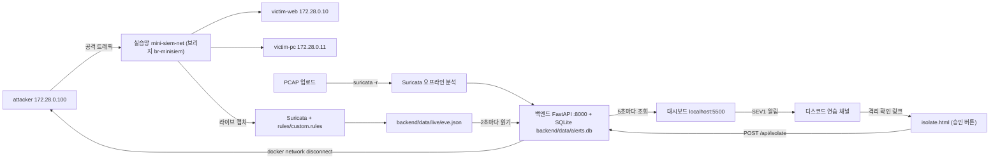

# RookiRooki 미니 SIEM 전체 기능 체험 종합 명령어

> 기준 버전: `Weo0o0/RookiRooki` **main `b452fec`** (#42까지 머지됨)
> 먼저 [설치_테스트_가이드](설치_테스트_가이드.md)로 설치와 기본 동작을 확인한 뒤 진행하세요(이 문서는 설치가 확인된 상태를 가정합니다).
> 순서대로 명령을 붙여 넣기만 하면, 이 프로그램이 **무엇을 하는지**와 **실제로 어떻게 동작하는지**를 화면으로 확인할 수 있게 정리했습니다.
> 모든 공격은 **팀 Docker 실습망 `172.28.0.0/24` 안에서만** 합니다. 다른 주소로 바꾸지 마세요.

---

## 이 프로그램은 무엇인가요? (3줄 요약)

1. 팀 전용 Docker 실습망에서 일어난 공격(웹 해킹, 비밀번호 대입, 포트 스캔 등)을 **Suricata**(네트워크 감시 프로그램)가 잡아냅니다.
2. 백엔드(FastAPI + SQLite)가 그 기록을 읽어 **심각도를 매기고**(응답이 200이면 SEV1로 올림), 비밀번호 같은 값은 **`[MASKED]`로 가립니다**.
3. 웹 대시보드에서 경보, 대응 방법(CLI 안내), 통계와 MITRE 표를 보고 **판정(트리아지)**, **디스코드 알림**, **승인 기반 컨테이너 격리**까지 해 볼 수 있습니다.

## 기능 지도

| 기능 | 어디서 보나 | 몇 단계 |
|---|---|---|
| Mock 모드(백엔드 없이 화면 체험) | 대시보드 오른쪽 위 `Mock 모드` | Part 2 |
| 샘플 로그 적재 | `POST /api/ingest/sample` | Part 3-2 |
| PCAP 업로드 분석 + 룰 검사 | 대시보드 `📁 PCAP 업로드` / `POST /api/pcap/upload` | Part 3-3 ~ 3-5 |
| MITRE 커버리지 · 사각지대(Blind 룰) | `📊 분석 통계` 탭 / `GET /api/stats` | Part 3-6 |
| 라이브 실시간 탐지 | `Live API` + `실시간 캡처 상태` 패널 | Part 4 |
| 200 OK → SEV1 격상 | 경보 목록 심각도, `HTTP Status` | Part 4-6, 4-7, 4-11 |
| `[MASKED]` 마스킹 | 경보 상세 `Raw URL` | Part 4-6 |
| OSI 흐름 · 대응 CLI 안내 | 경보 상세 `대응 플레이북`, `시각화 분석` 탭 | Part 4-6 |
| 트리아지 TP / FP / 보류(미확정) | 경보 상세 `트리아지 분석` / `PATCH /api/alerts/{id}/triage` | Part 5 |
| 오탐(FP) 숨김 | 목록 위 `오탐(FP) 포함해서 보기` 체크 | Part 5-3 |
| 차트 · 시간대 필터 | `📊 분석 통계` 탭 | Part 5-4 |
| 웹 알림 · 디스코드 알림 | `🔔` 알림 설정, `📜 알림 이력`, `🔔 알림 전송` | Part 6-1 ~ 6-3 |
| 승인 기반 격리 / 해제 | 디스코드 `격리 확인` 링크 → `isolate.html` | Part 6-4 ~ 6-8 |
| 보고서 내보내기 | `📄 보고서 내보내기 (.md)` | Part 7 |

## 전체 흐름



## 터미널 역할표

새 Ubuntu 창은 **PowerShell 새 창**에서 아래 명령을 한 번 입력해 Ubuntu로 들어갑니다. 이미 Ubuntu 창이면 이 줄은 건너뜁니다. 이 문서의 나머지 명령은 전부 **Ubuntu 안에서** 입력합니다.

```powershell
wsl -d Ubuntu
```

| 이름 | 하는 일 | `.venv` | 켜 둬야 하나 |
|---|---|---|---|
| **(서버_터미널.1)** | 백엔드 `uvicorn` (:8000), 데이터 백업 | 필요 | 예 (닫으면 백엔드 꺼짐) |
| **(프론트_터미널.2)** | 대시보드 `python3 -m http.server 5500` | 불필요 | 예 |
| **(요청_터미널.3)** | `curl`로 API 확인, 격리 상태 확인 | 불필요 | 계속 재사용 |
| **(attacker_터미널.4)** | 공격 명령 `docker exec attacker ...` | 불필요 | 계속 재사용 |
| **(라이브_터미널.8)** | 실습망 켜기/끄기, Suricata 라이브 캡처(`sudo`) | 불필요 | Suricata 실행 중엔 예 |

> 모든 창은 먼저 `cd ~/RookiRooki`로 저장소 폴더에 들어간다고 가정합니다.
> 백엔드는 **일반 사용자로** 실행합니다(`sudo` 금지). `--host 0.0.0.0`, `--reload`는 쓰지 않습니다.

---

## Part 0. 준비 확인 (처음 한 번)

### 0-1. 프로그램 설치 확인
**(서버_터미널.1)** Ubuntu, `.venv` 불필요
```bash
python3 --version
git --version
docker --version
docker compose version
suricata -V
jq --version
ls -l /etc/suricata/suricata.yaml
id -nG
```
**확인 포인트**
- `python3` 3.10 이상, `suricata -V`에 `This is Suricata version ...`가 나오면 OK.
- `ls -l /etc/suricata/suricata.yaml`이 `-rw-r--r--`가 아니면 PCAP 업로드가 실패하므로 한 번만 실행: `sudo chmod 644 /etc/suricata/suricata.yaml`
- `id -nG` 결과에 `docker`가 있어야 격리 기능이 동작합니다. 없으면 `sudo usermod -aG docker $USER` 후 Ubuntu 창을 모두 닫고 다시 엽니다. (`docker` 그룹은 사실상 관리자 권한이므로 실습 PC에서만 사용)
- 설치가 안 돼 있으면 [설치_테스트_가이드](설치_테스트_가이드.md) 1-2단계, Docker는 [WSL2_Docker_환경구축_종합명령어](../scenarios/lab/WSL2_Docker_환경구축_종합명령어.md) 1~3단계를 먼저 진행합니다.

### 0-2. 최신 main 받기
**(서버_터미널.1)** Ubuntu, `.venv` 불필요
```bash
cd ~/RookiRooki
git checkout main
git pull origin main
git log -n 3 --oneline
```
**확인 포인트**: 맨 위에 `b452fec Merge pull request #41 ...`(또는 그보다 최신)이 보이고, `ls frontend/`에 `isolate.html`과 `mock_demo_data.js`가 있어야 합니다.

### 0-3. 가상환경(.venv)과 패키지
**(서버_터미널.1)** Ubuntu, `.venv` 만들기
```bash
cd ~/RookiRooki
python3 -m venv .venv
source .venv/bin/activate
pip install -r backend/requirements.txt
python -m pytest backend/tests -q
```
**확인 포인트**: 프롬프트 앞에 `(.venv)`가 붙고, 마지막 줄에 `59 passed`가 나오면 정상입니다(경고 1건은 무시).

---

## Part 1. 깨끗한 상태 만들기

이전 실습에서 남은 프로그램과 데이터를 정리합니다. 데이터는 **지우지 않고 백업 폴더로 옮깁니다.**

### 1-1. 남아 있는 프로그램 끄기
**(서버_터미널.1)** Ubuntu, `.venv` 불필요
```bash
pkill -f "uvicorn backend.main:app"
pkill -f "http.server 5500"
sudo pkill -f '^suricata -i br-minisiem'
ss -tlnp | grep -E ':8000|:5500'
```
**확인 포인트**: 마지막 `ss` 명령이 **아무것도 출력하지 않으면** 8000·5500 포트가 비어 있는 것입니다. (`pkill`이 아무 말 없이 끝나도 정상입니다.)

### 1-2. 실습망 내리기
**(라이브_터미널.8)** Ubuntu, `.venv` 불필요
```bash
cd ~/RookiRooki/scenarios/lab
docker compose down
docker ps
```
**확인 포인트**: `docker ps`에 `attacker`, `victim-web`, `victim-pc`가 없어야 합니다.

### 1-3. 데이터 백업 후 비우기
백엔드가 쓰는 데이터는 전부 `backend/data/` 안에 있습니다(`backend/main.py`, `backend/live_capture.py` 기준).

| 경로 | 내용 |
|---|---|
| `backend/data/alerts.db` | 경보·판정·격리 기록 DB (SQLite) |
| `backend/data/live/eve.json` | 라이브 캡처 Suricata 로그 |
| `backend/data/uploads/` | 업로드한 PCAP |
| `backend/data/suricata/` | 업로드 분석 결과 |

**(서버_터미널.1)** Ubuntu, `.venv` 불필요
```bash
cd ~/RookiRooki
TS=$(date +%Y%m%d_%H%M%S)
mkdir -p ~/rooki_backup/$TS
[ -d backend/data ] && mv backend/data ~/rooki_backup/$TS/
ls ~/rooki_backup/$TS
ls backend/data
```
**확인 포인트**
- 마지막 `ls backend/data`가 `No such file or directory`면 깨끗한 상태입니다. 백엔드를 다시 켜면 빈 DB가 새로 만들어집니다.
- `mv`에서 `Permission denied`가 나면(예전에 Suricata를 `--user` 없이 돌려 root 소유 파일이 생긴 경우) 먼저 `sudo chown -R $USER:$USER backend/data` 후 다시 실행합니다.
- 브라우저에 대시보드 탭이 열려 있으면 **닫습니다**(웹훅 주소·알림 이력은 탭을 닫으면 사라집니다).

---

## Part 2. 네트워크 없이 화면 체험 (Mock 모드)

백엔드·Docker 없이 미리 준비된 가짜 데이터로 화면을 둘러봅니다.

### 2-1. 대시보드 켜기
**(프론트_터미널.2)** Ubuntu, `.venv` 불필요
```bash
cd ~/RookiRooki/frontend
python3 -m http.server 5500
```
브라우저에서 **http://localhost:5500** 을 엽니다. (파일을 더블클릭해서 `file://`로 열면 안 됩니다.)

**확인 포인트 (화면에서 볼 것)**
1. 위쪽 배너: `🟡 Mock 데이터 모드로 동작 중입니다.`
2. 오른쪽 위 데이터 선택: `기본 샘플 12건` / `실제 녹화 181건` / `합성 5일 197건`. 바꿔 가며 목록과 차트가 달라지는지 봅니다.
3. `🛡️ 실시간 관제 (SOC)` 탭
   - KPI 카드: `전체 경보`, `고위험 (SEV1~2)`, `확정 위험 (200 격상 등)`, `보류(미확정) (UNREVIEWED)`
   - `공격 카테고리 분포 (6종 + 기타)` 차트
   - `실시간 탐지 경보` 목록: 판정·카테고리(SQLi 1000001 ~ SSRF 1000006)·심각도 필터
4. 경보 하나를 클릭 → 오른쪽 상세
   - `SID`, `HTTP Status`, `출발지 IP`, `목적지`, `Raw URL`(비밀번호는 `[MASKED]`)
   - `대응 플레이북 (CLI 안내용)`: 검증·차단·원복 명령. **자동 실행하지 않고 복사만 합니다.**
   - `분석 명령 안내`
   - `시각화 분석`: `공격 흐름` / `네트워크 구성도` / `OSI 7계층` 탭
   - `승인 기반 임시 대응 (SOAR 시뮬레이션)`: `🛡️ 출발지 IP 차단 시뮬레이션 (10분)`을 눌러도 **실제 차단은 아닙니다**(`시뮬레이션 · 실제 차단 아님` 표시).
5. `📊 분석 통계 (Analytics)` 탭: 종합 현황, `시간대별 경보 타임라인`, `룰별(SID) 정탐 / 오탐 판정 비율`, `MITRE ATT&CK 탐지 커버리지 및 사각지대(Gap)`
6. Mock에서 트리아지를 저장하면 브라우저에만 반영되고 **새로고침하면 사라집니다**(정상).

> 이 창(프론트_터미널.2)은 끝까지 켜 둡니다.

---

## Part 3. PCAP 업로드 분석 (1단계 기능)

녹화해 둔 패킷 파일을 올려서 Suricata가 룰로 검사하는 흐름입니다. 이 Part는 **라이브 기능을 끈 상태**로 진행합니다.

### 3-1. 백엔드 켜기 (기본 모드)
**(서버_터미널.1)** Ubuntu, `.venv` 필요
```bash
cd ~/RookiRooki
source .venv/bin/activate
uvicorn backend.main:app --port 8000
```
**확인 포인트**: `Uvicorn running on http://127.0.0.1:8000`이 보이면 OK. 이 창은 켜 둡니다. 브라우저로 http://localhost:8000/docs 를 열면 API 목록(Swagger)이 보입니다.

### 3-2. 샘플 로그 적재 (가장 쉬운 데모)
**(요청_터미널.3)** Ubuntu, `.venv` 불필요
```bash
cd ~/RookiRooki
curl -sS -X POST http://localhost:8000/api/ingest/sample | python3 -m json.tool
```
**확인 포인트**: `"alerts_stored": 12`. 한 번 더 실행하면 `"alerts_stored": 0`, `"duplicates_skipped": 12`가 나옵니다(중복 방지).

### 3-3. 경보 목록 보기 도구 만들기
아래 두 줄은 **경보 목록을 보기 좋게 출력하는 함수**입니다. 요청_터미널.3 창을 새로 열 때마다 한 번 붙여 넣습니다. (격리용 1회용 토큰은 화면에 찍지 않게 했습니다.)

**(요청_터미널.3)** Ubuntu, `.venv` 불필요
```bash
alerts() { curl -sS "http://localhost:8000/api/alerts?limit=50&include_fp=${1:-0}" | python3 -c "import sys,json
d=json.load(sys.stdin); print('total:', d['total'])
for a in d['items']: print(a['id'], a['sid'], a['category'], a['severity'], 'HTTP', a['http_status'], a['src_ip'], '->', a['dest_ip'], a['verdict'] or 'UNREVIEWED', a['raw_url'] or '')"; }
alerts
```
**확인 포인트**: `total: 12`와 함께 `번호 SID 카테고리 심각도 HTTP 출발지 -> 목적지 판정 URL`이 한 줄씩 나옵니다. sqli 줄의 URL에 `password=[MASKED]`가 보입니다.

### 3-4. 대시보드를 Live API로 전환
브라우저(http://localhost:5500)에서 오른쪽 위 **`Live API`** 를 누릅니다.

**확인 포인트**
- 배너: `🟢 Live API 연결됨 (http://localhost:8000) · 5초 주기 자동 갱신 중`
- 경보 12건, 심각도 **SEV1 3 / SEV2 4 / SEV3 5**

### 3-5. PCAP 업로드 (curl 또는 화면)
저장소에 녹화본이 들어 있습니다: `scenarios/lab/pcaps/` 의 `lab_capture.pcap`, `c2_ssrf.pcap`, `web.pcap`, `ssh.pcap`.

**(요청_터미널.3)** Ubuntu, `.venv` 불필요
```bash
cd ~/RookiRooki
curl -sS -X POST http://localhost:8000/api/pcap/upload -F "file=@scenarios/lab/pcaps/c2_ssrf.pcap" | python3 -m json.tool
alerts
```
또는 화면에서 **`📁 PCAP 업로드`** → `~/RookiRooki/scenarios/lab/pcaps/` 파일 선택.

**확인 포인트**
- 응답에 `upload_id`, `alerts_stored`, `duplicates_skipped`, `skipped_lines`, `duplicate_of`가 나옵니다.
- 빈 DB 기준 기대값([설치_테스트_가이드 8단계](설치_테스트_가이드.md#8-pcap-업로드-테스트-post-apipcapupload)): `c2_ssrf.pcap` 7건, `lab_capture.pcap` 4건, `web.pcap` 1건, `ssh.pcap` 0건. 샘플 12건과 섞여 있으면 숫자는 다를 수 있습니다(같은 공격이 이미 있으면 중복 처리).
- 화면 업로드 시 배너: `✅ '<파일명>' 분석 완료! 경보를 갱신합니다.`
- 같은 파일을 다시 올리면 `alerts_stored: 0`과 `duplicate_of`가 채워집니다(같은 파일 재분석 방지).

> (선택) 룰만 따로 검사하고 싶을 때(백엔드 없이):
> ```bash
> mkdir -p /tmp/suricata_out
> suricata -r scenarios/lab/pcaps/c2_ssrf.pcap -S rules/custom.rules -l /tmp/suricata_out -k none --runmode single
> jq -r 'select(.event_type=="alert") | .alert.signature_id' /tmp/suricata_out/eve.json | sort | uniq -c
> ```
> SID별 탐지 개수가 나옵니다(1000001~1000006).

### 3-6. 통계 · MITRE 커버리지
**(요청_터미널.3)** Ubuntu, `.venv` 불필요
```bash
curl -sS http://localhost:8000/api/stats | python3 -m json.tool
```
**확인 포인트**
- `total`, `severity_counts`, `category_counts`, `mitre_coverage`, `blind_rules`가 나옵니다.
- `mitre_coverage`에 `T1046`, `T1071.001`, `T1110.001`, `T1189`, `T1190` 5개가 보이면 6종 시나리오가 다 들어온 것입니다.
- `blind_rules`: 필요한 로그 종류가 없어서 탐지하지 못하는 룰 목록입니다(빈 DB에 `ssh.pcap`만 올리면 6개가 보임).
- 화면: `📊 분석 통계` 탭 → `MITRE ATT&CK 탐지 커버리지 및 사각지대(Gap)`.

---

## Part 4. 라이브 모드 (실시간 탐지) — 깨끗한 상태에서 시작

### 4-1. Part 3 데이터 정리 (라이브를 빈 DB로 시작)
**(서버_터미널.1)** 에서 `Ctrl+C`로 백엔드를 끈 뒤, Ubuntu, `.venv` 불필요
```bash
cd ~/RookiRooki
TS=$(date +%Y%m%d_%H%M%S)
mkdir -p ~/rooki_backup/$TS
[ -d backend/data ] && mv backend/data ~/rooki_backup/$TS/
mkdir -p backend/data/live
ls -la backend/data/live
```
**확인 포인트**: `backend/data/live` 폴더가 **내 계정 소유로 비어 있으면** OK. (Suricata가 이 폴더에 `eve.json`을 만들고 백엔드가 읽습니다.)
브라우저 대시보드 탭은 닫았다가 http://localhost:5500 으로 **다시 엽니다**(이전 알림 이력 정리).

### 4-2. 실습망 켜기
**(라이브_터미널.8)** Ubuntu, `.venv` 불필요
```bash
cd ~/RookiRooki/scenarios/lab
docker compose up -d --build
docker compose ps
ip link show br-minisiem
docker exec attacker ping -c 2 172.28.0.10
```
**확인 포인트**: `attacker`, `victim-web`, `victim-pc` 3개가 `Up`(victim-web은 `healthy`), `br-minisiem`이 보이고, ping이 `0% packet loss`.

| 컨테이너 | IP | 역할 |
|---|---|---|
| attacker | 172.28.0.100 | 공격자 (격리 대상은 이 한 대뿐) |
| victim-web | 172.28.0.10 | 웹 서버 (sqli, xss, ssrf, c2) |
| victim-pc | 172.28.0.11 | SSH 서버 (bruteforce) |

### 4-3. 백엔드 켜기 (라이브 + 격리 기능 ON)
격리 토큰은 서버 메모리에만 있으므로, Part 6까지 **이 백엔드를 끄지 않고** 계속 씁니다.

**(서버_터미널.1)** Ubuntu, `.venv` 필요
```bash
cd ~/RookiRooki
source .venv/bin/activate
ISOLATION_ENABLED=1 LIVE_CAPTURE_ENABLED=1 uvicorn backend.main:app --port 8000
```
**확인 포인트**: `Uvicorn running on http://127.0.0.1:8000`. (`127.0.0.1`이어야 합니다.)

### 4-4. Suricata 라이브 캡처 시작
**(라이브_터미널.8)** Ubuntu, `.venv` 불필요 (`sudo` 비밀번호 입력)
```bash
cd ~/RookiRooki
sudo suricata -i br-minisiem -S rules/custom.rules -l backend/data/live -k none --user $(id -un) --group $(id -gn) 'net 172.28.0.0/24'
```
**확인 포인트**: 오류 없이 대기 상태가 됩니다. 이 창은 켜 둡니다. (`--user`, `--group` 덕분에 `eve.json`을 백엔드가 읽을 수 있습니다.)

### 4-5. 상태 확인 + 대시보드 Live 전환
**(요청_터미널.3)** Ubuntu, `.venv` 불필요
```bash
curl -sS http://localhost:8000/api/live/status | python3 -m json.tool
curl -sS http://localhost:8000/api/isolation/status | python3 -m json.tool
```
(창을 새로 열었다면 3-3의 `alerts()` 함수를 다시 붙여 넣습니다.)

**확인 포인트**
- live/status: `"enabled": true`, `eve_path`가 `.../backend/data/live/eve.json`, `last_error`가 `null`, `start_command`가 4-4 명령과 같음
- isolation/status: `"enabled": true`, `"allowed_ips": ["172.28.0.100"]`, `"isolated_ips": []`, `"docker_error": null`
- 브라우저에서 **`Live API`** 를 누릅니다 → `실시간 캡처 상태` 패널(EVE 파일 경로, 마지막 폴링, 저장 행 수 등)과 경보 0건이 보이면 OK.
- **반드시 Live API를 켠 다음에 공격합니다.** (처음 받은 목록은 기준선으로만 쓰고, 그 뒤 들어오는 경보부터 토스트 알림이 뜹니다.)

> 이제 공격을 **하나씩** 보내고, 매번 `alerts`와 화면을 확인합니다. 아래 명령은 `scenarios/lab/attacker/lab-traffic.sh`에 들어 있는 명령을 그대로 하나씩 꺼낸 것입니다. 경보가 화면에 뜨기까지 **5~10초** 기다립니다.

### 4-6. 시나리오 ① SQL 인젝션 (SID 1000001, sqli)
**(attacker_터미널.4)** Ubuntu, `.venv` 불필요
```bash
docker exec attacker curl -sS -o /dev/null -w "sqli HTTP %{http_code}\n" "http://172.28.0.10/login?username=admin'%20OR%20'1'='1'--&password=test"
```
**(요청_터미널.3)** 10초 후
```bash
alerts
```
**확인 포인트**
- 공격 창: `sqli HTTP 200` (로그인 우회 성공)
- `alerts`: `1000001 sqli SEV1 HTTP 200 172.28.0.100 -> 172.28.0.10 UNREVIEWED .../login?username=admin...&password=[MASKED]`
- 화면: 오른쪽 아래 토스트, `확정 위험 (200 격상 등)` 카드가 1, 경보 클릭 시
  - `HTTP Status: 200`, 심각도 SEV1 → **200 OK 격상**
  - `Raw URL`에 `password=[MASKED]` → **마스킹**
  - `대응 플레이북 (CLI 안내용)`에 출발지 `172.28.0.100`이 채워진 검증·차단·원복 명령 → **CLI 안내(실행 안 함)**
  - `시각화 분석` → `OSI 7계층`, `공격 흐름`, `네트워크 구성도`
- 처음엔 SEV3로 보였다가 몇 초 뒤 SEV1로 바뀔 수 있으며, 이때 `SEV1 격상` 토스트와 `📜 알림 이력`의 `🚨 [SEV1 격상] 고위험 경보` 줄이 나타납니다(응답 기록이 조금 늦게 도착하면 나중에 갱신하는 구조, [live_capture_guide](live_capture_guide.md) 7절 및 [Part 6-3](#6-3-새-sev1-만들기-격리-링크-받기) 참고).

### 4-7. 시나리오 ② XSS (SID 1000002, xss)
**(attacker_터미널.4)** Ubuntu, `.venv` 불필요
```bash
docker exec attacker curl -sS -o /dev/null -w "xss HTTP %{http_code}\n" "http://172.28.0.10/search?q=%3Cscript%3Ealert(1)%3C/script%3E"
```
**(요청_터미널.3)** 10초 후 `alerts`

**확인 포인트**: 공격 창 `xss HTTP 200`, 목록에 `1000002 xss SEV1 HTTP 200`. 화면에서 MITRE `T1189`, 플레이북 안내 확인.

### 4-8. 시나리오 ③ SSH 무차별 대입 (SID 1000003, bruteforce)
**(attacker_터미널.4)** Ubuntu, `.venv` 불필요
```bash
docker exec attacker hydra -l labuser -P /lab/passwords.txt -t 4 -w 3 ssh://172.28.0.11/
```
**(요청_터미널.3)** 10초 후 `alerts`

**확인 포인트**: 목록에 `1000003 bruteforce SEV2 HTTP None 172.28.0.100 -> 172.28.0.11`. SSH는 암호화돼 비밀번호 내용은 보이지 않고 **짧은 시간 반복 접속 횟수**로 잡습니다. HTTP 200 격상은 적용되지 않습니다.

### 4-9. 시나리오 ④ 포트 스캔 (SID 1000004, portscan)
**(attacker_터미널.4)** Ubuntu, `.venv` 불필요
```bash
docker exec attacker nmap -sS -Pn -T4 -p 1-100 172.28.0.10 172.28.0.11
```
**(요청_터미널.3)** 10초 후 `alerts`

**확인 포인트**: 목록에 `1000004 portscan SEV3`. 화면 MITRE `T1046`.

### 4-10. 시나리오 ⑤ C2 비콘 (SID 1000005, c2_beacon)
**(attacker_터미널.4)** Ubuntu, `.venv` 불필요 (C2는 약 30초 걸림)
```bash
docker exec attacker sh -c 'for i in 1 2 3 4 5; do curl -sS --connect-timeout 2 http://172.28.0.10:8443/health >/dev/null || true; sleep 6; done'
```
**(요청_터미널.3)** 10초 후 `alerts`

**확인 포인트**: 목록에 `1000005 c2_beacon SEV2`. 화면 MITRE `T1071.001`.

### 4-11. 시나리오 ⑥ SSRF (SID 1000006, ssrf)
**(attacker_터미널.4)** Ubuntu, `.venv` 불필요
```bash
docker exec attacker curl -sS -o /dev/null -w "ssrf_success HTTP %{http_code}\n" "http://172.28.0.10/fetch?url=http%3A%2F%2F172.28.0.10%2Fhealth"
docker exec attacker curl -sS -o /dev/null -w "ssrf_failure HTTP %{http_code}\n" "http://172.28.0.10/fetch?url=http%3A%2F%2F172.28.0.11%3A8080%2Fhealth"
```
**(요청_터미널.3)** 10초 후 `alerts`

**확인 포인트**: `1000006 ssrf SEV1 HTTP 200`(성공 요청), `1000006 ssrf SEV3 HTTP 403`(실패 요청). **같은 SSRF라도 200을 받은 것만 SEV1**이 되는 차이를 비교해 보세요.

> 6종을 한 번에 보내려면: `docker exec attacker /lab/lab-traffic.sh` (약 35~45초)

### 4-12. 라이브 결과 한눈에 보기
**(요청_터미널.3)** Ubuntu, `.venv` 불필요
```bash
curl -sS http://localhost:8000/api/live/status | python3 -m json.tool
curl -sS http://localhost:8000/api/stats | python3 -m json.tool
```
**확인 포인트**: live/status의 `rows_stored`가 늘어나 있고, stats의 `category_counts`에 보낸 시나리오가 모두 보입니다. 화면 `📊 분석 통계` 탭의 MITRE 표와 타임라인에도 반영됩니다.

---

## Part 5. 트리아지 (사람이 판정하기)

| 화면 표시 | 저장 값 | 뜻 |
|---|---|---|
| 정탐 (TP) | `TP` | 진짜 공격이 맞음 |
| 오탐 (FP) | `FP` | 잘못 울린 경보 |
| 보류(미확정) | `UNREVIEWED` | 아직 판단 안 함 (기본값) |

> 오탐 근거와 메모 템플릿: [triage_templates](../rules/triage_templates.md)

### 5-1. 화면에서 판정하기
1. 대시보드에서 sqli 경보 클릭 → `트리아지 분석 (Fact vs Assessment 분리)`
2. `판정` = `TP (정탐)`, `신뢰도` = `HIGH (높음)`, `담당자` = 본인 이름, `조치 상태` = `안내만`
3. `관찰된 사실`: 예) `HTTP 200 응답, 로그인 우회 패턴`
4. `분석가 추정`: 예) `SQL 인젝션 성공 가능성 높음`
5. **`트리아지 결과 저장`** 클릭

**확인 포인트**: 목록의 판정 배지가 바뀌고, `보류(미확정)` 카드 숫자가 1 줄어듭니다. 새로고침해도 유지됩니다(DB 저장).

### 5-2. curl로 판정하기
먼저 `alerts`로 판정할 경보 번호(맨 앞 숫자)를 확인합니다. 아래 `<ID>`를 그 숫자로 바꿉니다.

**(요청_터미널.3)** Ubuntu, `.venv` 불필요
```bash
curl -sS -X PATCH http://localhost:8000/api/alerts/<ID>/triage -H "Content-Type: application/json" -d '{"verdict":"FP","confidence":"MEDIUM","analyst":"tester","observation":"실습 트래픽 확인용","assessment":"오탐으로 분류해 봄"}' | python3 -c "import sys,json; a=json.load(sys.stdin); print(a.get('id'), a.get('verdict'), a.get('confidence'), a.get('analyst'), a.get('action_status'))"
```
**확인 포인트**
- 출력 예: `<ID> FP MEDIUM tester NONE`
- 보낼 수 있는 키는 `verdict`(`TP`/`FP`/`UNREVIEWED`), `confidence`(`HIGH`/`MEDIUM`/`LOW`), `observation`, `assessment`, `analyst`(50자 이내), `action_status`(`ISOLATED`/`GUIDE_ONLY`/`NONE`)뿐입니다. 다른 키나 다른 값(예: `"verdict":"FN"`)을 넣으면 **422**가 납니다.
- 보류로 되돌리기: `-d '{"verdict":"UNREVIEWED"}'`

### 5-3. 오탐(FP) 숨김 확인
**(요청_터미널.3)** Ubuntu, `.venv` 불필요
```bash
alerts 0
alerts 1
```
**확인 포인트**: `alerts 0`(기본)에는 FP로 판정한 경보가 **안 보이고**, `alerts 1`에는 보입니다. 화면에서도 목록 위 **`오탐(FP) 포함해서 보기`** 를 켜고 끄면서 같은 차이를 확인합니다. `/api/stats` 집계도 기본은 FP 제외입니다.

### 5-4. 판정이 차트에 반영되는지 보기
`📊 분석 통계` 탭
- `룰별(SID) 정탐 / 오탐 판정 비율`: 정탐·오탐·보류(미확정) 막대. 막대에 마우스를 올리면 오탐률 표시. (미탐·정미탐은 백엔드가 지원하지 않아 항상 0입니다.)
- `시간대별 경보 타임라인`: `분 단위`/`시간 단위`, `최근 3시간`/`24시간`/`7일`/`전체 기간` 바꿔 보기. 시간은 **UTC** 기준이라 한국 시간보다 9시간 빠르게 보입니다.

---

## Part 6. 알림과 승인 기반 격리

> **안전 수칙**
> - 디스코드는 **연습용 채널의 웹훅만** 씁니다. 웹훅 주소는 **대시보드 입력칸에만** 붙여 넣고, 파일·메신저·PR·스크린샷에 남기지 않습니다.
> - SEV1 알림의 `격리 확인` 링크 안에는 **1회용 토큰**이 들어 있습니다(10분 뒤 만료, 한 번 쓰면 끝). 링크를 다른 곳에 옮기지 마세요.
> - 격리 대상은 `attacker(172.28.0.100)` 한 대뿐이고, 최종 판단은 서버가 합니다.
> - `localhost` 링크는 **백엔드를 켠 같은 PC 브라우저에서만** 열립니다(휴대폰 디스코드에서는 안 열림).
> - 시연 대본: [isolation_demo_script](isolation_demo_script.md)

### 6-1. 알림 설정
1. 대시보드 오른쪽 위 **`🔔`(알림 설정) 버튼** 클릭
2. `Discord Webhook URL` 칸에 `<연습용_웹훅_URL>` 붙여 넣기 (비워 두면 웹 화면에만 알림이 남음)
3. `고위험(SEV1) 신규 경보 탐지 시 자동 알림 발송` 체크
4. **`테스트 발송`** → 연습 채널에 테스트 메시지가 오는지 확인 → **`저장`**

**확인 포인트**: 웹훅 주소는 이 브라우저 탭에만 임시 저장됩니다(탭을 닫으면 사라짐).

### 6-2. 수동 알림 보내 보기
경보 하나 클릭 → **`🔔 알림 전송 (웹/디스코드)`** → 상단 **`📜 알림 이력`** 열기

**확인 포인트**: 디스코드 연습 채널에 경보 카드가 오고, `📜 알림 이력`에도 같은 내용이 남습니다. **알림 이력 화면에는 격리 링크·토큰이 나오지 않습니다**(정상).

### 6-3. 새 SEV1 만들기 (격리 링크 받기)
격리 토큰은 **SEV1 + 출발지 172.28.0.100 + 경보 발생 5분 이내**일 때만 나옵니다. 그래서 방금 새 SQL 인젝션을 한 번 더 보냅니다.

**(attacker_터미널.4)** Ubuntu, `.venv` 불필요
```bash
docker exec attacker curl -sS -o /dev/null -w "sqli HTTP %{http_code}\n" "http://172.28.0.10/login?username=admin'%20OR%20'1'='1'--&password=test"
```
**확인 포인트**
- 라이브 경보는 먼저 **SEV3**로 저장된 뒤, HTTP 200 응답 기록이 도착하면 백엔드가 같은 경보를 **SEV1**로 갱신(UPDATE)합니다.
- 이때 대시보드는 (a) **`SEV1 격상`** 제목의 토스트를 띄우고, (b) **`📜 알림 이력`** 에 **`🚨 [SEV1 격상] 고위험 경보`** 줄을 남기며(알림 이력에는 링크나 토큰이 표시되지 않음), (c) 자동 알림 체크박스가 켜져 있고 웹훅이 설정되어 있으면 디스코드 연습 채널에 **`🚨 [자동 알림] 고위험 경보 탐지 [SEV1]`** 메시지를 경보당 정확히 한 번 보내고 맨 아래에 **`격리 확인` → `[확인 페이지 열기]`** 링크를 붙입니다.
- `Live API`를 눌렀을 때 이미 SEV1이었던 경보는 기준선(baseline)이므로 알림이 발송되지 않습니다. 처음부터 SEV1으로 들어온 새 경보 ID는 일반 신규 경보 토스트와 함께 동일한 단일 디스코드 메시지를 보냅니다.
- 디스코드 메시지가 오지 않으면 해당 경보 상세를 열고 **`🔔 알림 전송 (웹/디스코드)`** 를 누릅니다.
- 디스코드에서 **`확인 페이지 열기`** 링크를 클릭하면 같은 PC에서 격리 확인 페이지(`isolate.html`)가 열립니다.
- 경보는 발생 시각까지 비교해 중복을 거르므로(`ux_alert_identity_v2`), 같은 공격을 다시 보내도 **새 경보로 저장**됩니다.

### 6-4. 확인 페이지 보기 (열기만 해서는 아무 일도 없음)
링크를 엽니다 → `isolate.html` (격리 판단 기준: [isolation_criteria](../rules/isolation_criteria.md))

**확인 포인트**
- 경보 요약(번호, 시간, 심각도 SEV1, HTTP 상태 200, 시그니처, `172.28.0.100 → 172.28.0.10:80`)
- 노란 안내: `이 컨테이너를 실습망에서 끊습니다: 172.28.0.100`
- 주소창 끝의 `#token=...`이 **자동으로 지워집니다.**
- 아래쪽: `현재 격리 중: 없음`
- 이 시점에는 **격리되지 않았습니다**(페이지는 조회만 함).

### 6-5. 승인해서 격리하기
**`승인(격리 실행)`** 을 **한 번** 누릅니다.

**확인 포인트 (화면)**: `격리했습니다 (172.28.0.100, attacker)`, `[격리 해제]` 버튼 등장, `현재 격리 중: 172.28.0.100`

**(요청_터미널.3)** Ubuntu, `.venv` 불필요
```bash
docker inspect -f '{{json .NetworkSettings.Networks}}' attacker
docker exec attacker ping -c 2 -W 1 172.28.0.10
curl -sS http://localhost:8000/api/isolation/status | python3 -m json.tool
```
**확인 포인트**
- `docker inspect` 결과가 `{}` → 실습망에서 분리됨
- ping 실패(`Network is unreachable` 또는 `100% packet loss`)
- status: `"isolated_ips": ["172.28.0.100"]`, `recent`에 `isolate` / `ok` 기록

### 6-6. 같은 링크 재사용 → 거절 확인
디스코드의 **같은 링크**를 다시 열고 `승인(격리 실행)`을 누릅니다.

**확인 포인트**: `Token already used — 새 경보 링크로 다시 시도하세요`, 승인 버튼은 다시 켜지지 않습니다(서버 응답 403). 토큰은 1회용입니다.

### 6-7. 격리 해제
6-5 화면의 **`[격리 해제]`** 를 누릅니다. 페이지를 새로고침해서 버튼이 없어졌다면 아래 curl로 해제합니다.

**(요청_터미널.3)** Ubuntu, `.venv` 불필요 (버튼을 못 쓸 때만)
```bash
curl -sS -X POST http://localhost:8000/api/unisolate -H "Content-Type: application/json" -d '{"ip":"172.28.0.100"}' | python3 -m json.tool
```
**확인 포인트**: 화면 `해제했습니다`, 또는 curl 응답 `"status"`, `"ip": "172.28.0.100"`, `"container": "attacker"`.

### 6-8. 해제 후 원래대로 돌아왔는지 확인
**(요청_터미널.3)** Ubuntu, `.venv` 불필요
```bash
docker inspect -f '{{(index .NetworkSettings.Networks "mini-siem-net").IPAddress}}' attacker
docker exec attacker ping -c 2 172.28.0.10
curl -sS http://localhost:8000/api/isolation/status | python3 -m json.tool
```
**확인 포인트**: IP가 **`172.28.0.100` 그대로**, ping `0% packet loss`, `"isolated_ips": []`, `recent`에 `unisolate` / `ok`.

> 해제가 안 됐을 때 수동 복구([backend/README.md](../backend/README.md)):
> ```bash
> docker network connect --ip 172.28.0.100 mini-siem-net attacker
> cd ~/RookiRooki/scenarios/lab && docker compose up -d --force-recreate attacker
> ```

### 6-9. (선택) 격리 기록을 트리아지에 남기기
sqli 경보 상세에서 `조치 상태` = `격리함`으로 바꾸고 `트리아지 결과 저장`. (curl이면 `-d '{"action_status":"ISOLATED"}'`)

---

## Part 7. 보고서 내보내기

대시보드 오른쪽 위 **`📄 보고서 내보내기 (.md)`** 클릭

**확인 포인트**
- 브라우저 다운로드 폴더에 `mini-siem-report-<날짜>.md` 파일이 생깁니다.
- TP(정탐)로 판정한 경보가 있으면 **정탐 경보만**, 없으면 전체 경보 기준으로 작성됩니다(파일 맨 위 `대상 범위`에 표시).
- 경보가 하나도 없으면 `🔴 내보낼 경보 데이터가 없습니다.`
- 보고서에 실제 회사 정보나 토큰이 들어가지 않았는지 확인한 뒤 공유합니다.

---

## Part 8. 정리

### 8-1. 모두 끄기
1. **(라이브_터미널.8)** Suricata 창에서 `Ctrl+C` (다른 창에서 끌 때: `sudo pkill -f '^suricata -i br-minisiem'`)
2. **(서버_터미널.1)** `Ctrl+C`
3. **(프론트_터미널.2)** `Ctrl+C`
4. 브라우저 대시보드 탭 닫기 (웹훅 주소 지워짐)

**(라이브_터미널.8)** Ubuntu, `.venv` 불필요
```bash
docker exec attacker ping -c 1 172.28.0.10
cd ~/RookiRooki/scenarios/lab
docker compose down
ss -tlnp | grep -E ':8000|:5500'
```
**확인 포인트**: (내리기 전) ping 성공 = attacker가 격리된 채 남지 않음. `docker compose down` 후 `ss`가 아무것도 출력하지 않으면 끝.

### 8-2. 다시 처음부터 하고 싶을 때
Part 1-3(백업 후 비우기)부터 다시 시작합니다. 백업은 `~/rooki_backup/<날짜_시간>/data/`에 남아 있습니다. `backend/data/`와 녹화 파일은 **커밋하지 않습니다.**

---

## 문제 해결

| 증상 | 원인 | 해결 |
|---|---|---|
| `Address already in use` (8000/5500) | 이전 서버가 아직 켜져 있음 | `ss -tlnp \| grep -E ':8000\|:5500'` → `pkill -f "uvicorn backend.main:app"` 또는 `pkill -f "http.server 5500"` |
| Live API 전환 시 연결 실패 / 브라우저 콘솔 CORS 오류 | `file://`로 열었거나 `localhost:5500`·`127.0.0.1:5500`이 아닌 주소 | (프론트_터미널.2) `python3 -m http.server 5500` 후 `http://localhost:5500` |
| 트리아지 저장·curl에서 **422** | 허용되지 않은 키나 값 (예: `FN`, 오타, 빈 본문) | 5-2의 허용 키·값만 사용 |
| 격리 승인 시 **403 `Isolation is disabled`** | 백엔드를 `ISOLATION_ENABLED=1` 없이 켬 | 4-3 명령으로 다시 실행 (재시작하면 기존 토큰은 사라지므로 6-3부터 다시) |
| 403 `Invalid token` / `Token expired` / `Token already used` | 링크 토큰이 틀림 / 10분 지남 / 이미 사용 | 6-3으로 새 SEV1을 만들어 새 링크 사용 |
| 403 `Target not allowed` | 출발지가 172.28.0.100이 아닌 경보 | attacker에서 보낸 SEV1 경보로만 격리 가능 |
| 503 `Docker permission denied` | 내 계정이 `docker` 그룹이 아님 | `sudo usermod -aG docker $USER` 후 Ubuntu 창 모두 다시 열기 |
| 디스코드 알림에 `격리 확인` 링크가 없음 | SEV1이 아니거나, 토큰 조건(172.28.0.100, 5분 이내) 불충족, 또는 격리 기능 꺼짐 | 4-3 플래그 확인 후 6-3 공격 다시 |
| Discord 알림에 링크가 있는데 열리지 않음 / 다른 PC·휴대폰에서 열었음 | localhost 링크는 서버를 켠 같은 PC에서만 열림 | 같은 PC의 브라우저에서 열기. 그래도 안 되면 6-3 공격을 다시 보내 새 링크를 받기 |
| `live/status`의 `rows_stored`가 0 / `last_error`가 있음 | `eve.json`이 없거나 읽기 권한 없음 (Suricata를 `--user` 없이 실행) | 4-4 명령 그대로 다시 실행, `ls -la backend/data/live` 소유자 확인, 필요 시 `sudo chown -R $USER:$USER backend/data` |
| `br-minisiem: No such device` | 실습망이 안 켜짐 | 4-2 `docker compose up -d --build` 먼저 |
| PCAP 업로드 **503** `Suricata unavailable` | Suricata 미설치 | Part 0-1 설치 |
| PCAP 업로드 **502** `Suricata failed ...` | `/etc/suricata/suricata.yaml` 읽기 권한 없음 | `sudo chmod 644 /etc/suricata/suricata.yaml` |
| 같은 PCAP을 올렸는데 `alerts_stored: 0` | 같은 파일 중복 방지 (정상) | 처음부터 보려면 Part 1-3 후 다시 |
| `Cannot connect to the Docker daemon` | Docker 서비스 꺼짐 | `sudo systemctl start docker` (자세히는 [WSL2_Docker_환경구축_종합명령어](../scenarios/lab/WSL2_Docker_환경구축_종합명령어.md)) |
| 경보가 SEV3로 보였다가 SEV1로 바뀜 | 응답(200) 기록이 조금 늦게 도착해 나중에 갱신 | 정상. 5~10초 뒤 다시 확인 |
