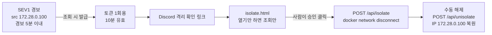

# RookiRooki 정책 요약 (PM)

| 항목 | 내용 |
|---|---|
| 기준 코드 | main `9f5503a` (2026-11-27 00:09 KST, PR #43 머지 후) |
| 작성 | 유현우 (PM·백엔드) |
| 원칙 | 코드가 사실입니다. 문서(README 등)와 다르면 코드 기준으로 적고, 다른 곳은 7절에 모았습니다. |
| 표기 | `파일:행` = 근거 위치. README·시연 문서와의 차이는 7절에 모았고, README 정정 PR로 고칩니다. |
| 같이 보는 파일 | `policies/sev_sla_policy.json`(등급·SLA 기계 판독용), `policies/PROJECT_SPEC_QA.md`(결정 이력·QA·회고) |

---

## 1. IP·네트워크 정책

### 1-1. IP 표

| IP / 대역 | 정체 | 공격 대상 | 격리 | 라이브 저장 | 근거 |
|---|---|---|---|---|---|
| `172.28.0.0/24` | 실습망 `mini-siem-net` (브리지 `br-minisiem`, 게이트웨이 `.1`) | 이 대역 안에서만 공격 | — | 출발지·목적지가 **둘 다** 이 대역일 때만 저장 | `scenarios/lab/docker-compose.yml` networks 절, `backend/live_capture.py:17`, `:47-51`, `:134` |
| `172.28.0.100` | `attacker` 컨테이너 | 공격 출발지 | **허용 (유일)** | 저장 | `docker-compose.yml` attacker, `backend/isolation.py:13` |
| `172.28.0.10` | `victim-web` (HTTP 80, C2 대상 8443) | 피해 대상 | 거절 (403) | 저장 | `docker-compose.yml` victim-web, `backend/isolation.py:185` |
| `172.28.0.11` | `victim-pc` (SSH 22) | 피해 대상 | 거절 (403) | 저장 | `docker-compose.yml` victim-pc, `rules/custom.rules:7` |
| `172.28.0.101~105`, `172.28.0.50` | 녹화 pcap 안에만 있는 주소 (컨테이너 없음) | — | 거절 (허용 목록 밖) | — | `rules/isolation_criteria.md` 4절 |
| 그 밖의 모든 IP | 실습망 밖 | **금지** | 거절 (403, docker 호출 안 함) | 저장 안 함(`rows_skipped_out_of_scope`) | `backend/isolation.py:185`, `backend/live_capture.py:134,140` |
| `192.0.2.0/24`, `198.51.100.0/24`, `203.0.113.0/24` | RFC 5737 문서용 대역 | 문서 예시에만 | — | — | `README.md:244` |
| `127.0.0.1` / `localhost` | 백엔드(8000)·대시보드(5500) | — | — | — | `README.md:295`, `backend/main.py:38` |

### 1-2. 네트워크 규칙

- 실습망은 `internal: true`라서 컨테이너가 인터넷으로 나가지 않습니다 (`docker-compose.yml` networks 절).
- 피해 컨테이너는 호스트에 포트를 열지 않습니다(80·22 노출 주석 처리) (`docker-compose.yml` victim-web·victim-pc).
- 백엔드는 기본 `127.0.0.1:8000`으로 실행하고, 격리를 켠 서버는 `--host 0.0.0.0`·`--reload`·`--workers`를 쓰지 않습니다(토큰이 메모리에 있음) (`README.md:295`).
- CORS 허용 출처 기본값은 `http://localhost:5500`, `http://127.0.0.1:5500` 두 개이고, `*`는 코드에서 걸러 냅니다 (`backend/main.py:38-39`).
- 대시보드는 `python3 -m http.server 5500 --bind 127.0.0.1`로 열고 `file://`로 열지 않습니다(CORS 때문, 실습망 밖으로 포트를 열지 않음) (`README.md:298`, PM 결정 2026-11-27).
- 공격·녹화는 팀 Docker 실습망에서만 하고, 학교·회사·가정 네트워크나 허가 없는 대상을 쓰지 않습니다 (`README.md:239-244`).

---

## 2. 탐지 룰과 심각도

### 2-1. 룰 6종 (SID 대역 `1000001`–`1000999`)

| SID | 키 | 기본 SEV | 격상 | 탐지 조건 (임계값) | MITRE | 근거 |
|---|---|---|---|---|---|---|
| 1000001 | `sqli` | SEV3 | 같은 요청 HTTP 200 → SEV1 | URI의 따옴표+`or/and/\|\|`, 따옴표+`--/#//*`, `union (all) select` | T1190 Initial Access | `rules/custom.rules:3` |
| 1000002 | `xss` | SEV3 | 같은 요청 HTTP 200 → SEV1 | URI의 `<script` 등 위험 태그, `on…=`, `javascript:` | T1189 Initial Access | `rules/custom.rules:5` |
| 1000003 | `bruteforce` | SEV2 | 없음 | `172.28.0.11:22`로 같은 출발지 SYN **60초 4회** | T1110.001 Credential Access | `rules/custom.rules:7` |
| 1000004 | `portscan` | SEV3 | 없음 | 22·80이 **아닌** 포트로 같은 출발지 SYN **10초 20회** | T1046 Discovery | `rules/custom.rules:9` |
| 1000005 | `c2_beacon` | SEV2 | 없음 | 8443으로 같은 출발지 SYN **30초 5회** | T1071.001 Command and Control (가안) | `rules/custom.rules:11` |
| 1000006 | `ssrf` | SEV3 | 같은 요청 HTTP 200 → SEV1 (403은 SEV3 유지) | `/fetch?` + `url=`이 내부 주소(`172.28.` `127.` `localhost` `10.` `192.168.` `169.254.`) | T1190 Initial Access (가안) | `rules/custom.rules:13` |

- 기본 SEV·MITRE는 백엔드 표가 정본입니다 (`backend/eve_parser.py:4-11`). 룰 카탈로그 6종은 모두 `status: testing`입니다 (`rules/rule_catalog.json`).

### 2-2. 판정·격상 규칙

| 규칙 | 실제 동작 | 근거 |
|---|---|---|
| 200 OK 격상 | `sqli`·`xss`·`ssrf`이고 **그 요청**의 HTTP 응답이 200일 때만 SEV1, `is_confirmed_risk=1` | `backend/eve_parser.py:101-102` |
| 다른 3종 | HTTP 상태를 저장하지 않고 기본 SEV 유지 | `backend/eve_parser.py:96-97` |
| 라이브 늦은 응답 | 경보를 SEV3로 먼저 저장한 뒤, 늦게 온 HTTP 200이면 **같은 id**를 SEV1로 UPDATE(아니면 SEV3) | `backend/live_capture.py:84-104` |
| XSS | 실습 앱 `/search`가 항상 200이라 XSS는 거의 항상 SEV1. **현행 유지**(PM 결정 2026-11-27). 시연에서 XSS 격리 링크는 누르지 않음 | `rules/isolation_criteria.md` 2·3절 |
| 평문 비밀번호·토큰 | **마스킹만** 하고 심각도는 올리지 않음(`pii_masked=1` 표시). 「최소 SEV2 검토」 문구는 삭제(PM 결정 2026-11-27) | `backend/eve_parser.py:12-20`, `:102` |
| SEV4 | **예약 등급.** 현재 SEV4를 만드는 룰 없음(PM 결정 2026-11-27). 화면은 값이 없을 때 SEV4 색만 씀 | `backend/eve_parser.py:4-11`, `frontend/index.html:1605` |

---

## 3. SLA (대응 시간·공유 주기)

README 초안 표를 **그대로 확정**했습니다(2026-11-27). 정본은 `policies/sev_sla_policy.json`입니다.

| 등급 | 의미 | 초기 대응 목표 | 상황 공유(재알림) | 격리 링크 |
|---|---|---|---|---|
| SEV1 | 그 웹 공격 요청이 200을 받은 침투 성공 의심 | 5분 이내 | 15분마다 | 조건 충족 시 있음 |
| SEV2 | SSH 무차별 대입·C2 비콘 등 고위험 시도 | 15분 이내 | 30분마다 | 없음 |
| SEV3 | 포트 스캔, 200이 아닌 웹 공격 시도 | 1시간 이내 | 2시간마다 | 없음 |
| SEV4 | 예약(현재 해당 룰 없음) | 다음 영업일 이내 | 일일 요약 | 없음 |

- **SEV1 5분과 격리 링크의 관계:** 초기 대응 5분은 「경보 시각부터 5분 안에 분석가가 경보를 열어 판단을 시작한다」는 뜻입니다. 격리 토큰도 경보 시각부터 5분 안에 조회해야 발급되므로(`backend/isolation.py:16,71-80`) 두 기준이 같은 시계를 씁니다. 토큰은 발급 뒤 10분간 유효하므로(`:15`) **판단 시작 5분 + 승인 결정 10분**, 즉 경보 뒤 최대 약 15분 안에 승인 여부를 정합니다. 15분은 SEV1 첫 상황 공유 시점과도 맞습니다.
- **SEV1 상위 보고:** SEV1 선언 뒤 30분 안에 원인을 못 찾으면 **유현우(PM)**에게 보고합니다(`README.md:322`, PM 결정 2026-11-27).
- **구현 상태:** SLA 시간·재알림은 **백엔드·프론트 모두 구현되어 있지 않습니다.** 코드에서 `SLA`, 대응 시간, 재알림 로직을 찾지 못했습니다(`backend/*.py`, `frontend/index.html` 검색 결과 0건). 지금은 사람이 지키는 운영 기준이며, 화면에도 표시되지 않습니다. 구현 제안은 `PROJECT_SPEC_QA.md` 남은 과제(Day 4 이후)에 있습니다.

---

## 4. 알림 정책

| 항목 | 실제 동작 | 근거 |
|---|---|---|
| 폴링 | Live 모드는 5초마다 `GET /api/alerts` | `frontend/index.html:1470` |
| 첫 폴링 | 이미 있던 경보는 기준선으로만 기록하고 알리지 않음 | `frontend/index.html:1371-1374` |
| 새 경보 | 웹 알림 이력과 「새 알림」 토스트 | `frontend/index.html:1387-1392` |
| SEV1 격상 | SEV3로 들어왔다가 SEV1로 바뀐 경보는 「🚨 [SEV1 격상]」으로 이력에 **한 번** 더 남고 토스트 표시 | `frontend/index.html:1394-1401` (PR #42) |
| Discord 자동 알림 | 「SEV1 자동 알림」이 켜져 있으면, 새 SEV1과 격상된 SEV1을 **경보당 1번만** 전송(`sev1NotifiedIds`) | `frontend/index.html:1366`, `:1377-1379`, `:1403-1412` |
| 오탐 제외 | `verdict=FP` 경보는 기본 목록·통계·자동 알림에서 제외 (`include_fp=1`일 때만 포함) | `backend/main.py:24`, `:443-451`, `frontend/index.html:1380-1385` |
| 웹훅 주소 | 브라우저 `sessionStorage`에만 저장(탭을 닫으면 사라짐). 코드·저장소·문서에 실주소 금지 | `frontend/index.html:3379`, `:3604`, `README.md:233` |
| 웹훅 없음 | Discord 대신 웹 화면에만 출력 | `frontend/index.html:3549-3553` |
| 격리 링크 | SEV1이고 `isolation_token`이 있을 때만 **Discord로 보내는 사본**에만 붙음. 웹 이력·저장소에는 토큰 없음 | `frontend/index.html:3540-3557` |
| 오탐 학습 점수(같은 키 3점 이상이면 알림 생략) | **구현 안 됨.** 대신 FP 판정으로 숨김 | `README.md:353-391`(추가 목표), `docs/ARCHITECTURE.md:374` |

- Discord는 **비공개 연습용 채널**만 씁니다. 링크를 가진 사람은 누구나 승인할 수 있기 때문입니다(`docs/isolation_demo_script.md` 6절).

---

## 5. 격리 정책 (승인 기반, 기본 꺼짐)

| 항목 | 값 | 근거 |
|---|---|---|
| 스위치 | `ISOLATION_ENABLED=1`일 때만. 꺼져 있으면 토큰 `null`, `POST /api/isolate`는 403 「Isolation is disabled」 | `backend/isolation.py:47-48`, `backend/main.py:531-532` |
| 대상 | `attacker`(`172.28.0.100`) 한 대, 네트워크 `mini-siem-net` | `backend/isolation.py:12-13` |
| 심각도 | SEV1만 (SEV2 bruteforce·c2_beacon은 링크 없음) | `backend/isolation.py:14`, `:74` |
| 경보 나이 | 경보 시각부터 300초(5분) 이내(시계 오차 60초 허용) | `backend/isolation.py:16-17`, `:79-80` |
| 토큰 | 경보당 1개, `secrets.token_urlsafe(32)`, 1회용, 600초(10분), 서버 메모리에만 있음(재시작하면 사라짐) | `backend/isolation.py:15`, `:83-100` |
| 토큰 오류 | 403 `Invalid token` / `Token already used` / `Token expired` | `backend/isolation.py:108-112` |
| 승인 | 확인 페이지는 GET 조회만 함. 토큰은 읽자마자 주소창에서 지움. 「승인(격리 실행)」 클릭 때만 POST | `frontend/isolate.html:38-41`, `README.md:297` |
| 실행 | `docker network disconnect mini-siem-net attacker` 후 끊겼는지 다시 확인(아니면 502) | `backend/isolation.py:194-196` |
| 해제 | 자동 해제 없음. `POST /api/unisolate`(`alert_id` 또는 `ip` 중 하나)로 `--ip 172.28.0.100` 지정해 다시 붙이고, IP가 다르면 502 `IP not restored` | `backend/isolation.py:228-231`, `backend/main.py:541-553`, `README.md:294` |
| 기록 | 실행·해제 결과를 `isolation_log` 테이블에 남김, 상태 API에 최근 20건 | `backend/isolation.py:19`, `:23-32`, `:250-` |
| 최종 판단 | 링크를 받은 **사람**. 「격리 권장」 기준은 `rules/isolation_criteria.md` 2절(SQLi·SSRF의 SEV1, bruteforce, c2 권장 / XSS 낮음 / portscan 안내만) | `rules/isolation_criteria.md` |
| 공개 시 주의 | 토큰이 Discord 링크 안에 들어 있음. 팀 메신저·PR·화면 공유에 붙이지 않음 | `README.md:296` |

- 호스트 방화벽(iptables 등) 실행, 자동 차단, 자동 해제, 여러 공격자 동시 격리는 **하지 않습니다**(Backlog, `README.md:433-438`).

---

## 6. 트리아지·데이터·보안 기본기

### 6-1. 트리아지

| 필드 | 허용 값 | 화면 표시 | 근거 |
|---|---|---|---|
| `verdict` | `TP`, `FP`, `UNREVIEWED`(기본) | 정탐 / 오탐 / **보류(미확정)** | `backend/main.py:95`, `frontend/index.html:186,220,298,541` |
| `confidence` | `HIGH`, `MEDIUM`, `LOW` | — | `backend/main.py:96` |
| `observation` / `assessment` | 각 2000자 이하. 사실과 추정을 나눠 적음 | — | `backend/main.py:97-98` |
| `analyst` | 50자 이하 | — | `backend/main.py:23`, `:99` |
| `action_status` | `ISOLATED`(격리함), `GUIDE_ONLY`(안내만), `NONE`(없음, 기본) | — | `backend/main.py:100`, `frontend/index.html:1618` |

- 정의되지 않은 필드는 거절(`extra=forbid`), 빈 요청은 422 (`backend/main.py:93`, `:486`).
- 프론트에 있는 FN(미탐)·TN 판정은 백엔드가 받지 않습니다(화면에 「API 미지원」 표시, 항상 0건) → 남은 과제 (`frontend/index.html:218,539,3069-3095`).
- 보류(미확정)도 정답입니다. 증거가 부족하면 보류로 두고 메모에 무엇을 더 볼지 적습니다(`rules/triage_templates.md` 3절).

### 6-2. 데이터 수집·보존

| 항목 | 값 | 근거 |
|---|---|---|
| 업로드 형식 | `.pcap`, `.pcapng`만 (그 외 400) | `backend/main.py:342-343` |
| 업로드 크기 | 20MB (초과 413, 파일 삭제) | `backend/main.py:21`, `:360-361`, `:417-418` |
| 같은 파일 재업로드 | SHA-256이 같으면 다시 분석하지 않음(`duplicate_of`) | `backend/main.py:365-387` |
| 중복 경보 | (시각, SID, 출발지, 목적지, 포트, URL)이 같으면 한 번만 저장 | `backend/main.py:172-174` |
| Suricata 제한 시간 | 120초 (`SURICATA_TIMEOUT`) | `backend/main.py:337` |
| 목록 조회 | `limit` 1~200(기본 50) | `backend/main.py:440` |
| 라이브 배치 | 한 번에 최대 8MB, 2초마다 폴링 | `backend/live_capture.py:19`, `:42` |
| 저장 위치 | `backend/data/`(DB·업로드·Suricata 출력·라이브 eve). Git 제외(`backend/.gitignore`) | `backend/main.py:118`, `:345-346`, `backend/.gitignore` |
| 보존 기간·삭제 주기 | 코드에 자동 삭제 없음. **시연 전마다** `backend/data`를 백업 폴더로 옮기고 빈 상태로 시작 | `docs/RookiRooki_전체기능_체험_종합명령어.md:155-157`, PM 결정 2026-11-27 |

### 6-3. 비밀값·안전

- 마스킹 키: `password`, `passwd`, `pwd`, `token`, `secret`(대소문자 무시). `key=값`과 `"key":"값"` 형태의 값을 `[MASKED]`로 바꿈 (`backend/eve_parser.py:12-20`).
- 비밀번호·API 키·웹훅 주소는 코드에 적지 않고 환경변수나 브라우저 세션에만 둡니다 (`README.md:233`).
- SQL은 파라미터 바인딩(`?`)만 씁니다. 서버 문자열은 이스케이프해서 화면에 넣습니다 (`README.md:234-236`).
- 백엔드는 root로 실행하지 않습니다. 격리를 쓰려면 사용자 계정이 `docker` 그룹이어야 합니다 (`README.md:295`).
- 샘플·pcap에는 실제 계정·비밀번호·개인정보를 넣지 않습니다. `scenarios/lab/attacker/passwords.txt`는 실습용 흔한 단어 8줄입니다 (`README.md:239-244`).
- 공개 저장소에 녹화 pcap 4개와 Mock 데이터(실제 녹화 181건 등)를 그대로 둡니다(PM 결정 2026-11-27). 모두 실습망 주소만 들어 있습니다.

### 6-4. 환경변수 기본값

| 변수 | 기본값 | 근거 |
|---|---|---|
| `ALLOWED_ORIGINS` | `http://localhost:5500,http://127.0.0.1:5500` (`*` 무시) | `backend/main.py:38-39` |
| `DB_PATH` | `backend/data/alerts.db` | `backend/main.py:118` |
| `SAMPLE_EVE_PATH` / `PLAYBOOKS_PATH` / `RULE_CATALOG_PATH` | `scenarios/sample_eve.json` / `scenarios/playbooks.json` / `rules/rule_catalog.json` | `backend/main.py:121-127` |
| `UPLOAD_DIR` / `SURICATA_OUT_ROOT` / `RULES_PATH` | `backend/data/uploads` / `backend/data/suricata` / `rules/custom.rules` | `backend/main.py:345-347` |
| `SURICATA_BIN` / `SURICATA_TIMEOUT` | `suricata` / `120` | `backend/main.py:330`, `:337` |
| `LIVE_CAPTURE_ENABLED` | 꺼짐 (`1`일 때만 켜짐) | `backend/live_capture.py:35` |
| `LIVE_EVE_PATH` / `LIVE_POLL_SECONDS` | `backend/data/live/eve.json` / `2` | `backend/live_capture.py:38`, `:42` |
| `ISOLATION_ENABLED` | 꺼짐 (`1`일 때만 켜짐) | `backend/isolation.py:48` |
| `DOCKER_BIN` | `docker` | `backend/isolation.py:52` |

---

## 7. 문서와 코드가 다른 곳 (코드 기준으로 적음)

| # | 문서 위치 | 문서 내용 | 코드·결정(사실) | 처리 |
|---|---|---|---|---|
| 1 | `README.md:322` | 평문 비밀번호·토큰이면 최소 SEV2 검토 | 마스킹만, 심각도 변화 없음 (`eve_parser.py:101-102`) | 정정 PR 진행 중 |
| 2 | `README.md:84`, `:435` | 라이브 탐지는 Stage 2(Backlog) | 선택 기능으로 구현됨 (`live_capture.py`, PR #25) | 정정 PR 진행 중 |
| 3 | `README.md:308` | Day 3에 「4시나리오」 확인 | 6종 (`eve_parser.py:4-11`) | 정정 PR 진행 중 |
| 4 | `README.md:300-309` | Day 3 Feature Freeze 18:00, Day 4는 시연 | 작업일 11/23~26, 기능 동결은 **11/26 18:00**으로 옮김, 발표 11/27은 버그 수정만 | 정정 PR 진행 중 |
| 5 | `README.md:338` | 백엔드가 `SIEM_WEBHOOK_URL`로 웹훅 발송 | 백엔드에 해당 변수 없음. 프론트가 브라우저에 저장한 주소로 발송 (`index.html:3379`) | 정정 PR 진행 중 |
| 6 | `README.md:355-391` | 오탐 학습 점수 3 이상이면 알림 생략 | 구현 안 됨. FP 판정으로 숨김 (`ARCHITECTURE.md:374`) | 정정 PR 진행 중(「미구현」 표시). 구현은 추후 작업 |
| 7 | `README.md:128` | 빠른 실행에 `uvicorn ... --reload` | 라이브·격리를 켤 때는 `--reload` 금지 (`README.md:284`, `:295`) | 정정 PR 진행 중 |
| 8 | `frontend/index.html:218,539,3069-3095` | FN·TN 판정 | 백엔드는 TP/FP/UNREVIEWED만 (`main.py:95`) | 남은 과제(FN/TN 정리) |
| 9 | `rules/isolation_criteria.md` 머리 표 | 기준 코드 `a9f69b3` | 현재 main `9f5503a` (격리 코드는 그 뒤 바뀌지 않음) | 정정 PR 진행 중 |
| 10 | `ai-guides/05_PM_AI룰.md:3`, `:15` | 기준 PR #10, 실시간 캡처·실제 차단은 Backlog | 둘 다 선택 기능으로 구현 | 정정 PR 진행 중 |
| 11 | 팀 결정 기록(11/23) 2번 | 공격 4종(ssrf·c2 삭제) | 11/24 PR #11·#12로 준비, 11/25 회의에서 6종 확정 | `DECISIONS_changelog.md`로 덧붙임 |
| 12 | `docs/isolation_demo_script.md`, `docs/isolation_rehearsal_log.md` 머리 표 | 작성자를 「배기윤 (시나리오)」로 적음 | 역할은 최지웅(시나리오), 배기윤(룰) | README 정정 PR에서 수정 예정 |
| 13 | `README.md` 대시보드 실행 명령 | `python3 -m http.server 5500` (모든 인터페이스에 열림) | **권장:** `python3 -m http.server 5500 --bind 127.0.0.1` | 정정 PR 진행 중 |

- PM 문서의 위치는 `policies/`입니다. `rules/isolation_criteria.md`와 `rules/triage_templates.md`의 이동은 **보류**이며, 지금은 옮기지 않습니다 (PM 결정 2026-11-27).
